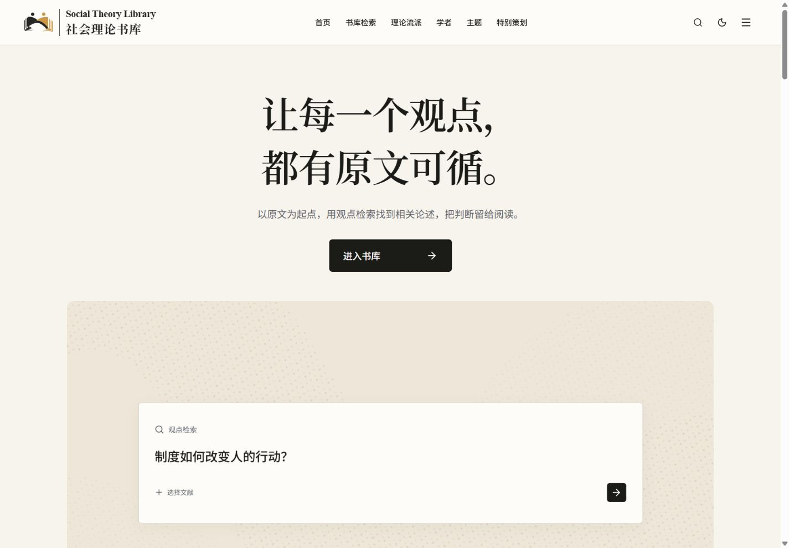
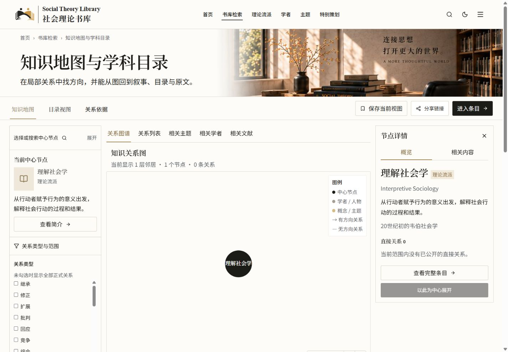
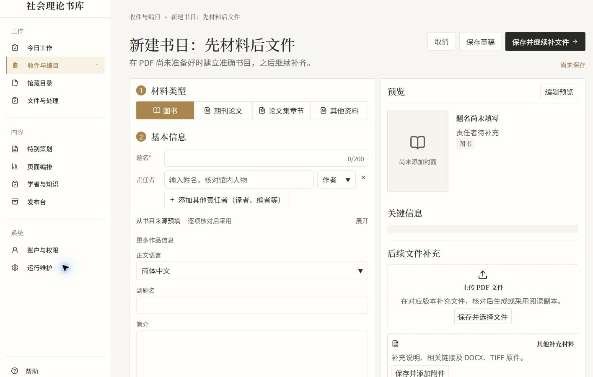
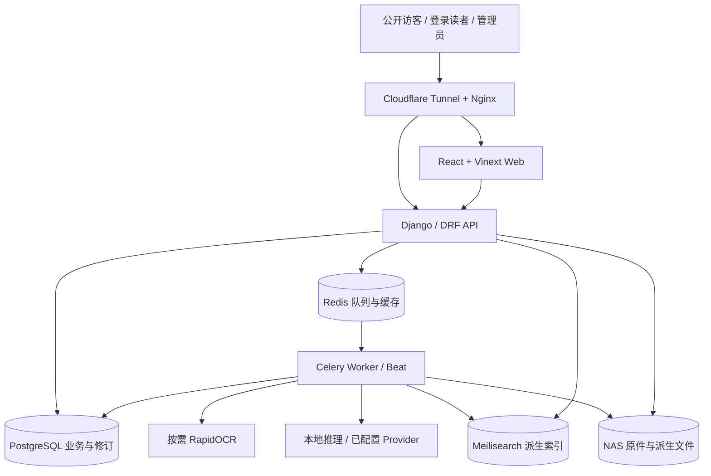

<p align="center">
  
</p>

<h1 align="center">Social Theory Library</h1>
<p align="center"><strong>社会理论书库 · 让每一个观点，都有原文可循。</strong></p>
<p align="center">
  <a href="https://books.winstonmo.com">访问书库</a> ·
  <a href="docs/architecture/README.md">架构与管理端指南</a> ·
  <a href="docs/architecture/13_DEPLOYMENT_AND_OPERATIONS.md">本地运行</a> ·
  <a href="docs/architecture/AUDIT_BASELINE.md">版本与证据</a>
</p>



STL 围绕社会学、人类学与民族学组织文献、人物、理论、主题和公开策展。它把版本明确的书目、可以定位的原文与有来源的知识关系连接起来，支持从研究问题发现文献、返回原文，再组织自己的阅读与研究。

读者可以沿学者、理论传统、主题或阅读路径进入书库；登录后使用书目、全文和观点检索、PDF Reader、笔记、书单及私人研究。管理工作区将入库、编目、知识编辑、策展、预览和发布连接到同一套数据与修订记录。

> **当前基线：STL 4.0。** 本次文档依据 2026-11-09 公网 `curation-publish-r1` 及逐项核对的运行源码重建。生产镜像与 Git 提交的对应强度见[审计基线](docs/architecture/AUDIT_BASELINE.md)。GitHub 更新不等于生产重新部署。

> **知识底层开发分支与Mac接续：** 使用`codex/stl-knowledge-intelligence`，先读[交接入口](docs/stl4/MAC_CODEX_HANDOFF_20261114.md)和[当前进度](CURRENT_PROGRESS.md)。[正式公网与新底层对照](docs/stl4/PUBLIC_KNOWLEDGE_COMPARISON_20261114.md)区分已上线、内网验证及开发中能力；数据库、馆藏、模型与密钥不在Git中。

## 在 STL 中完成什么

| 场景 | 能力与边界 |
| --- | --- |
| 从问题发现文献 | 书目、原文与观点检索；结果保留来源与定位信息，使用时重新校验公开资格 |
| 阅读与核对原文 | PDF.js Reader、目录、页码映射、文本定位、引用及下载；原文与探索功能须登录 |
| 理解知识联系 | 学者、理论传统、概念、主题、学科、关系、时间线与公共阅读路径；区分关系角色与证据 |
| 积累自己的研究 | 阅读进度、笔记、收藏、书单、计划、引文核对与连续研究；本人数据与明确分享范围分开 |
| 维护馆藏 | 批次上传、手工编目、版本/文件工作台、元数据候选、字段锁、OCR与处理恢复 |
| 组织公开内容 | 策展项目、文章、推荐、原文证据、页面版位；草稿保存、预览、审核版本与正式公开分别记录 |

AI 能提供字段、观点、文章和研究建议。建议必须与来源、人工决定和发布状态一起理解；当前实现不等于“整书自动策展并发布”。模型、索引及 Provider 的实际可用性取决于部署配置。

## 页面一览

<table>
  <tr>
    <td width="50%"><br /><strong>发现与阅读入口</strong></td>
    <td width="50%"><br /><strong>知识关系与原文入口</strong></td>
  </tr>
  <tr>
    <td colspan="2"><br /><strong>管理工作区：材料类型、书目信息与责任者</strong></td>
  </tr>
</table>

以上为只读实拍，管理端使用空白表单并裁去账号区。更多[桌面与窄屏截图、访问状态及检查边界](docs/architecture/PUBLIC_SITE_VERIFICATION.md)。截图证明对应时刻的页面呈现，不代表所有功能已验收。

## 系统怎样工作



公开站、管理端与局域网入口共用数据库、任务系统和 NAS。PostgreSQL 保存业务真相与版本，Meilisearch 保存可重建投影，Redis 承担队列/缓存/租约，文件按照身份、版本与权限交付。OCR、模型和各类 worker 有独立运行状态，不能从首页可用推断所有能力就绪。

完整图集：[C4 上下文与容器](docs/architecture/01_SYSTEM_ARCHITECTURE.md) · [真实运行关系](docs/architecture/02_RUNTIME_ARCHITECTURE.md) · [组件与数据](docs/architecture/05_ADMIN_COMPONENT_MAP.md) · [ERD](docs/architecture/06_DOMAIN_MODEL.md) · [生产部署](docs/architecture/13_DEPLOYMENT_AND_OPERATIONS.md)。

## 核心工作流


作品与版本分开，原件与派生文件分开，保存与公开分开。一项正式发布需要版本和来源检查；任务入队不代表处理完成，索引更新也不替代发布账本。细节见[入库与策展流程](docs/architecture/08_CURATION_WORKFLOW.md)、[对象生命周期](docs/architecture/OBJECT_LIFECYCLES.md)。

## 技术与模块

| 层次 | 当前实现 | 源码入口 |
| --- | --- | --- |
| Web | React 19、Next API 兼容层、Vinext / Vite；运行命令为 Vinext | [web/app](web/app)、[web/components](web/components)、[web/lib](web/lib) |
| HTTP 与领域服务 | Python 3.12 容器、Django、Django REST Framework | [api/config](api/config)、[api/catalog](api/catalog) |
| 身份与私人空间 | capability、owner 校验、加密与明确分享范围 | [api/accounts](api/accounts)、[api/reading](api/reading)、[api/common](api/common) |
| 入库与文件 | 批次、处理任务、正文/目录修订、NAS 交付 | [api/ingestion](api/ingestion)、[api/distribution](api/distribution) |
| 数据与异步 | PostgreSQL 16、Redis 7.4、Celery、Meilisearch 1.37 | [compose.yaml](compose.yaml)、[Discovery 配置](compose.discovery.yaml) |
| 文档识别 | 当前配置为 RapidOCR / ONNX / FastAPI；旧 Paddle 构建资料保留 | [ocr_service](ocr_service)、[OCR 架构](docs/architecture/10_ASYNC_TASKS_AND_OCR.md) |
| 网络与运维 | Nginx、Cloudflare Tunnel、容器网络、按需重任务 | [deploy](deploy)、[scripts/nas_on_demand.py](scripts/nas_on_demand.py) |

精确依赖范围见 [Web 清单](web/package.json)、[API requirements](api/requirements.txt)；声明范围、镜像版本与实际运行状态是不同证据。当前 Web 的 Node 要求为 `^22.23.4 || ^24.22.1 || >=26.12.1`，Docker 基线为 Node 24.22.1。

## 文档导航

[**完整架构目录 →**](docs/architecture/README.md)

| 想了解什么 | 阅读入口 |
| --- | --- |
| 产品定位、架构与运行容器 | [项目概览](docs/architecture/00_PROJECT_OVERVIEW.md) · [系统](docs/architecture/01_SYSTEM_ARCHITECTURE.md) · [运行](docs/architecture/02_RUNTIME_ARCHITECTURE.md) |
| 管理端全部页面及隐藏入口 | [信息架构](docs/architecture/04_ADMIN_INFORMATION_ARCHITECTURE.md) · [79 个入口](docs/architecture/ADMIN_PAGE_INVENTORY.md) · [21 组业务调用链](docs/architecture/ADMIN_MODULE_CONTRACTS.md) |
| 组件、表单、状态与样式 | [前端](docs/architecture/03_FRONTEND_ARCHITECTURE.md) · [组件依赖](docs/architecture/05_ADMIN_COMPONENT_MAP.md) · [设计系统](docs/architecture/12_DESIGN_SYSTEM_AND_PAGE_PATTERNS.md) |
| 数据、知识关系与公开消费者 | [领域模型](docs/architecture/06_DOMAIN_MODEL.md) · [关系语义](docs/architecture/07_KNOWLEDGE_GRAPH_AND_RELATIONS.md) · [消费者表](docs/architecture/MODEL_PUBLIC_CONSUMERS.md) |
| AI 建议、保存、预览和发布 | [策展工作流与集中审阅建议](docs/architecture/08_CURATION_WORKFLOW.md) |
| API、OCR、异步与安全 | [接口与服务](docs/architecture/09_API_AND_SERVICE_MAP.md) · [异步任务](docs/architecture/10_ASYNC_TASKS_AND_OCR.md) · [权限](docs/architecture/11_PERMISSIONS_AND_SECURITY.md) |
| 部署、测试与问题证据 | [部署](docs/architecture/13_DEPLOYMENT_AND_OPERATIONS.md) · [测试](docs/architecture/14_TESTING_AND_QUALITY.md) · [审计问题](docs/architecture/15_KNOWN_ISSUES_AND_OPEN_QUESTIONS.md) |
| 维护文档与参与开发 | [贡献指南](CONTRIBUTING.md) · [静态索引维护](docs/architecture/inventory/README.md) · [AGENTS.md](AGENTS.md) |

## 本地运行

需要 Docker Compose；独立开发还需要 Python 3.12 与符合上述 engines 的 Node。请先阅读[本地运行完整说明](docs/architecture/13_DEPLOYMENT_AND_OPERATIONS.md)，配置自己的数据库、文件目录、随机秘密和加密 key。

```powershell
git clone https://github.com/WinstonMo0807/social-theory-library.git
cd social-theory-library
Copy-Item .env.example .env
# 编辑本地 .env：数据库、随机秘密、NAS_HOST_ROOT、localhost:8080 origins
# 使用独立本地数据，PUBLIC_DEPLOYMENT_MODE=false
docker compose -p stl-local config --quiet
docker compose -p stl-local up -d --build postgres redis meilisearch api worker ingestion-worker beat web edge
```

基础本地入口为 `http://localhost:8080`。Compose 启动会执行数据库迁移，因此不要复用生产环境文件或挂载。OCR、语义模型及外部 Provider 需要另外准备，Git clone 不包含模型、馆藏或授权凭据。本轮没有实跑全新空白 Docker 安装。

独立前端开发在 `web` 目录运行 `npm ci`、`npm run dev`。直接启动 Django 时须显式提供进程环境；`manage.py` 不自动读取根 `.env`。

## 检查与当前质量状态

```powershell
# web 目录
npm run api:check
npx tsc --noEmit --incremental false
npm run test:runtime-api

# 根目录，需已安装 web 依赖
node scripts/architecture-inventory.mjs
python scripts/architecture_inventory.py
python scripts/architecture_page_map.py
python scripts/check_architecture_docs.py
```

本轮类型检查、契约复查及 7 项前端定向测试通过。41 项隔离后端回归中 39 项通过、2 项失败，原因是旧测试夹具不满足现行材料类型/主题发布约束；失败保留在[验证与问题报告](docs/architecture/14_TESTING_AND_QUALITY.md)，未宣称全量测试通过。并发发布、真实 OCR、Provider 和完整写入流程需要相应隔离环境继续验收。

仓库当前没有 `.github/workflows` CI，也未发现项目级 LICENSE。本 README 不展示未核实的 CI、许可或完成度徽章；第三方许可证不代替项目整体授权。

## 数据与安全

- 访客浏览公开网页；探索、PDF 正文与下载须登录。编辑、发布、系统管理和馆长权限分别校验。
- 机器建议、人工决定、正式修订与搜索派生数据分层保存；自动处理不得覆盖原件、人工锁定字段或私人笔记。
- Git 保存源码、安全示例、文档和经过检查的页面图片，不保存真实 `.env`、凭据、馆藏 PDF、用户数据、模型、索引、数据库备份及发布包。
- 私人研究只按本人授权及明确分享范围访问；调用外部 Provider 的数据范围须遵循现有授权与能力配置。
- 生产发布、数据迁移和不可逆操作需要独立的范围、恢复与授权记录。本次提交仅归并已运行代码和文档，没有再次部署。

源码、API、任务与文档的维护入口见[贡献指南](CONTRIBUTING.md)；运行现状以[审计基线](docs/architecture/AUDIT_BASELINE.md)及后续明确记录的发布为准，历史开发日志不能替代当前版本证据。
