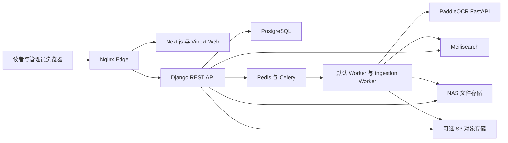

# Social Theory Library 架构

## 2026-10-26 M21合并影响确认、原请求恢复和回退入口

现有节点合并/回退路由改由knowledge_merge_commands包装原knowledge_nodes事务；原范围指纹用于确认前核对，AuditEvent登记请求与停止回执，KnowledgeNodeMergeRecord继续保存业务记录与回退。新增原节点历史/本人请求读取，无新表或迁移。前端沿原保存回执hook，原文/文章引用不自动改绑。

## 2026-10-26 DOCX分页预览的账户绑定与撤销复核

原CitationAudit派生预览全部前端请求携带X-Reader-Owner，禁自动刷新重发；生成/取消复用privacy.command_owner在账户锁内复核停用和token_version。无新表、迁移或并行服务。原隔离转换服务和加密派生字段保留，未运行转换或部署。

## 2026-10-26 中断页分页

处理工作区增加failed-pages/<task_id>只读分页，重用failed_ocr_pages与task_version，限制OCR任务和VIEW_SYSTEM_STATUS；前端按原任务身份/版本保存页序选择并沿原重试POST，不增模型或任务实现。

## 2026-10-26 选材备注保留修复

selection_notes保留于原加密研究，selection_note_sources只保存原定位身份；普通刷新不回查全部历史源，单条selection-note-source沿本人研究权限显式读取，仅返回书目/定位。未新增表/迁移。

## 2026-10-26 R05导出入口

R05笔记导出使用原ResearchProject/turns一致快照；前后账户核验与可取消请求，前端只输出已保存笔记投影，不导出模型待确认内容。

## 2026-10-26 R05书目与封面

研究来源投影从已发布目录快照提供document_type/language；跨页沿首个同版来源传递。封面复用现有MediaPlacement，失效来源不保留书目/封面快照。

## 2026-10-25 R05整批选材同步

原ResearchProject selections新增apply分支，保持旧指纹兼容，原事务一批写入；私人响应投影最近100个回执UUID。无新模型/迁移/服务。授权本机意图和单次重连许可不自动变成后台任务。

## 2026-10-25 R05分支草稿

branch-input沿已有标签页授权暂存边界；原请求/分支草稿保留原父轮次，来源请求只传非空身份字段，未改变后端来源验证规则。

## 2026-10-25 R05固定请求暂存

turn-request沿原受限标签页暂存：固定原请求体，恢复只还原页面，不自动重发；复用现有研究turns幂等与请求回查，无新后台或表。

## 2026-10-25 R05离线笔记

R05离线稿共用受限sessionStorage封装，复用研究前缀清理；notes保存原修订号。原PATCH增加可选显式账户校验封装，未改数据库或构建第二套笔记。

## 2026-10-25 R05回执

本人研究原turns列表支持request_id过滤，回执返回原request_id；前端固定提交体并双向核对账户，复用原幂等请求及任务。无新表/迁移。

## 2026-10-25 R05授权暂存

R05暂存复用标签页sessionStorage，stl:research-input:v1账户/研究隔离；默认关闭，仅输入文字与范围枚举。会话退出/重新登录清理，服务器研究仍沿原加密对象，无新后端服务。

## 2026-10-25 R06本地比较草稿

comparison-draft复用加密ResearchTurn并从原collect_research_turn分支处理；原任务租约恢复/取消generation生效。generate_local只用本地传输。模型候选与ResearchProject.comparison人工笔记分开，未新增表或迁移。

## 2026-10-25 R06/R08准确版本对照

R06版本差异复用公开parallel/versions和原私人parallel-tasks。Reader并读URL新增right_asset/right_revision，原revision/focus传入两侧选择保护；源修订失效时需显式重选，不建新版本关系。

## 2026-10-25 R06补充检索

R06复用ResearchTurn.return_context标记比较缺口，原retry继承该上下文。读者明确选择检索范围，结果不会自动写入comparison。没有新模型或迁移。

## 2026-10-25 M04人物候选分页

原manual-catalog人物查询增加独立people_page及总数/页数，沿同一Person与原排除规则。前端复用usePersistentWorkspace账户绑定读取，原人物创建/确认边界不变。

## 2026-10-25 M04同名核对

manual-catalog增加match_title只读查询，使用与最终保存相同的既有规范题名字段，结果仍按12条分页。前端保存前核对不替代原事务和固定请求回执，没有新模型或迁移。

## 2026-10-25 M03候选范围与恢复

M03原收件接口增加分页前scope筛选和独立selected_candidate投影，沿同一Work/Edition/Asset/AuditEvent。保存选择版本不自动更新，回执补当前收件身份；无模型、迁移或合并变更。

## 2026-10-25 M08策划图片用途

策划材料新增只读cover_display_uses：新稿绑定所选公开版本，旧稿读原MediaRendition用途，关联计划读明确关联版本；沿原文章快照与图片接口，不迁移历史数据。响应重算封面地址及可用版本标识，撤下来源不能保留缓存可用值。

## 2026-10-25 M21文章正文引用

M21文章正文反向引用复用M28 issue_references，原uses端点scope=articles，最新/active/scheduled修订和原项目可见性在SQL内过滤，12份分页。影响栏只返回题名/修订状态和原历史入口，不复制正文或建立引用表；普通范围排除回收文章，回收查询默认行为保持。

## 2026-10-25 R34多对象组合

R34组合分享仍使用原ReaderShare，加密specification容纳最多4个additional_sources；所有来源及选中项独立版本绑定，原单对象内容摘要兼容。来源目录的首条公开书目摘要不加入签名范围。原文章提案接手按每条材料的origin_kind核对版本且复用原来源锁，隐私导出/撤回覆盖整个组合，不新增模型。

## 2026-10-25 R34未知提交停止

R34未知分享停止复用原KnowledgeSaveReceipt和privacy.command_owner，同一账户锁串行化创建与停止；已建立返回原授权，未建立保留最少取消回执，不新增表。原权限/加密选择/撤回和成员边界继续，跨对象范围下一段接续。

## 2026-10-25 M26旧凭据边界

原provider-secrets端点保留兼容管理，当前馆长+账号+版本保护，已绑定凭据统一从原子来源/模型编辑器修改。原凭据库每页50条，绑定/计数来自原数据；未知保存nonce为私有SiteSetting，无新表。前后端不再单独调用旧凭据写入完成来源绑定。

## 2026-10-25 M26模型配置

M26与原设置页共享模型编辑器和原ai_runtime_profiles、AIClient、加密凭据。使用同一来源/凭据配置锁及版本隔离，模型密钥和绑定原子保存；环境管理、共享别名和普通管理员边界保留。模型检查不生成内容；读者自有模型连接独立于服务器模型设置。无需迁移。

## 2026-10-25 M26来源配置

M26复用原来源注册表和加密凭据，统一锁及版本保护覆盖读取、来源更新、凭据保存/删除与未知响应隔离。敏感别名仅馆长可读写；普通管理员保留原启停权限。M26与处理中心共享编辑器，无新表。AI配置旧调用链仍待接续。

## 2026-10-25 M27检索索引备份

原备份支持Meilisearch独立导出或同归档保存。使用原实例POST /dumps与任务回执，读取只读共享导出目录；不读取/复制活动数据库目录。schema3包含独立索引SHA/版本/范围，数据库与索引不宣称共享事务时点。distribution0006及可选Compose叠加配置未应用，见docs/stl4/INDEX_BACKUP_20261025.md。

## 2026-10-25 M27增量原件

原BackupJob/BackupSchedule新增固定全量基准保护性关联，distribution0005未应用。schema2增量归档包含完整数据库与变化原件，引用仅一份schema1完整原件归档；创建和完整性校验均重新核对基准文件。没有独立数据库增量链或第二套备份服务，原schema1保持兼容。

## 2026-10-25 原备份共享快照

PostgreSQL原备份任务在只读REPEATABLE READ事务导出快照给pg_dump，Asset清单及迁移记录同事务读取；复制原件与任务状态写入在事务结束后进行。SQLite使用在线backup副本并从副本读取清单。保留原任务、归档格式和恢复命令，新增元数据仅描述本次快照范围。未执行迁移、备份或生产操作，外部索引与增量能力仍为单独待办。

## 2026-10-25 OCR配置并发保护

原ocr-runtime接口与SiteSetting复用，视图移入catalog/ocr_runtime_settings.py并保留views导入兼容。PUT使用配置指纹、用户/设置行锁与实体锁；PATCH仅推进旧版本以阻止迟到保存，已完成的新值不撤回。M26与处理设置共享OcrRuntimeEditor，不存客户端配置副本，按账户只保存未确认版本指纹。无新模型或迁移。运行事务与部署仍待验收。

## 2026-10-24 存储临时清理

StorageCleanupPlan保存有上限的本地导入临时文件清单，distribution0004只声明未迁移。沿原Celery/storage_tasks逐项核对原件与文件身份，不碰馆藏/读者记录。保留天数沿私有SiteSetting与原维护回执；不新增索引、馆藏或运行队列。Windows可审清单，保护式删除须运行环境支持POSIX目录描述符。

## 2026-10-24 M24路线候选

M24整条路线候选继续使用原ReadingPathCandidate/EvidencePack/IntelligenceFeedback。规则编排与主题关联选择有明确上限，无模型/新队列；主题拓展同时核对原批准关联与激活书目快照。采用通过原EditorialRevision只保存原路线草稿，旧通用候选入口不能另建。无新schema。

## 2026-10-24 M24编排与预览

M24未保存预览沿原公开阅读路径投影，只读核对完整当前草稿与准确edit_version。只在界面内保留阶段/材料移动与删除关系输入，保存/发布仍走原路径命令和EditorialRevision；没有新数据库表或读者数据同步。

## 2026-10-24 原时间线双对象归并

原EditorialRevision及content_placements执行事件/页面编排的原子归并与回退，新增受保护的TimelineMergeRecord和merged_into，0088仅声明未执行。保留原身份与历史引用，旧公开链接经保留事件资格解析；回退拒绝后续编辑冲突。原账户权限/回执复用，未连接数据库、运行测试或执行真实归并；几何/并发/公开操作仍待验收。最终重置清单须包含新引用依赖预演，不在开发时清理。详见docs/stl4/TIMELINE_EDITOR_20261023.md。

## 2026-10-24 时间线出处选图

原事件editorial_details保存固定媒体版本；TimelineEvidenceImage保护未发布直接草稿，EditorialRevisionMedia保护修改前后历史与变体。主要图片随事件发布，补充图片仅后台核对；公开文件要求当前approved事件的准确主要图片。0087只声明未执行。来源图片接线完成，重复事件归并与真实操作/像素仍待继续；见docs/stl4/TIMELINE_EDITOR_20261023.md。

## 2026-10-24 事件角色与版本责任分离

原TimelineEventRelation补角色，原Edition/Contribution/PublisherAuthority供给版本责任。公开版只读明确出版版本的有效正式书目快照，章节责任不扩大、未发布元数据不外泄。新增只读24项分页接口，catalog0086仅声明未执行。角色源码接入，图片、归并与真实验收仍待完成；证据见docs/stl4/TIMELINE_EDITOR_20261023.md。

## 2026-10-24 主题父链与确认预览

原父链校验与只读预览共享实际路径，统一拒绝循环、已合并上级和超过200层的异常结构；原层级锁、CAS及正式修订保留。父ID表示误报、取消丢选及查重首批截断已作源码修正，真实交互未验收。详见docs/stl4/TOPIC_EDITOR_20261023.md。

## 2026-10-24 主题关联说明与原公开修订

关联说明保存在原Topic.curation，随原EditorialRevision发布，仅附加到仍可公开的已选对象。新增分页只读选材接口使用原对象与当前项目权限。原私人笔记/账户数据不参与，无模型变更。版本题名歧义、排序取消误报修改、移除后带回旧说明已作源码修正。真实业务和视觉验收仍待核实，静态证据见docs/stl4/TOPIC_EDITOR_20261023.md。

## 2026-10-24 原审核任务恢复协议

TheoryReviewTask原动作接固定请求/CAS/当前角色和原AuditEvent回执，通用列表/详情只读，生成服务保留；其他聚合入口进入同一审核表单。后续任务不会重置已有人工确认关系、证据与审核结果。无模型或迁移变更，实际并发/断线/权限/视觉未验收，静态证据见CONCEPT_EDITOR_20261023。

## 2026-10-24 M21复用原材料审核任务

候选区接原TheoryReviewTask及原解析生成流程，学者范围以已确认参与的具体版本约束；任务候选不推定个人立场，历史摘录不视为准确原文。原任务动作并发/恢复边界继续核对，实际业务及视觉未验收，详见CONCEPT_EDITOR_20261023。

## 2026-10-24 页面编排反向引用

影响栏只读精确查询原编排最新/发布修订，私人项目在计数前按原可见范围过滤。准确修订链接进入同一编排历史，未建立第二份引用关系或自动迁移。文章正文及其他引用范围仍待，静态证据见CONCEPT_EDITOR_20261023；未运行正式验收、迁移或部署。

## 2026-10-24 真实结构依赖摘要

修正原lifecycle漏掉catalog关联、学者Person间接关系与同模型方向重复键；只读计数不扫描读者私人模型。M21影响栏复用原历史API，未知结果和内部数据边界保持。全站JSON引用及迁移仍待，静态证据见CONCEPT_EDITOR_20261023，无实际验收或数据操作。

## 2026-10-24 学者知识用法与材料栏目

学者中心五栏复用原scholar编排与node作者用法，只读聚合最新明确归属并返回原记录编辑，不复制用法。六组分页、旧归属移除、失效引用、GET权限及契约已接；管理整类自问补切栏/中文输入/隐藏待核对请求/离页保护。当前受影响页限本编排来源问题，全站影响、候选/图形及实际视觉未验收。无模型/账户数据改动；静态记录见CONCEPT_EDITOR_20261023。

## 2026-10-24 学者关系准确来源

ScholarRelation沿原修订保存准确原文与版本，catalog0085只声明两项PROTECT外键及成对约束，未执行。公开必须匹配正式快照、准确定位和匿名可读资格；已失效原引用允许保存核对意见与撤回，不允许再次公开。管理整类自问修正已知来源失效仍可点发布、公开空出处误称草稿两个细节；未运行使用验收。无账户模型变更，仍归原catalog业务数据与既定重置工具动态外键范围，不授权或执行任何清理。其他待办见CONCEPT_EDITOR_20261023与CURRENT_PROGRESS。

## 2026-10-24 学者中心关系目录

复用原人物—节点及学者—学者关系，统一24条分页与同页编辑，保留正式/草稿范围和账户、CAS、未保存保护。按管理整类自问修正重复内层导航及双向箭头，不让用户在详情里悄悄切换另一条记录。准确学者关系原文、完整候选/图形/影响及运行视觉仍待。静态证据见CONCEPT_EDITOR_20261023；没有测试、浏览器、迁移或上线。

## 2026-10-24 节点内部说明与文字格式

KnowledgeNode.editorial_details只保存内部编辑说明和绑定原正文的格式，catalog0084未执行。原正式表/EditorialRevision/版本历史和合并快照继续；公开detail仅输出经过绑定及安全校验的prose，内部说明不会跟随公开字段。复用既有文字编辑/渲染，无第二套正文或编辑库。原节点及关系六个管理路由补入契约；混合目录只读，列表GET/POST，详情写入仍有原权限与回执。

## 2026-10-24 理论关系原文锚点

原KnowledgeRelation接EvidenceSpan/DocumentRevision保护外键，0083仅声明。API用source_anchor原子传入引用身份，原EditorialRevision保存两项ID；source_material只读派生，公开端不暴露私人编号或失效原文。发布重新核对，图谱批量读取固定激活来源，原版本历史/合并冲突和回退范围指纹覆盖新字段。目录不加载原文。没有迁移执行或部署。

## 2026-10-24 关系的准确原文引用

原PersonNodeRelation使用EvidenceSpan/DocumentRevision保护外键固定原文，不复制馆藏或允许提交引文正文。catalog0082仅声明。原ScholarCommandMixin保存摘要/审计包含引用身份，确认再核对匿名公开的当前原文件、文档、页码、校验值与原始Unicode偏移；公共图谱批量取回真实引文，失效不回退到其他版本。原合并复制与冲突检查保留引用ID，账户及私人研究权限不变。

## 2026-10-24 原人物概念关系方向与混合目录

PersonNodeRelation新增relation_type/direction/node_is_source（catalog0081仅声明）；原身份及唯一约束继续，旧行默认相关/无方向。人物关联确认原事务、AuditEvent、发布依赖继续；公共图谱保持person_node类别与原ID，箭头按明确方向。概念混合目录SQL UNION分页原KnowledgeRelation与PersonNodeRelation，不建关系副本。合并保留新字段并拒绝语义冲突；回滚以原关系全字段及关联范围指纹保护后续改动，历史缺失指纹转人工核对。未执行迁移、测试或部署。

## 2026-10-24 原人物知识关联的确认入口

学者编辑页沿原PersonNodeRelation/PersonTopicRelation保存待核对及明确确认/撤回。原规范行无并行草稿表，公开行修改必须明确确认；不允许普通保存隐式改公开内容。原AuditEvent保存前后关系元数据，原ScholarCommandMixin固定请求回执防重。对已公开父对象使用原KnowledgePublicationEvent/DomainChangeEvent持久更新投影；无新增迁移。

## 2026-10-24 原账户恢复凭据的邮箱链接

RecoveryCode新增purpose/account_fingerprint，旧行默认password_code；验证与重置链接分别受原User行锁、一次性摘要及账户状态约束。accounts0005仅声明未执行。认证邮件复用原Celery默认队列和邮件后端，任务参数加密、120秒过期，原worker必须加载accounts.tasks并共享私人加密键；正文与token不进入日志/审计。console/file后端不能用于认证邮件。人工找回复用PublicFeedback使用咨询，不查询用户、不自动绑定用户ID；管理员原反馈处理和用户管理权限边界不变。

## 2026-10-24 研究回放文字历史

ResearchReplayRevision依附原ResearchTurn并随其级联删除，仅存加密的回放名称/笔记/标签，按原轮次revision唯一。历史分页读取及恢复均经原研究所有者过滤；恢复是新保存，不覆盖原检索输入。原研究/读者中心隐私导出纳入历史，研究整体25MiB边界及版本复核；不进入公开馆藏、模型记忆或提案分享范围。reading0027未执行；回退须保留历史表及识别该表的兼容级联逻辑。

## 2026-10-24 策划提案接手

ReaderShare授权和原文章新建命令通过reader_proposals服务衔接。提案授权中明确选择的公开版本成为原RecommendationIssue.items，私人正文/笔记/问题/摘录/附言不复制。原AuditEvent只记录授权UUID、文章UUID和条目数，授权行锁串行化跨编辑接手；原新建回执负责重试/停止。无新数据库模型、并行内容库或发布入口。

## 2026-10-24 私有账户头像

AccountAvatar以User为唯一身份，独立加密派生图避免把私人头像加入公开MediaAsset。复用原图片检查/私人加密/User锁/AuditEvent，写入仅本人，读取限本人或MANAGE_USERS；只返回受保护PNG。原reading/export包含本人派生图，读取管理列表仅注解修订号，不整批加载图片。accounts0004声明未执行；账户备份/重置保留需要同时包含头像及账户命令回执。

## 2026-10-24 账户邀请

邀请沿原User与账户命令AuditEvent保存，不建平行身份或凭证表。24小时服务端签名链接绑定原事件和账户版本，发起者权限失效、账户变化、重新生成或撤销后旧链接不可激活。本人接受锁发起/目标User、采用原密码校验与token_version，AuditEvent回执保证重复接受不改密码。邀请审计随账户备份保留；不含原始令牌/密码、不等同邮箱验证、不发送外部消息。无迁移或实际账户操作。

## 2026-10-24 OCR任务服务绑定

ocr_transfer沿ProcessingJob.stats保存target/configuration指纹，目标只来自原ocr_runtime配置。上下文局部绑定一次页请求，既有extract/provider调用不变；变更配置后不再发送。人工转移沿账户→Edition→ProcessingJob锁、原固定回执、after-commit派发，不新增库/队列/迁移。远程需MANAGE_AI与明确发送确认，心跳跟随所选服务；原执行编号无法写页和文件进度。

## 2026-10-24 M09原队列的指定任务恢复

processing_recovery只汇总真实活动并调用原恢复服务。recover_stalled_processing_jobs可按job_id限定，候选与OCR摘要修复均保持该范围；原定时全局恢复行为保留。Discovery人工恢复复用index_writer的非阻塞写入锁和原_enqueue_job/_dispatch，核对原代际/来源修订/任务归属，正常协调等待不重派。调用方沿账户→原父对象→任务锁与固定AuditEvent回执串行，不新增任务存储、设备路由或数据库schema。原worker的task_id写入保护继续生效。

## 2026-10-23 查询词维护写回原知识草稿

M13 knowledge-terms封装原KnowledgeNode/EditorialRevision/AuditEvent。只提交aliases字段，组合保存保留原草稿其他字段；公开采用仍由原发布与QueryLexicon变更事件负责。来源版本包含原编辑版本及正式/草稿别名，固定请求与停止按账户锁串行。原别名发布应用保留同名记录身份，显式is_verified决定优先于旧创建默认，无新存储或迁移。

## 2026-10-23 检索维护中的原查询会话

M13预览沿原DiscoverySearchSession与推荐检索流水线，index.query.preview审计只串行请求身份及会话ID，不存第二份查询正文或材料。原会话创建后、提交派发前将所有通道权限收窄为public；正文限定作品，知识/策展沿原全库查询。读者中心搜索记录开关仍由原remember_search_after_commit处理。原DiscoveryView只对显式X-Editor-Owner头追加账户核对，不改变无此头的访客权限。没有新存储、队列或迁移。

## 2026-10-23 处理任务创建与原队列复用

processing_creation仅对原start_catalog_ocr与queue_outline_rebuild提供配置入口，复用ProcessingJob/AuditEvent和processing.workspace.command回执。与原停止操作共享账户锁，版本与文件身份在事务内复核；OCR不隐式取消进行中任务，目录相同来源进行中时复用。没有模型、存储或执行器迁移。Discovery继续原source/generation身份与逐片段幂等写入，新增当前单元定位及重试前审计；未新增检索方案。

## 2026-10-23 处理文件读模型

ProcessingJob与SemanticIndexJob继续独立保留原身份。文件模式沿存储的Asset.source_asset或本文件身份分组，未关联文件的记录按任务身份单列；窗口查询选择最新阶段并保留在途/暂停记录，再分组分页，固定SQL结构与绑定参数。只展开当前20组×每组最多20条，全部记录沿原任务分页。原权限筛选和呈现共用，未新增任务或数据迁移。

## 2026-10-23 项目来源读模型

项目来源沿原修订流式读取身份并批量核对既有公开查询条件，当前页沿原resolve_target生成详情，不持久化第二份引用或可见状态。预览只聚合原文章元信息；正文继续由原受保护预览/公开页呈现。项目私密问题与简介不加入公共响应。无新增模型、任务或迁移。

## 2026-10-23 策划项目与原文章

新增CurationProject只承担项目问题、简介、人员、计划、团队范围与归档；文章继续使用RecommendationIssue/EditorialRevision，媒体沿MediaRendition，操作回执沿AuditEvent。0079新增可空文章归属及顺序，不转换或删除旧文章。项目团队边界延伸到草稿/预览、来源、队列、处理任务、通用编排、回收恢复和媒体引用；公开文章仍以原明确发布修订决定。共享媒体和馆藏书目继续为馆内共用资料。写入统一账户→项目→文章→子项/任务锁，项目版本包含人员、文章顺序和修订聚合；归档不撤销公开、不删除、不自动启动任务。生产与数据库迁移未执行。

## 2026-10-23 索引维护主入口

新版M13以既定Discovery为主入口，复用原来源状态、文档投影、版本/任务和派生词典。候选默认待明确切换，切换复用原写入锁与来源验证；没有新模型、测评、任务或词典系统。旧语义工具只保留显式legacy入口。

## 2026-10-23 处理工作区

原两类任务存储、队列服务与AuditEvent继续复用。新工作区复用原分页读模型和原执行函数，共享账户与任务版本锁、固定请求和失败后续任务指针。旧OCR创建回执独立保留，未新增任务模型或执行器。

## 2026-10-23 媒体修订

M08沿原MediaAsset/MediaRendition及EditorialRevision，裁切与出处作为不可变衍生图快照；原图及其他对象引用不变。PDF页只准备候选，选择仍走现有书目发布边界；固定操作回执沿AuditEvent，不新增媒体库或文件表。

## 2026-10-23 材料保存恢复

WorkflowEditor仍使用原WorkspaceEdits与字段决定。AuditEvent既有保存回执扩展可查询/停止，账户锁串行化同一操作者原请求，作品版本CAS保持。浏览器不缓存字段正文，封面/父请求按owner核对。

## 2026-10-23 材料优先编目

新手工入口编排原CatalogingSession/Work/Edition/Person及字段确认服务；人物只按明确选择关联，未核验新人物保留草稿。已有共享作品的全新出版版本允许独立版本字段写入，共享作品修改仍进入发布草稿。新增章节/其他类型与论文集/丛书号沿同一检索和公开快照，不建立平行书库；0078仅声明。

## 2026-10-23 新版收件先确认身份

仅stl4-upload新批次在提取后等待管理员决定Work/Edition，再使用原处理队列。确认已有版本的不同原件沿staged文件补充，不替换现行公开文件；完全重复原件复用既有Asset。历史批次及人工锁定保持。未创建平行馆藏/文件/OCR服务。

## 2026-10-23 上传沿原双通道与收件身份

上传工作区只编排原UploadBatch/UploadItem、本地分片/R2 staging与AuditEvent，服务端配置决定通道。预约/追加/改名通过当前账户和批次版本并发控制；同文件失败恢复复用原item。浏览器内容摘要按账户隔离，不保存原文件名正文或凭据。未启动独立文件库、OCR或重复馆藏。

## 2026-10-23 内容编排共用原修订

内容编排八类入口复用原content_placement EditorialRevision/AuditEvent，无新存储。分组与公开字段同草稿版本；内部阅读目标明确在匿名投影删除。共享来源来自同一馆藏/准确出版版本/原文修订与正式学者/策划，八类公开页接同一公开服务；首页仍原site_content。目录/保存/发布沿原能力和账户边界。

## 2026-10-23 M29首页编排源码接入

首页槽位作为原site_content修订的home_layout保存，不创建第二套内容表或复制来源对象。正式首页仅读最新published网站快照，并通过原策划有效版本、学者/主题正式快照与公开馆藏版本重新解析；私有媒体仅当前公开且来源有效的条目授权。User锁/会话版本/原AuditEvent回执保护保存和发布；首页预览禁用私人续读组件。

## 2026-10-23 M28回收与恢复

统一读取原RecycleEntry、生命周期归档状态和AuditEvent；不新增身份/文件表。旧lifecycle与新页面共享restore_archived_object；原restore_object补发布关联保护与一致锁顺序。强类型恢复命令及新删除请求回执沿原审计保存，保留对象UUID，不重新公开或重启任务。

## 2026-10-23 M27存储备份与恢复准备

原BackupJob/归档生成/数据库命令继续复用，新增distribution0003仅声明BackupVerification与BackupSchedule。原Celery beat按明确启用的计划分派，worker再核对权限；校验流式只读，与备份生成、隔离数据库导入分别保存。恢复报告采用签名文件投影，无在线生产恢复接口。没有修改账户模型、文件存储职责或另建备份库。

## 2026-10-23 M26本地模型与服务

M26投影原HealthCheckRun/ProcessingJob/OCR/Discovery/AI Runtime/Provider，无新服务库或迁移。GET不执行探测；显式检查按原权限复用既有检查器，只保存限定字段。新Discovery维护选项允许读取503未就绪状态，不改变原索引/推理失败边界。旧settings片段仍指向原配置页面。

## 2026-10-23 M24公共阅读路径

M24 catalog0077仅扩原ReadingPathItem学习目标及有类型依赖JSON，原阶段归一化/发布快照负责写读，不建新图库/规划库。学习顺序用有界DFS（最多600材料）定位循环，理论相关仅说明联系。新增只读编排验证和原保存回执，未调用Provider或运行检索测评。

## 2026-10-23 M23时间线编辑

M23复用TheoryTimelineEvent/TimelineEventRelation/EditorialRevision/AuditEvent；catalog0076增事件日期与私有editorial_details，不建独立人物、文件或时间线。原公共时间线/学者页读取同一发布事件，私有编辑资料不公开。迁移仅文件，未执行。

## 2026-10-23 M22主题编辑

M22主题层级继续Topic.parent，别名继续search_aliases，编排继续curation和EditorialRevision；实际保存/发布/原合并共享层级事务锁。直接发布与修订发布统一可公开关联最低条件。保存复用ScholarCommandMixin的类型配置和AuditEvent，另补两种身份的未知请求停止标记，见docs/stl4/TOPIC_EDITOR_20261023.md。

## 2026-10-23 M21概念编辑

M21复用content_placement类型EditorialRevision和原AuditEvent，不新增业务表。概念用法公开字段与内部编辑字段在公共读取边界分开；confirmed_only选择性发布使用原版本和公开过滤。取消未知请求以同一User锁与AuditEvent停止记录阻止迟到写入。详见docs/stl4/CONCEPT_EDITOR_20261023.md。

## 2026-10-23 M20学者公开编辑

M20保持原Person/ScholarProfile/EditorialRevision/AuditEvent。新建可关联既有人物，账户锁内权限与UUID审计回执包裹原保存；选书读取原正式出版快照，顺序和推荐理由归原curation/发布修订，无平行馆藏/新表。共享后台响应补可选编辑账户比对及private/no-store/Vary，学者只读预览POST与主题共原预览服务。

## 2026-10-23 M19人物规范与身份核对源码接入

人物规范继续使用原Person、PersonNameVariant、Contribution、ScholarProfile、AuditEvent、QueryLexicon与知识发布事件。0075仅为原Person追加语言/国别/内部说明/标识来源五字段，不新建人物库。规范编辑与学者发布版本分开；存在学者草稿先完成版本核对。新字段默认空，旧归并回执只在新增字段仍为空时兼容，真实后续改动仍阻止撤回。

## 2026-10-23 M25账户管理

M25唯一User与AuditEvent服务，HMAC版本+实际能力预览+升序User锁+UUID审计回执。旧账户写入地址收敛同一服务，角色/状态/密码变化统一token_version退役，inactive无后台能力。移除旧用户列表读者私人计数。没有新账户表、角色体系或迁移；见docs/stl4/ACCOUNT_MANAGEMENT_20261023.md。

## 2026-10-23 原账户上的受限分享

新ReaderGroup/Member/Invite与ReaderShare/Notice归reading，与管理权限组分离。原项目/书单/笔记是权威内容，分享只存加密范围/版本/接收身份；读取重新投影，原文按匿名可见性。原privacy导出删除接五类协作资料，旧同步导出同源。新0024迁移未执行，账号凭据和角色不变；详见docs/stl4/SHARING_WORKSPACE_20261023.md。

## 2026-10-23 R34引用书单

引用抽屉书单命令沿原User→ReadingList锁、原Annotation加密笔记和KnowledgeSaveReceipt；不新增数据副本或模型。选文保存保留文件/修订/范围身份，原annotation_source做严格当前来源复核。签名撤销仅ID/版本，关联研究/记忆时拒绝整批撤销。

## 2026-10-23 私人轮次回放

R30读取原ResearchTurn.selected_refs/scope；新轮次加密保存题名/项目笔记起始快照，不回填旧历史。回放笔记不进入原worker模型上下文。明确分支新建原ResearchProject，选材限定原文且无记忆授权，原ResearchImportReceipt复用最少创建回执保护删除后不重建。无平行研究库和新迁移。见docs/stl4/RESEARCH_REPLAY_20261023.md。

## 2026-10-23 阅读记录投影与最少回执

R28统一原Annotation/Bookmark，无复制库或新迁移；公开来源另外复核，私有正文搜索在5000条本人范围内解密，索引只合并ID/时间/类型。研究关联写入原加密项目，独立笔记不自动授权模型。KnowledgeSaveReceipt命名空间回执阻止已删笔记迟到重建；原隐私任务身份改category+id，兼容唯一ID旧影响。详见docs/stl4/NOTEBOOK_WORKSPACE_20261023.md。

## 2026-10-23 书单转换仍用原计划

booklist_plans复用原PersonalReadingPlan、PlanCommandReceipt及plan_rules；来源写入原加密payload，回执不保存正文。User锁、保存版本和来源摘要复核后同事务生成；原建议任务仅在提交后触发。无新表/新队列，不同步第二份馆藏。见docs/stl4/BOOKLIST_PLAN_20261023.md。

## 2026-10-23 原私人书单扩展

原ReadingList/Item增目标、标签、稳定专题来源与移除时间，通过0023声明；无第二馆藏。沿原KnowledgeSaveReceipt最小回执和User锁；每小时清理到期关联，正式启用前应用0022/0023并统一验收。公开书目读时复核、本人进度/笔记独立保存、导出不发布。见docs/stl4/BOOKLIST_WORKSPACE_20261023.md。

## 2026-10-23 认证入口与过期Cookie

AuthEntryView仅用于原登录/注册/找回入口，避免默认JWT读取过期cookie先失败；Cookie模式写入仍显式CSRF。GET login提供CSRF初始化；成功登录轮换CSRF。remember_session作为签名令牌声明在续期时沿用，未扩展期限或权限。重置确认按User→RecoveryCode锁序消费。公开登录浮层共用AuthForm，私人工具不自动重放业务。

## 2026-10-23 转存回执与资料任务复用

ResearchImportReceipt为原私人研究的最小请求回执，user/request_id唯一、project删除置空、只存摘要不存正文；reading0022仅新增表，未执行。原ReaderDataOperation同时接受整类和所选导出，继续单队列/版本复核/权限/取消及下载资格；作品收藏接原SavedItem投影。不是新的馆藏或账户库。

## 2026-10-23 原私人资料的总览投影

reader_center只聚合原七种owner对象，UNION仅身份和时间、数据库分页后读取正文；正文检索在本人范围解密，不接公开索引。最近阅读沿原来源可读性过滤，待办沿原计划。未新建资料库或迁移。原账户页按所需模块读取，总览不再拉九组全量列表。

## 2026-10-23 共用外观与私人响应

AppearanceProvider 是唯一浏览器外观状态，原字号/字体与新增theme落在原ReaderProfile JSON；预绘制脚本应用非敏感本机选择，登录后按当前owner读取。User→ReaderProfile事务锁防止偏好合并丢失。common.private_responses.PrivateAccountResponses收敛原Reading私人响应，保留各服务实际权限和user查询；前端账户key、发起owner、请求取消与前后身份验证互相补充。没有引入独立账号/馆藏/问答库。夜间不反色原PDF或书封。

## 2026-10-23 知识历史命令适配

knowledge_history作为现有EditorialRevision和KnowledgePublicationEvent的M18投影/命令入口，无新表。恢复和撤回都调用create_editorial_revision，不直接写公开状态。AuditEvent保存请求意图摘要，原revision.idempotency_key保存actor+request UUID；重试在锁定目标后先查原回执，才核对当前保存版本。人工待发布稿保持独立，不被覆盖。编辑器/预览/历史共用原owner和edit_version；真实关联计数不能当作完整引用网络或页面访问量。

## 2026-10-23 知识发布检查沿用规范服务

knowledge_publication_review为原KnowledgePreviewPayload的只读聚合，读取原草稿、正式修订与所选媒体不可变元数据；复用editorial_revision内既有patch/关联校验，在内存目标上做字段及model校验，不调用save、迁移、模型或任务。公开序列化分组比较，未建另一发布模型。

原preview路由兼容完整预览、review工作台与frame模式。AdminShell只在原认证/路由授权后移除frame管理外框。知识编辑器及参考面板共用原KnowledgePublishControl；未知操作继续按原修订恢复。旧知识重定向兼容两组对象参数，版本记录分区可直接定位。该预览版本仍不包含所有独立关联对象；来源人工审阅与最后原事务校验继续保留。

## 2026-10-23 预览与编辑共用保存版本

editorial_edit_version提取原AdminEditorialDraftReadMixin的哈希逻辑，current_editorial_version只读原主体/最新草稿/正式revision；不新建版本表。知识preview读前/读后比对同一版本并回传，未保存选择仍只作原serializer内存投影。前端按账户/对象/保存版本隔离读取，失败清空旧预览；全屏链接携原保存版本。相关馆藏与关联对象自身版本不纳入此哈希，正式来源资格仍由原业务服务核验，不把此保护当全站快照。

## 2026-10-23 知识发布复用与账户校验

KnowledgePublishControl作为原编辑器的确认/恢复组件，不建第二个发布服务。第一次公开调用规范保存CAS，已存在的不可变编辑修订直接走原发布事务，避免覆盖草稿撤回状态。sessionStorage按owner/对象保存非正文的准确请求阶段，恢复先检查原修订。两类旧知识权限继承RequiresCapability以共享可选owner校验，原capability保持。知识编辑器内发布入口共用上下文，待核对期间锁定写入；独立旧工作室与固定页面继续待接完整M17/M18。

## 2026-10-23 出版前检查与同版预览

NEW-A16复用PublicationLedger的owner/未知命令回执/原维护服务，增加只读review呈现；后端review_details从prepare_revision、正式修订与当前资产状态生成检查信息。主校验仍为原publication_preflight，不以OCR就绪作为所有书目发布条件。iframe复用既有AdminWorkPagePreview/WorkDetailView，前后校验版本和指纹；消息确认限制同源、准确frame、Edition及两版本标识。EditionCompactSerializer仅在精确preview_edition上下文取已保存信息，公开调用保持正式快照。未新增持久化模型或发布任务。

## 2026-10-22 出版版本发布工作台

publication_desk为只读投影，复用CatalogPublicationRevision/KnowledgePublicationEvent、prepare_revision及edition_file_workspace.impacts。版本标识绑定Edition状态/活动指针/更新时间、Work更新时间、最近正式修订及作品编辑修订。原维护发布/撤回和rollback命令在既有事务内核对预览版本；旧调用兼容。恢复仍创建原发布服务的新序号修订，原快照、PDF、人工草稿不覆盖。

前端复用发布队列准确selection，选中Edition显示版本历史/影响/依赖，缺失选择不展示其他记录。未知命令按owner/edition在sessionStorage保留原路径/JSON，严格校验目标后显式重试；退出登录清除本页记录。私人依赖只复用聚合数量，不返回私人正文或身份。

## 2026-10-22 文章发布检查

issue_publication_review在原EditorialRevision账本上生成只读差异、发布检查和公开来源预览。实际publish_issue复用checks并保留原父锁、CAS、发布/定时指针；没有第二套发布服务或数据模型。iframe走既有后台preview页的frame模式，仅在AdminShell认证及路由权限后省略外壳，页面内容复用RecommendationIssueView/SiteHeader；版本或账户变化拒绝过期预览。素材修改沿原updated_at校验和不可变rendition快照，不覆盖公开引用的旧图。

## 2026-10-22 关联选材与正文建议

选材关联复用正式edition snapshot/ContributionProjection/public scholar及已发布KnowledgeRelation/PersonNodeRelation，读取原文章保存选材，返回有界一跳关联和具体依据。后台只读请求不写关系；不新增搜索、模型、表或私人资料副本。助手原ProcessingJob候选JSON保存提纲级别和所指人工段落快照；正文原JSON保存heading_level，前台/预览共同渲染。采用只追加，依旧按原父锁/CAS/准确公开来源校验。

## 2026-10-22 来源信息与真实缩略图接入

content_placements._source与editorial_blocks.resolve_target统一提供准确版本的只读书目信息/图片，复用原public_editions、正式snapshot、贡献范围与公开媒体授权。选材、材料建议和正文来源共享输出，不新增图片或来源副本。展示字段不进入EditorialRevision的区块持久化；编辑器/portal遵循同一保存锁。无schema或服务变化。

## 2026-10-22 PDF128–130选材与助手第一批（部分接入）

选材范围与准确来源身份保存在原EditorialRevision JSON，不新增表或并行馆藏；当前来源仅输出时解析，公开响应剔除选材状态。原Discovery服务负责候选检索，原ProcessingJob/Celery/CURATION_REASONING负责显式助手生成。

采用复用文章父锁、修订CAS及原save_issue；候选修改不能替换来源，公开资格重核后仅追加。忽略/重试/取消复用AuditEvent回执，重试保存上一轮错误及候选快照，task_token隔离后续轮次。前端共享编辑器动作锁，原草稿恢复与助手内存pending分别说明，无新队列、索引或迁移。

## 2026-10-22 编辑器材料建议和短期协作

候选继续依赖SearchService公开查询、准确来源解析和原EditorialRevision版本。放弃复用AuditEvent幂等回执，不建候选库；采用仍走原草稿保存/发布检查。新增文字格式为内容块JSON内有界区间，预览/前台共享固定元素渲染，无HTML持久化。

协作在现有Django cache中按issue保留90秒观察，原Redis配置提供跨进程共享，LocMem明确仅本服务进程。缓存锁仅包围有界缓存读写，不锁数据库、不代替文章版本并发保护。只留账号ID/连接ID/模式/时间，不留正文，不新增迁移。

## 2026-10-22 专题编辑器保存恢复

RecommendationIssue父锁、EditorialRevision版本与AuditEvent保存回执共享原主线，客户端固定请求体用于断线查回/重试。历史和来源分页、只读POST预览沿原DTO，不产生第二份业务数据。来源已失效只允许原区块保留准确身份及人工导读，公开检查继续阻断。前端按账号和页面生命周期隔离，暂存排除来源全文，退出清除。无schema迁移。

## 2026-10-22 今日工作读模型

管理首页复用原编目查询、策展修订和两类处理任务存储，以SQL UNION执行分类/时间排序/分页，只投影当前20项，不新增任务表、不启动处理或外部探测。角色过滤在库存组合之前执行，完整处理列表与正常GET共同要求VIEW_SYSTEM_STATUS，原具体OCR查看和任务命令分别沿既有权限。全站当前设计入口移除旧design-v2样式覆盖，原文件保留历史，品牌基础进入site-header。

## 2026-10-21 专题文章、嵌入阅读与明确公开评论

策划继续使用RecommendationIssue/EditorialRevision不可变发布快照，生效排期决定目录筛选与媒体公开资格。类型、公开策划资料、稳定正文/图片及展品分组保存在该快照，不新增平行内容库。来源继续绑定Edition/Asset/DocumentRevision，嵌入ReaderShell复用同一阅读/引用/笔记/收藏和文件访问。

ReadingList书目副本与准确原文引用分开；固定命令回执复用KnowledgeSaveReceipt独立哈希命名空间。新EditorialComment仅保存明确提交的评论，正文/署名加密，按公开文章修订归属；投稿与编辑公开分开，owner+审核权限+版本并发保护同步隐私导出删除，最少回执防删除后重放。0021仅源码，未执行迁移。具体边界见stl4/EDITORIAL_20261021。

## 2026-10-21 主题正式投影与私人身份

Topic保持唯一实体，catalog0074增加可空层级与媒体引用；正式名称/slug/层级/编排读取EditorialRevision，公开成员复用现有馆藏、规范节点、学者、策划与路径投影。目录与卡片共用准确版本计数，后台预览POST仅内存覆盖，保存和发布不混同。旧作品ID、Person及内联路径保留原身份，不猜新对象。

SourceFollow增加topic UUID，SavedTopic仍为独立收藏；收藏复用KnowledgeSaveReceipt的topic哈希命名空间，owner/版本/固定请求保护未知结果与删除防复活。隐私组沿用，撤下主题不输出旧名称简介。两个迁移仅源码，正式验收未运行。详情见stl4/TOPICS_20261021。

## 2026-10-21 正式学者档案与章节责任

ScholarProfile/Person继续唯一身份，公开展示读取正式EditorialRevision及当前公开关联，别名限人工核验。Contribution.scope在原责任关系内区分整版与准确章节，catalog0073不建第二份馆藏；工作流、发布快照/指纹、人工合并撤销同步保存。正式章节来源须同时匹配活动正文、活动目录、文件哈希与真实页。

contribution_projection按每个请求/任务及授权集合复用。整书书目仅整版责任；片段须完整落入明确章节。Discovery第一推荐链按准确当前文档ID限定召回，兼容semantic/claim/观点/问书库沿同一责任投影，索引不能替代正式作者身份。继承的library_retrieval Discovery adapter本轮一起保存；其余旧检索实验未启用。

SourceFollow增加学者档案UUID，SourceFollowEvent最少请求回执在记录删除后SET_NULL保留，固定nonce/owner/版本保护用于未知结果查回及防复活。隐私沿原数据组。catalog0073/reading0019未应用，正式验收未运行。

## 2026-10-21 阅读路径稳定材料与私人副本

ReadingPath/Stage/Item增加明确版本、文件、修订、页码和策划字段，不建第二套馆藏或版本库。稳定UUID穿过草稿、发布和私人副本，公开历史沿EditorialRevision.materialized_preview，GET不补写版本。公开路径只读取当前可公开的节点/出版版本和准确原文，隐私跟读也不能绕过来源边界。

PersonalReadingPlan.public_path_id非空表示唯一owner跟读，空值的public_path_copy为独立私人计划。PlanCommandReceipt记录owner/nonce/fingerprint/applied_revision，记录删除SET_NULL保留最少防重凭据。source_snapshot用于公开差异，path_snapshot重核权限后输出；显式替换仅改本人未完成材料，公开升级保留本人修改和完成历史。沿现有规划服务以item_id作为副本排程身份，默认旧work_id规则不变。catalog0072和reading0018仅源码。

## 2026-10-21 有界图谱与私人布局

theory_graph基于八个已有公开关系模型按邻域展开，typed身份不混同Person/ScholarProfile或同名对象；ScholarRelation使用发布修订。正式书目从当前发布快照定位准确版本。EvidenceSnippet仅允许该关系自己的当前授权文件、活动修订和逐字真实页，候选只供双权限人员核对，不参与公开统计。

SavedGraphView继承PrivateResearchRecord加密字段，GraphViewReceipt记录固定请求和结果版本；owner事务锁/版本检查/删除SET_NULL回执共同防重复与复活。privacy复用现有saved_knowledge组。前端公开URL只反映公开范围，私人saved_view由本人GET核验后加载；保存不创建第二份知识库。0017只准备迁移源码。详见stl4/GRAPH_20261021及stl4/VALIDATION。

## 2026-10-21 时间线投影与可选原生依赖

复用TheoryTimelineEvent、TimelineEventRelation、正式馆藏快照、Page与DocumentRevision；0071增加可空subject_edition及date_precision，不建立第二套事件或馆藏。公共按页批量投影，主体版本不借用其他版；来源独立核对当前阅读文件/活动修订/原文和访问权限。相关事件只表达已有共同关联，影响关系仍须正式KnowledgeRelation。后台继续沿原editorial revision流程。

PDF原生库仅在真实PDF处理函数入口导入，使普通API导入与契约生成不依赖本机PDF执行能力。11模块仅导入位置变化，业务AST与HEAD一致；不捕获或伪装依赖失败。原生处理环境仍待核实，实际PDF/OCR未执行。详见stl4/TIMELINE_20261020及stl4/VALIDATION。

## 2026-10-20 子学科与目录投影

Subdiscipline、Discipline、Topic保持独立实体，目录是原有实体/正式知识节点的有界公开投影，不另建分类库。子学科轻量列表与详情分开，后者复用既有人工关系、内容编排、正式发布快照与准确来源。core_works及旧works共用真实分页，来源仍按自身版本读回；可靠旧映射保留原身份，不凭名字合并。目录按真实parent呈现并保护未公开层级，详细契约见stl4/SUBDISCIPLINE_DIRECTORY_20261020。没有新迁移。

## 2026-10-20 PDF45–49理论条目收口

概念用法继续使用现有content_placements账本与EvidenceSpan，不建平行用法或原文表。规范理论及兼容旧接口统一服从当前发布快照/文件/人物权限；UI只消费经复核的投影。Subdiscipline等独立分类身份继续保留。

SavedKnowledgeNode只保存本人规范知识节点入口，KnowledgeSaveReceipt保存最小请求指纹与操作结果，删除收藏后保留防重放回执；隐私导出重验公开标题。0016未应用。理论网页条目引用与书籍原文引用分开，前端响应未知沿固定请求恢复，隐私写入核对固定owner且不自动刷新后重放。详见stl4/THEORY_DETAILS_20261020。

## 2026-10-20 Reader任务状态投影

Reader OCR状态新增精确文件的安全投影，复用既有任务、current-page暂停、续跑、锁和AuditEvent回执，不另建Worker。源normalized和文字staging保持同PDF/hash不变量；公开内容以当前发布事件/修订激活为准，后台整包与未公开文字不进入公共响应。前端任务轮询独立于PDF，当前原页缩略直接复用画布，无第二次文件请求；管理读写能力分开。详见stl4/READER_OCR_STATUS_20261020。

## 2026-10-20 并读任务与公共校准

并读在现有Reader路由/证据/发布边界上增加服务投影，使用实际Work/translation_of快照、Edition/Asset/Revision及原Discovery首推检索，不建第二套正文或索引。私人任务复用加密Research基础设施和保留/导出/删除；最小nonce回执保留删除墓碑，避免迟到请求复活。独立公共校准仅保存显式投稿范围，不依赖私人task外键；按匿名资格读回、审核发布分权。0015未应用，详见stl4/PARALLEL_READER_20261020。

## 2026-10-20 Reader与独立出版版本

Reader复用连续PDF/真实坐标/分发/目录/检索/引用，新增显示旋转和原坐标反算，不改原件。manifest用轻量的所选快照模型，公开次版本详情/图片/定位不依赖主版本仍公开；集合策略不变。SSR按需传唯一访问cookie，禁重定向；私人状态按owner重挂载、写入不重放401。Annotation标签与正文共用加密，UUID幂等和未知结果查回复用原表。0014未执行，详见stl4/READER_20261020。

## 2026-10-20 所选出版版本详情

公开Work详情在既有发布资格上绑定一个激活Edition；正文目录、书目、封面与原文均从该版快照解析，当前私人权限不会提升公开响应。关系从已有发布快照、知识实体、ReadingPath与策划账本取得，无新表/索引。共享期刊目录修复未发布slug回落；请求内loadWork去重不跨请求缓存。详见stl4/WORK_DETAIL_20261020。

## 2026-10-20 原查询范围回执

逐版本状态复用DiscoverySearchSession.results的有界身份/状态清单；原查询scope事件和实际返回驱动，不增加模型调用或平行任务。排除身份同时传入基础/深度current_scopes并在材料/上下文读回过滤。CAS阻止迟到任务，所有书目从当前公开快照批量重取。

## 2026-10-20 馆藏与原文检索呈现

馆藏Work合并/版本/分面沿现有发布快照和同一数据库查询；观点与原文页接原Discovery会话/三通道/深度任务，无新算法或索引。会话仅保存来源身份和排序，读时重新解析当前公开修订；取消恢复继续代次和任务CAS。本人近期历史复用加密ReaderSearchRecord，私人分页逐请求核对账户。没有新模型或数据库迁移；Reader目录修订类型与关闭演示回填作为继承依赖保存。

## 2026-10-19 公共交互检查点

新增SourceFollow/Event在原reading数据库，公开来源解析只读取当前激活修订；定时任务复用Celery每15分钟最多200项并按检查时间轮转。反馈管理复用PublicFeedback/AuditEvent；共享引用复用EvidenceReference/ResearchProject/原引用格式，不建平行馆藏或检索服务。来源记录加入现有隐私分类；访客选材仅在明确操作后保存来源身份与备注，原文/题名不在浏览器持久化，导出时重新核对。迁移未应用，部署未执行。

## 2026-10-18 文件与人工正文、私人分页预览

新的版本/文件工作台沿原Work→Edition→Asset/UploadItem，新增staged分支仅生成独立阅读副本，不自动书目增强或公开。CloudObject仍是唯一分发任务记录；显式准备命令关闭旧发布续跑回调。当前管理选择和活动CatalogPublicationRevision分别读取。

PageTextRevision与Page人工/核验指针采用0069 migration；普通提取/OCR/重置保留已采用人工文字。人工文字不伪造OCR置信度或字形坐标，公开采用复用不可变文档/证据/发布链，并保留人工目录与未发布书目。

CitationAudit新增加密派生字段（0012），可选LibreOffice转换服务通过固定Unix socket接收有界DOCX，无网络、数据库或NAS访问；原稿不替换，分页结果不替代原始段落/字符定位。service/profile默认未启用，迁移、服务及部署未执行。

## 2026-10-18 反证、隐私与页码解释

反证继续复用ResearchProject/ResearchTurn与Discovery，结构化条件进入真实检索；本人决定与系统候选分别保存，显式保存笔记与决定同一事务，笔记仍为proposed且不自动授权。双页映射信息沿公共Page内容、EvidenceReference与引文体检传递，不从同一扫描页推定具体印刷半页。

ReaderDataOperation与ReaderSearchRecord继承本人加密记录。偏好使用ReaderProfile既有JSON及修订；新搜索记录默认关闭，并在搜索事务提交后保存，避免turn→user反向锁序。资料删除按owner→contexts→target锁定并逐项事务化，公开文件与账户不属于删除目标；导出不快照存储失效原文，下载时复核版本和来源。0011迁移尚未执行。

PageMappingRevision保存不可原位覆盖的候选、幂等请求及采用历史；公开采用复用stage_document_asset、synchronize_document_revision与CatalogPublicationRevision发布，不改变旧公开Asset或未发布元数据。0068迁移只编写。Reader几何与OCR阅读副本来源守卫、自动目录任务注册一并保存为关联继承实现。DOCX派生预览独立单元尚在实施，未包含于本单元恢复证据。

## 2026-10-18 笔记明确授权与私人体检材料

已确认笔记仍存于ResearchMemory；研究/计划加密payload中的明确ID名单持久化使用范围，不建平行记忆库。确认、授权分别操作，正文/分类/来源变化撤销旧范围，删除保留独立原始Annotation。turn只返回仍获授权且同修订的本人提醒，不将私人正文混入公开Discovery查询。

私人来源复用CitationAudit加密记录及现有Celery/OCR、任务代次和账户配额。0010仅增加purpose/file_size_bytes及索引，未执行迁移。公开馆藏与私人来源身份隔离，精确匹配不跨未识别页，依据变更归档人工决定。普通audits计数不包含来源，私人导出单列来源。详情见docs/stl4两个20261018笔记/私人来源单元文档。

此前所记私人来源匹配和三栏解析缺口现已接入源码；DOCX精确排版仍未接入，真实运行及视觉验收未执行。

## 2026-10-18 稿件版本与目录校准接入

稿件新版继续复用CitationAudit，每次上传创建独立加密原稿与报告，通过加密payload记录本人版本关系及冻结比较基线；不复制原始文件到公共资料库，不新增模型或服务。精确上下文/书目及公开来源身份决定可复用范围，OCR再解析与任务恢复均保留人工历史并重新检查失效依据。基线不随读回/导出暴露。

管理目录工作台新增`/admin/library/assets/[assetId]/outline`，复用DocumentOutlineRevision、ProcessingJob、既有后台文件预览与PdfCanvas。候选保存不直接改变active目录；明确采用或恢复才新增采用修订。编辑基准与全局并发revision分开传递，单节点确认、旧定位清除和409另存均明确持久化。自动提取不覆盖人工目录，候选来源只供后台，不进入公开Reader导航。

详细实现及未验收边界见docs/stl4/CITATION_VERSIONS_20261018.md和OUTLINE_CALIBRATION_20261018.md。下方记录中的“新稿件版本未接入”已由本条更新；私人来源匹配与三栏稿件解析等缺口继续保留。

## 2026-10-18 引文体检上传、报告与核验工作台

R25–R27继续使用同一CitationAudit加密记录、Django/Celery任务、私人OCR适配层、公开馆藏与Reader；本单元不新增业务表、迁移或服务。检查项、范围、稿件统计和历史保存在原加密payload。上传、人工命令与失败任务恢复统一先锁账户再锁体检记录，保证本人最多两项活动任务；worker沿generation/task_id核验，满额的失败记录不消耗恢复次数。

前端三个路由分别承接提交/任务、报告/批量复核和具体问题/原文定位；私人读取和写入均核对cookie owner。原稿PDF仅按需从本人原稿接口取得blob并复用PdfCanvas，DOCX提供真实段落上下文与原稿下载，不冒充Word排版。公开原文画布沿Reader访问、页身份、修订和坐标协议；候选元数据与历史原文在读时重新检查公开资格，撤回内容不会继续作为匹配结果。关系分析只能由本人选定原文后显式请求本地Provider，能力接口仅报告配置资格，不冒充服务健康。

新版本稿件增量比较及用户另传私人来源的匹配尚未接入；保留为功能缺口，不能以现有局部重试或公开选材代替。

## 2026-10-18 个人阅读计划与身份边界

个人阅读计划沿用加密 PersonalReadingPlan，与同一 Discovery、公开修订与 Reader 共用来源身份。周预算/周期、只读预览和人工调整通过既有 PATCH 协议传递，不新增平行馆藏或业务表。计划级笔记使用默认关闭，显式owner+confirmed名单及版本用于生成前、写回与读时校验；未采纳候选在撤销后失效，已人工采纳结果保留。前端通用私人工作区在读写前后核对cookie owner，避免跨账号响应落到旧工作区。完整行为与迁移/权限验收仍待统一执行。

## 2026-10-15 STL 4.0 空馆藏运行边界

公网 PostgreSQL 已完成账号保留型重置：账号、ReaderProfile、恢复码、角色/权限及 Django schema 元数据继续由现有 Django 单体负责；馆藏 Work 到 EvidenceSpan 的业务数据、公开文件、OCR 派生数据和检索投影已清空。Redis/Meilisearch 仍是同一生产服务，只清空数据内容，不建立第二套书库。服务启动产生的健康检查和入库来源记录属于运行时运维状态。

后端兼容入口仍由同一服务提供，`viewpoint-search` 与同步 `semantic-search` 只作为过渡层，响应带 4.0 canonical endpoint，最终视觉接入使用异步 Discovery 身份链。模型目录和隔离实验不属于生产馆藏，也不得写入生产活动索引。

## 2026-10-15 视觉接入前的第一推荐检索目标（隔离实施，未切生产）

下一阶段以同一 Django 模块化单体、PostgreSQL、Redis、Celery、Meilisearch、PaddleOCR、PDF Reader 为基础，采用分层检索链：QueryLexicon 双语/别名扩展与范围约束，Meilisearch 关键词召回和 EmbeddingGemma 2 768 维 dynamic-int8 Dense 召回，RRF 融合后按 Work/Edition/DocumentRevision 去重和覆盖控制，再由现有 mMARCO 做快速初排，BGE-reranker-v2-m3 对默认前20候选深排，ConvMemory-v2 只对前5—10条组织邻近段落、章节标题和研究会话上下文，最终统一经过 EvidenceSpan、字符偏移、正式PDF页码和修订身份复核后交给 Reader、连续研究和观点分组。

即时层先返回关键词/Dense/RRF/mMARCO结果；BGE和上下文组织通过可追踪的异步任务补充，不让页面等待慢模型才有首屏，也不把处理中状态写成完成。E5-small与mMARCO继续作为原始基线，EmbeddingGemma、Qwen3-Embedding和BGE-M3保持独立向量空间与索引版本；Qwen3-Reranker-0.6B只保留为隔离的极限研究模式，ConvMemory不单独决定证据相关性。模型实验、索引、缓存键和任务状态必须与生产活动索引隔离，完成真实比较和统一视觉/API验收前不得切换生产。

Discovery generation 记录 `pipeline` 与 `dimensions`，索引、向量缓存和 Meilisearch embedder 按同一 generation 校验；默认 E5 384 维回退不与 EG2 的768/512/256/128空间混用。生产推理使用代码内固定 model lock，模型包 lock 仅供显式隔离实验容器读取。

源码地图、视觉接入顺序、NAS实况和未完成边界见[最终开发与视觉接入交接](FINAL_DEVELOPMENT_HANDOFF_20261015.md)。

## 2026-10-13 本轮非视觉架构增量

沿Django模块化单体与同一馆藏、任务、索引及存储。reading新增五类加密owner记录承载持续研究/体检/个人计划/记忆，公共EvidencePack不保存私人稿件；私人扫描稿以bytes适配既有OCR gateway，单页加密检查点与代次恢复，不进入公共入库。PrivateLocalTransport固定验证后的本地IP并保留Host/TLS，拒绝代理/重定向/跨来源。计划估时为有依据可编辑的规则假设，非真实质量评估。

catalog复用EditorialRevision实现页面编排和类型化策划块；本地outline/guide/comparison沿ProcessingJob生成候选，采用只改草稿。目录用DocumentOutlineRevision保留来源、层级、同页顺序与人工修订。Ask和Discovery共享检索函数与读时资格复验。迁移为catalog0064/0065、reading0008、ingestion0020，仅在隔离验收库执行；生产未应用。

行为、责任与限制见[覆盖矩阵](implementation/FEATURE_COVERAGE_20261013.md)及[后端集中验收](implementation/BACKEND_ACCEPTANCE_RESULTS_20261013.md)。正式前端接入待视觉确认。

2026-10-13 新视觉待确认期间的非视觉增量（代码已写入，尚未验收/部署）：目录复用 Asset/DocumentRevision 与 ProcessingJob，新增 DocumentOutlineRevision 保存完整树与采用历史；OCR 与目录共用 source_identity 识别当前、合法staging及授权待替换文件。reading 保存本人加密研究、轮次、稿件体检、个人计划与记忆，复用 Discovery/本地AI/现有加密及资格服务，不写公共 EvidencePack。内容编排扩展既有 EditorialRevision 的 content_placement 目标类型并复用 AuditEvent 回执，不建第二CMS或馆藏。分别见 [来源与目录](implementation/SOURCES_20261013.md)、[编排与知识](implementation/CURATION_20261013.md)；私人研究文档随收口补入。正式前端待视觉确认后接入，新增接口不能作为Reader端或真实模型已可用的证明。

2026-10-13 最新技术交接：[主手册](NEXT_DEVELOPMENT_MANUAL.md) 已压缩为技术总纲，按对话决定、模块归属、共享契约和 16 功能模块组织；接入附录按需查，不预载全部历史。最终图片包是严格视觉目标；完整实现后统一测试和逐图对照，取代旧的分段验收顺序。这是开发约定更新，不表示业务架构已经完成迁移。

2026-10-13：下一轮设计以 [开发手册](NEXT_DEVELOPMENT_MANUAL.md) 和 [接入附录](NEXT_DEVELOPMENT_MAP.md) 为准。用户撤销本对话全部既有视觉，改由新图片决定外观；保留全部功能目标。目标采用现有 Django 内的模块化职责、统一原文定位/检索/任务接口，联动持续研究、目录、策划，以及新增引文体检、智能阅读路线、反证搜索和私人记忆。当前仅完成文档设计，没有新增模型、服务或部署。下列 C 原型与旧版本条目均为历史实现记录，不构成下一轮视觉约束。

2026-10-12：新增 C 方案本地交互入口 `web/c-preview`，采用仓库现有 React/Vite 与 `components/pdf-canvas.tsx`，不替换生产 Next/Vinext 路由。固定 `books.winstonmo.com` 数据桥仅转发公开读取及正常读者 Discovery 创建/扩大/取消；不携带登录凭据，不接受管理写入。localStorage 保存版本化体验记录，IndexedDB 保存用户本机导入 PDF；这不是需要与 NAS 同步的第二套生产主库。研究保存问题/父轮次/范围/选材/候选身份，策划保存草稿及独立发布快照。新模型、OCR、Qdrant/LangGraph 仍为后续架构设计，未在本轮部署。实现与边界见 [C 本地入口](../web/c-preview/README.md)。

2026-10-03：3.0.9 管理端在原视觉与处理架构上增加只读的今日工作 OCR/索引提醒。DashboardView 复用 catalog_availability、Edition OCR/semantic 状态和现有 UploadItem 预检摘要，区分 OCR 完成与公开观点投影就绪；Processing Center 仍是唯一修复入口。上传 pipeline 将逐页预检原因计数和决策写入既有 JSON 摘要，不新增表、队列、索引或客户端 PDF 解析。当前仅本地实现，未部署。

2026-09-28本地候选增加只读Discovery A/B管理命令及推理可选contexts契约，未上线。复用原证据、模型、索引与评测工具，独立评测环境中比较片段/邻文排序；不建立第二套权威馆藏，不改变默认公开检索或Ask，不新增数据库schema。已保留模型输入预算、撤回/修订校验及人工PDF标注门槛，真实精度待评测。详见[实现边界](VIEWPOINT_QUALITY_IMPLEMENTATION_2026-09-28.md)。

2026-09-23的3.0.8.1增加统一RecycleEntry和默认可见性Manager，覆盖19类管理记录；对象及历史外键继续存在，恢复不自动发布。catalog0063移除长文本B-tree，保留现有搜索索引职责。ProcessingJob新增heartbeat_at，OCR按单页提交并以稳定请求身份去重；15秒心跳与服务活动分开，页数仅按落库结果前进。API保留三个worker并启用预加载，推理减少中间复制且权重不变。完整范围、测量限制与实际发布见[V3.0.8.1交付记录](V3.0.8.1_COMPLETION_RELEASE.md)。以下版本条目为对应时点记录。

2026-09-22追加：Processing Center的OCR控制复用ProcessingJob与原断点恢复服务，以ocr_monitor=1读取6项分页持久状态，不触发健康探针或旧暂停任务全量分类。显式手工重试记录旧错误和尝试次数，保留页/任务身份并开启新一轮有上限尝试，失败后逐页保存；自动重试上限、文件版本、永久错误与权限保护保留。没有第二套任务存储或schema变化。

## 2026-09-22 3.0.8与后续修复已上线

增加内部ONNX推理服务和独立一并发查询/索引Celery队列，复用Django、PostgreSQL、Redis、Celery、Meilisearch、原生文本/OCR与现有Reader。查询会话只保存来源引用和排序，当前权限/修订读时复检；DiscoveryDocument是可重建投影，SemanticIndexVersion按semantic/discovery分类保留旧版本。来源变更提交后去抖派发，每300秒协调增量补漏。固定FP32模型只读挂载，运行不联网、不需GPU。初始15来源/4483文档全部active，真实公网查询通过；当前API/Web应用486af13，推理仍为e02。详见[实现](V3.0.8_IMPLEMENTATION.md)与[交付](V3.0.8_COMPLETION_RELEASE.md)。

生产在原项目中合并`compose.public.yaml`、`compose.cloudflare.yaml`、`compose.discovery.yaml`。推理服务仅接`discovery_internal`，两个专用Worker分别消费`discovery_query`、`discovery_index`；普通Worker仍消费`celery`，上传/OCR沿既有`ingestion`。Beat每五分钟协调派生索引，每小时清理过期查询会话。只有模型清单就绪不能证明实际推理成功，应用readiness也不能证明全库投影完成；三种状态分别记录。运行命令和资源边界见[部署说明](DEPLOYMENT.md)。

## 2026-09-21 3.0.7 实现增量（已上线）

推荐期/计划项独立于馆藏发布，正文与网站设置复用EditorialRevision。计划项连接CatalogingSession，明确确认准确Edition后动态开放旧期馆藏链接，保留期文。网站旧直接写入口转入草稿发布；公共读取继续正式数据。队列由admin_queue_query进行SQL筛选、计数、稳定分页，admin_queue仅加载有界页关系；未完成工作与后台技术任务仍各用原模型。前端固定模块共用公共组件预览，导航收敛13项，内部旧路由保留查询/对象/返回位置。无新检索引擎、无栈变更、无原文件和索引重建。详细范围与验收状态见[V3.0.7_COMPLETION_RELEASE](V3.0.7_COMPLETION_RELEASE.md)。

EvidenceCuration按学者、主题或KnowledgeNode管理原文引用，EvidenceCurationReference通过受保护外键指向既有EvidenceSpan/Passage及DocumentRevision。策展修订仅存来源身份、分组、关联理由和顺序，不接收可编辑原文或定位；公开读取再次校验准确版本、文件及有效文档修订。ScholarRelation两端共用一个身份、方向、说明和来源，草稿复用EditorialRevision，只有正式修订供两个公开页面读取。新原文/关系草稿进入同一策展待办SQL分页，不另建任务系统。

catalog 0057—0059及ingestion 0017均为兼容迁移。即时预览在独立iframe视口内渲染同一个React公共组件，跟随表单输入；完整私有预览读取已保存草稿。构建、接口与隔离数据库检查和实际浏览器检查分别记录，不以SSR检查替代交互或视觉证据。

原3.0.6架构阅读入口是[实际运行架构](GPT_ARCHITECTURE_CONTEXT.md)、[管理端功能画像](ADMIN_ARCHITECTURE_PROFILE.md)和[上架发布流程](INGESTION_AND_PUBLICATION.md)。本文件保留按阶段追加的实现记录；下方“未测试/未部署/尚未实现”等只对当时时点成立，不是当前缺口清单。最新运行与验证边界以上方3.0.8记录、根目录CURRENT_PROGRESS.md和[部署说明](DEPLOYMENT.md)为准。

3.0.6封面补充复用CoverCandidate、媒体、CatalogFieldDecision、EditorialRevision和AuditEvent，不新增表或第二套处理服务。入库在原件/阅读副本准备后优先渲染少量前部PDF候选，再进入AI书目和全文/OCR；封面不依赖OCR就绪。Edition级接口只在明确操作时渲染任意指定页或上传图片，按角色、Work/Edition、当前文件指纹及同请求回执校验。普通GET只读取候选，自动任务不选择封面、不覆盖人工决定；公开读取继续沿用有效修订，原PDF/Page不改变。

3.0.6补漏继续使用既有架构与修订/任务记录。0056只为Discipline/Subdiscipline添加可空hero_rendition引用，复用EditorialRevision及媒体历史；公开读取含DisciplineCompactSerializer。推荐预览复用同一选择服务，以签名绑定对象/版本/名单，确认命令保留原回执幂等。健康GET读取已有检查记录，过期为未知，不隐式外调。候选条件指纹只含公开编目字段；使用反馈记入原审计事件，无新分析或训练系统。

## 当前阅读入口与重设计用途

2026-09-20剩余开发交付（本地实现、未测试）：处理中心的普通/语义任务继续存放于ProcessingJob/SemanticIndexJob，通过数据库全范围筛选/计数和UNION稳定分页提供同一响应，不建平行任务表。OCR显示名称在读取时由当前Edition→Work及已有Work编辑修订计算；PDF仍是该版本的文件上下文，任务ID只是展开的追踪编号，绝不以文件名或任务号另建馆藏。页数/进度取实际处理记录，控制沿用RETRY_JOBS及既有暂停/恢复/取消命令。

知识表单复用AdminEditorialDraftReadMixin的对象锁和If-Match。预填建议仅在浏览器；显式保存时校验EnrichmentCandidate/ResearchRun，再由原编辑器保存字段，采用记录与正常修改同事务。学者名称变体需要的结构化数据继续经原字段 mutation 与EditorialRevision服务写入，不把aliases字符串冒充完整身份记录；后台私有响应返回最终同一份修改版本。单独关联操作不会隐式保存整页，权限、旧公开稿和发布资格不变。未新增数据库schema、公开字段、训练表或另一份public control清单。本轮按最新用户指令不执行开发后的测试/检查/部署，旧段落中的“完成后统一测试”不再是当前执行安排。

2026-09-20字段联动增量（本地实现、未测试）：研究上下文可带白名单内的未保存书目信息，但仅用于查找，不修改正式实体或人工锁。字段依赖沿用CatalogFieldContract/AssistantFieldPolicy，ResearchRun的字段指纹区分有效输入，已有结果只读轮询，外部查找须明确请求并通过原能力检查。普通标量字段的预填仍在浏览器，正式保存由原Edition edits事务校验并记入CatalogFieldDecision/Log和AuditEvent；未增加训练表/导出，私人阅读数据不进入上下文。知识助手的名称填入与既有候选采用写库明确分开，后者继续使用原安全校验及EditorialRevision。知识子学科建议及当前值已改为真实Subdiscipline/KnowledgeNodeSubdiscipline，不复用旧parent语义；无数据迁移。

2026-09-20新增OCR（本地实现，未测试）：`ProcessingCenterView`新增Edition范围的只读进度查询及start/pause/resume/cancel命令，馆藏与处理中心共用`EditionOcrControl`。原ProcessingJob保存全本识别模式、来源版本、已完成页序和当前阶段，AuditEvent记录同请求回执，不增表或并行队列。人工重跑逐页使用原OCR服务，传输临时PDF片段后映射原页序；只有已持久化的页算进度。已公开/历史公开Asset继续由stage_document_asset创建新正文解释，原Page与私人引用不动；未公开文件原Page ID保留。公开更新仍经原CatalogPublicationRevision/事件资格，不将state=published或OCR100%冒充公开生效。后台权限沿用RETRY_JOBS，不扩大Editor权限；读取不触发外部检测。用户要求全部功能完成后才统一测试，当前新增代码未构建或验收。

时间线出处复用TheoryTimelineEvent既有evidence_asset/evidence_page与EditorialRevision，前端分别选择事件关联作品和出处作品/Edition/文件。公开链接由原active_asset_q批量检查资格，不复制public control登记、不重建Page。

2026-09-20身份建议增量：作者、译者和出版社复用整页`edits`及原FieldAssistant采用服务，在当前表单预填，保存才写入。人物采用传明确Person ID及职责，服务重验候选、身份、人工锁与编辑版本；移除预填不算采用，多作者不覆盖原名单，同人不同职责分别保留。元数据匹配馆内实体仍保留原候选来源。使用结果增加范围说明：人物按selected_identity记录，接受另一作者不算人工改写了原人物选择；标量按field_value比较，完整原值/建议值/最终值仍保留。未知姓名只进入原新建框，原查重/显式创建流程保留，不自动合并或创建。以上不增加表、迁移、训练导出或公开字段；完整未保存表单驱动检索尚未实现。

2026-09-20本地3.0.6增量：整份Edition工作页保存入口为`POST catalog/admin/library/works/{work_id}/edits/`。共同edit_version同时反映作品、版本、编辑修订及字段决定/锁；整份修改复用原分节服务，已公开作品继续走EditorialRevision。AuditEvent保存重试回执，候选和最终人工值复用CatalogFieldDecision/Log，不新增草稿或训练语料表。简介/出版年份在浏览器预填不写库；显式保存才记录使用结果。现有Work级待发布草稿保留其Edition上下文；另一个Edition不能替换或混入已有稿，新整页、旧分节和助手写入均检查并返回409。训练资格和正确性仍未评估，不据此外传或训练。当前为本地实现，非生产发布声明。

2026-09-13已补[实际架构与应用场景](GPT_ARCHITECTURE_CONTEXT.md)、[上架与发布过程](INGESTION_AND_PUBLICATION.md)和[重设计任务说明](REDESIGN_BRIEF.md)。它们把当前代码、最近生产快照和下一步设计目标分开，是整体重设计的首读材料。本文件保留历次实现细节，旧版的“当前生产”或开发期“待验收”只对当时成立；最新状态以CURRENT_STATE、CURRENT_PROGRESS及实际源码核对。

本次文档/Git同步没有再次改变运行架构。后续允许对整体后台与上架过程提出重大改进，但技术栈、存储或生产迁移必须作为明确设计决策，不能从“需要重设计”推导成当前已获准删除数据或新建第二套书库。

## 3.0.5架构增量

### 3.0.6 待部署增量

2026-09-19补齐：理论关系及时间线事件也使用同一私有edit_version/If-Match和EditorialRevision。新增0055只扩展既有target_type的choices，不新建草稿表，不迁移Page或文件。保存/准备下线不改变公开对象，正式发布重验约束；关系保留KnowledgeRelationVersion及既有实体发布事件，时间线保留原canonical change的依赖更新。普通Editor的发布资格不变。包含此增量的迁移/构建/浏览器与回退仍按本版账本验收，下文“六类无migration”为此前增量的历史范围。

书目/待办/工作台共用catalog_publication_state、catalog_health及catalog_availability的只读结果；上传、手工编目与维护仍是不同来源，文件命令由当前Edition发起。未创建第二套书库或状态表，原Page、资产和私人数据关系保持。

六类后台知识编辑（学者、主题、学科、子学科、理论节点、阅读路径）私有GET新增edit_version。PATCH/PUT/DELETE必须携带读取时的If-Match，缺少为428，旧内容或正在保存为409；事务内再次核对并锁定对象，Scholar还核对Person。值来自对象时间、既有CanonicalObjectRevision及最新EditorialRevision，不新建表，也不在公开响应暴露。连续编辑复用save_object_editorial_patch组合旧草稿，未发布部分不直接写公开对象。旧客户端必须先重新读取，不能用通配符绕过；当前六类前端均已接入。该增量不需要migration，最终部署/兼容验收见3.0.6账本。

核心增量已于2026-09-12部署，最新上线和收尾源码范围见CURRENT_STATE.md及CURRENT_PROGRESS.md。下方保留设计与历史验证范围，早期待验收描述不等于当前未部署。

发布状态明确区分人工决定、活动书目和后台智能任务。首次metadata-only发布在真实公开书目消费者完成且PDF可读取时可以启用原不可变快照，不等待知识关系等派生处理；全文资格和已有活动版本更新保持原完整条件。投影计划捕获已登记的全部受支持状态，不能再用Edition默认子集漏掉catalog_publish明确要求的graph/timeline。

Work编辑与旧MetadataReview成功保存时统一建立/复用CatalogingSession，GET只读取，不开会话。字段投影影响从catalog/contracts/projections.py共用声明生成，运行协调器和字段说明不再独立手写。旧表读取统计只记录按日/表类型的计数，不存SQL、查询内容和读者身份；未覆盖时间和后台范围不能证明旧表零读取，继续保留兼容表。

Reader组件仅协调界面，访问/页缓存、导航缩放、文字选择、私人记录、文内搜索、引用、进度和页面标记拆为内部hooks；公开URL、PDF.js与权限服务不变。核心公开Work/Edition及Reader访问/manifest/页面响应由真实serializer生成契约，复杂历史Evidence仍是明确JSON兼容层。

新增私有媒体使用NAS的private目录持久化挂载到所有API/Worker服务，不向Edge提供静态公开目录。原PDF、公开图片、模型和索引挂载路径不变。

KnowledgeNode与ReadingPath图片通过0053的可空cover_rendition复用现有媒体和EditorialRevisionMedia。独立image_selection字段绑定对象类型、ID和具体衍生图，草稿先保持原图，人工发布才更改引用。对象编辑共用save_object_editorial_patch，组合说明、关系/阅读阶段与图片，不新建发布系统。仅图片变更触发Public投影，公开图片继承原功能开关和published过滤，历史书目和文件不改写。前端共享明确目标的媒体选择及响应式图片组件，指定编辑对象载入前禁用控件。该切片已完成本地测试，生产仍待验收。

学者肖像沿用Person和MediaAsset/MediaRendition，0052仅增加可空肖像FK及EditorialRevisionMedia引用保护。编辑选择为ScholarProfile的独立portrait_selection字段，绑定当时Person并由同一编辑修订发布，其他元数据草稿会合并保留。仅图片变更触发Public投影，原书目快照和文件不改写。公开图片需同一人物已核验且学者档案已发布，只接受当前媒体组的具体rendition；私人草稿使用原后台文件接口。前端复用媒体库和现有确认发布，详见V3.0.5_MEDIA。真实PostgreSQL和生产恢复仍待验收。

人物查重、执行预览和非冲突合并复用既有Person、ScholarProfile、字段确认与持久发布服务。0051增加不可变操作记录，没有第二套人物表。9类人物业务引用和5类学者档案引用按明确清单核对，2类操作审计FK保留原端点。Owner确认后迁移无冲突引用，回滚拒绝后续人工修改，公开书目继续等待新修订处理。管理页复用外层验证会话、既有资源hook、生成契约和确认对话框；结果不确定时保留原幂等请求，重开记录后重新读取撤回资格。只读人物摘要不依赖ScholarProfile。前端已完成本地操作验收，双档案与重复关系取舍及PostgreSQL并发尚未验收，详见 `V3.0.5_PERSON_RESOLUTION.md`。

CatalogingSession 记录上传、手工、导入和已有版本的编目过程，Work 身份由 Edition 推导。EntityResolutionCandidate 新增真实 session FK，旧 upload FK 保留兼容且可空，至少一个上下文由数据库约束保证。决定、撤销、证据和正式关联仍复用原服务。新 API 和 Web 会话入口不建立第二套书库。详细审计和未完成项见 `V3.0.5_ARCHITECTURE_AUDIT.md` 与根目录 CURRENT_PROGRESS。本节是当前开发源码，下面生产段落仍是历史版本记录。

`catalog/contracts/fields.py` 统一当前工作台字段的分组、必填、标签、依赖、可写字段与验证描述。DRF 工作流保存、Field Assistant 标量采用和发布检查共用校验实现。Edition.publication_mode 默认 document，新的手工书目明确为 bibliographic；有任何 Asset 的版本仍执行文件门槛。纯书目公开仍使用原 CatalogPublicationRevision，没有虚构文档、页或 Reader 锚点。

旧 MetadataReview PUT 通过 CatalogContractValidationMixin 复用字段校验，并将明确提交的字段同步到 CatalogFieldDecision。遗漏语言保留既有值，不能靠序列化默认值取得人工确认。新关联对象仍只进入发布包，最终发布前不公开；旧接口不支持修改已经发布的 Work。受控索引测试完成状态与真实 Worker/Provider 验收分开记录。

原始 preflight_summary 保留机器识别时的证据。人工关联已有 Work 后，effective_catalog_reconciliation 从当前已审核、目标与 Edition.work 一致的 EntityResolutionCandidate 推导有效复用状态，后台与流水线共用这一读模型。撤销不需要覆写旧报告。更强的 existing_edition 保护保持不变，不能被 Work 层选择降级。

MetadataCandidate 也已扩展真实 session FK，人工来源导入只保存建议及来源。verified 编目 API 从实际 DRF serializer 生成 OpenAPI 和 TS，旧未声明响应的 API 仍在覆盖清单中，不能用猜测类型代替真实契约。生成与校验命令见 `V3.0.5_API_CONTRACT.md`。

发布命令收敛与公开恢复见 `V3.0.5_PUBLICATION.md`。工作台读取、差异和公开历史使用同一 revision 事实，恢复发布保持递增序号并引用曾合法激活的原快照。书目编辑、后台处理和公开状态分别呈现。此机制尚未完成生产 PostgreSQL/索引/文档恢复验收。

段落索引写入必须确认 CatalogPublicationRevision 属于当前 Edition、元数据已就绪且引用当前 Reader Asset。准备中的新全文只能写入自己的修订范围，不能清理旧正式修订。缺少这些发布条件时不执行索引创建、上传或删除；现有源文件和索引保持原样。

Reader 页内容 API 将页码元数据与正式正文分开。页码、尺寸和私人阅读锚点要求获准访问的活动 Reader Asset；文字、文本块和章节仍要求同一活动全文修订。没有正式全文时返回 `text_available=false`、空正文和空文本块，不改写数据库中的 OCR 内容。访问接口的 `ocr_text_available` 也检查正式全文资格，`ocr_status` 继续报告实际处理状态。文内搜索与 PDF 文件选择规则保持原有边界。

观点检索将索引返回值视为候选位置，不直接作为公开依据。基线重新检查活动 Catalog/Document 修订、Reader Asset 和当前会话的文件权限，使用获准 EvidenceSpan 的原文。结果题名、作者、年份和筛选项成员来自同一正式快照，分类实体的当前公开资格仍保留。新正文正在准备时不要求旧正式 DocumentRevision.is_active，保持上一正式正文可查。作品、作者、年份与规范分类筛选也不能仅依赖外部索引执行，使用既有正式快照筛选服务复核。

媒体原件、衍生图和公开引用由 MediaAsset、MediaRendition、CatalogPublicationMedia 负责。Work 封面和推荐图例分别使用真实 rendition FK，选择通过原编辑修订发布；精确尺寸和说明固定在活动公开快照中，后台改图不会就地改变读者内容。旧图例 HTTP 入口复用同一媒体服务，不再删除历史文件。元数据接口、写入与 PDF 图例生成保留所选 Edition 上下文，其他实体仍沿用旧图像字段，详见 V3.0.5_MEDIA。

字段助手的旧 TheorySchool 输入继续可读，但新关联只经既有、经确认且身份安全的 LegacyKnowledgeMapping 写到 KnowledgeNode/WorkNodeRelation。发布过的 Work 仍先建立 EditorialRevision。采用时锁住映射与目标，拒绝缺映射、类型错误、非正式目标或名称不匹配。历史 WorkKnowledgeRelation 和证据原样保留，不把静态扫描归零当作完整旧版退役或运行时零调用证明。

更新日期为 2026-09-05。本文件描述当前源码结构。生产状态来自 NAS 与公网验收，仍属于有时间边界的运行快照。

## 3.0.4 智能编目与知识发布

3.0.4 沿用现有 Django、Next/Vinext、PostgreSQL、Redis、Celery、Meilisearch 和 PaddleOCR。它没有建立第二套书库、候选系统或 RAG。主要变化是明确正式馆藏的发布边界，并让后台围绕字段与馆内对象工作。

Knowledge Studio 的普通入口 `/admin/knowledge` 使用现有字段助手与编辑事务，按对象字段展示建议。只读展示适配将当前草稿中的关联 ID 解析成名称，不改变正式关系。原来源、候选聚合和派生状态操作保留在 `/admin/system-health/knowledge` 诊断入口，沿用同一受保护 API。智能处理状态和重新处理复用发布事件控件，不建立第二套任务服务。

数据职责分为三层。

- 临时证据层保存 OCR 初步结果、联网资料、结构化来源、AI 建议、未采用候选和拒绝反馈。这里的内容只帮助管理员判断。
- 正式馆藏层保存管理员确认并正式发布的 Work、Edition、Person、Contribution、Topic、KnowledgeNode、学科、版本字段、说明和正文引用。它是全馆唯一事实来源。
- 派生智能层保存 QueryLexicon、全文文档、Semantic passage、观点材料、Ask/RAG 检索材料、关系读模型、推荐和缓存。这些结果可从正式馆藏重建，也不能反向修改正式事实。

`CatalogFieldDecision` 记录字段的 empty、suggested、needs_review、confirmed、conflict、not_applicable 和 stale 状态。字段依赖服务在上游值变化后失效机器建议。已经人工确认的字段只会标记需要复核，不会被删除或覆盖。章节状态由字段状态聚合，步骤访问记录不再是发布事实。

统一字段助手位于管理员字段与现有馆内搜索、OCR、MetadataCandidate、EntityResolutionCandidate、EnrichmentCandidate 和结构化来源之间。它按字段策略聚合相同实体或值，默认返回三项，不向普通 Admin 输出 confidence、source score 或候选表名。采用动作在同一数据库事务中写入字段或正式草稿关系、字段决定、候选决定、依赖失效和审计。失败时整次采用回滚。

即时创建的 Person、Topic、KnowledgeNode 和 PublisherAuthority 会先搜索馆内重复对象，再创建草稿对象并关联当前 Edition。`PublicationBundle` 保存这些对象与当前编目上下文。新实体在父作品正式发布前不具备公开资格。

每次首次发布、正式更新、撤回或正文版本变化都会创建 `CatalogPublicationRevision`。revision 保存正式快照、相关实体、DocumentRevision、Reader Asset、metadata ready、fulltext ready 和来源信息。`Edition.active_catalog_revision` 是公开服务使用的稳定指针。新 revision 的必要派生处理失败时，旧活动 revision 继续服务。

正式发布事务同时写入 `KnowledgePublicationEvent` 和逐消费者 `KnowledgeProjectionDelivery`。事件携带对象、正式 revision、变化字段、相关实体、正文版本和发布状态。现有 ProjectionState、QueryLexicon generation、全文、Semantic、观点、Ask/RAG 与推荐服务作为幂等消费者继续复用。字段影响映射会跳过无关工作，例如只换封面不会重跑 OCR 或 embedding。

公开作品 serializer、全文入口、Reader、Semantic、观点检索和 Ask 使用统一的活动 revision 资格。书目公开需要 metadata ready；正文智能检索还需要 fulltext ready，并且 Asset 与 DocumentRevision 必须和活动 revision 一致。OCR 可以在作品发布后继续处理，质量不足的文本不会进入公开正文智能能力。

QueryLexicon registry v2 只从正式 Person 姓名和确认别名、已发布 KnowledgeNode、Topic、Discipline、Subdiscipline，以及已有活动馆藏 revision 的作品题名生成。草稿、联网候选、AI 猜测、拒绝记录和 PDF 自动别名不进入正式词典。

Admin Workbench 保留现有视觉语言。字段旁提供智能查找、创建并关联和查看依据。贡献角色使用作者、译者、主编、编者、校注、摄影和其他贡献者。紧凑预览与完整草稿预览继续复用公开 `WorkDetailView`；完整预览隐藏 Admin 侧栏，只保留草稿提示与返回编辑。

catalog 0040 是 additive migration。它建立新表和指针，并为能够证明已发布的历史 Edition 回填初始 revision。它不会自动合并实体、接受候选、修改人工馆藏、执行 OCR 或重建活动索引。详细升级门槛见 [V3.0.4_UPGRADE.md](V3.0.4_UPGRADE.md)，完整审计见 [V3.0.4_ARCHITECTURE.md](V3.0.4_ARCHITECTURE.md)。

当前 3.0.3 分支为 `codex/v3.0.3-public-knowledge-control`。它从已部署 3.0.2 的完整 tracked tree `7ff73f028a1f97d1678faff8008fdc841a8c4447` 开始。源码冻结前，公网仍运行 3.0.2。最终切换结果以 `storage/backups/pre-v303-cutover-20260828-012030/deploy-record` 和公网 readiness 为准。

## 3.0.3 Public Knowledge Control Plane

3.0.3 没有增加新数据库、搜索服务或平行管理后台。它收敛公开知识资格、后台预览、原文定位和处理中心的信息架构。

- Scholar 的公开资格统一为 `ScholarProfile.editorial_status=published`，且 Person 必须为 `verified`。直接发布与 EditorialRevision 发布在同一事务中提升 Person 资格，并记录 Person DomainChange。公开列表、详情、检索、推荐、时间线和 Frontend Impact 使用同一资格判断。
- `PublicPageContract` 登记 Scholar 9 页、Theory 7 页、Topic 8 页。后台 Preview 使用公开 serializer 和公开组件，同时保留草稿视角及 `private, no-store`。匿名请求不能读取草稿。
- Theory、Concept、Debate 的正式身份继续来自 KnowledgeNode。旧 TheorySchool 页面与 Topic、Scholar 的旧关系只作只读补充。审计命令会报告仍依赖旧来源的模块及退役条件。
- EvidenceEnvelope 的 Reader locator 同时保留页码和 Passage 或 EvidenceSpan 身份。Reader focus 再次检查公开版本、Asset access、active DocumentRevision 和 Evidence stale 状态。无可靠片段匹配时不把同页任意 EvidenceSpan 当成依据。
- 原文检索、观点检索和向书库提问共用检索模式切换和 Reader 定位约定。观点检索仍保留独立的立场分组与 Evidence validation，默认排序继续使用 Semantic V2。
- Processing Center 使用七个可保留 URL 状态的工作面，分别呈现总览、Research Sources、AI 与模型、OCR 与文档、任务与 Worker、Projection 一致性、故障与恢复。Provider secret 仍只保存在服务端，前端只显示配置状态。
- Explore 与其他公开知识页面继续使用现有暖纸色、字体、间距和 motion token。3.0.3 没有建立新设计系统。

本版没有数据库 migration。它不恢复 OCR，不启用 4070 或 LLM，也不改变 Claim benchmark gate、活动语义索引或 ORIGINAL PDF。

当前 3.0.2 分支为 `codex/v3.0.2-admin-convergence`，起点是远端 `88ded5412ca041312175b93307a0ed697ff6f599`。该提交包含已在生产验证的 Web revision `fa7444d` 与 PostgreSQL Claim 修复 `4c30565c`。公网在本节更新时仍运行 3.0.1。API、默认 Worker、Ingestion Worker 与 Beat 的 source revision 为 `4c30565c`，Web 为 `fa7444d`。3.0.2 候选 migration head 为 catalog 0039、ingestion 0014、reading 0007。最终生产状态以 [DEPLOYMENT.md](DEPLOYMENT.md) 的最新记录为准。

## 3.0.2 产品收敛层

3.0.2 没有增加第二套 Candidate、Knowledge、Preview、Provider 或任务数据库。它在现有服务上增加统一适配层。

- `CandidateDecisionProtocol` 把候选已有的决定服务翻译成统一动作描述。前端只执行后端返回的动作，不自行决定证据是否足够。
- `FieldProducerCapabilityMatrix` 从 Research Field Contract、Document Intelligence、Provider Registry 和 AI runtime 汇总字段真实生产能力。Contract 表示允许研究，Matrix 表示当前能否产生可靠候选。
- Library Synthesis 继续写现有 MetadataCandidate。输入只能是 active EvidenceSpan 组成的 EvidencePack，输出带 Evidence 引用；没有 executor 时只创建等待需求。
- `KnowledgeObjectEditorAdapter` 复用现有专业 mutation 与 EditorialRevision。ContentCompleteness 来自真实公开 serializer 与前台模块字段。Frontend Impact 来自 Dependency Resolver 和 ProjectionState。
- Knowledge Growth 是有界派生读模型。它读取新的 EvidenceSpan、DerivedClaim、EnrichmentCandidate、DebateCandidate 和 ReadingPathCandidate，最多呈现少量当前建议，不新增 `KnowledgeUpdateSuggestion` 表，也不自动修改 Canonical。
- 受保护 Preview 选择 EditorialRevision、未发布 canonical draft 或已发布内容，使用同一公开 serializer 和公开详情组件。预览响应 private、no-store；公开 queryset 仍只返回 published 对象。
- `ProviderCredentialSecret` 只保存服务端加密 ciphertext、alias、用途、key version 和测试状态。加密主密钥来自环境或 Docker secret，明文不进入 SiteSetting、前端、日志或 API 响应。
- Claim Gold 工作面使用现有 ClaimBenchmarkJudgment，并要求引用 active、未 stale 的 EvidenceSpan。它不自动生成 gold，也不改变 Semantic V2 默认排序。
- SafeWebFetcher 把失败保存为无 query-string 的 SourceRecord，供 Processing Center 显示真实最近错误。页面 robots 指令、SSRF、逐跳固定 IP、内容类型、大小、HTML 与中文编码检查都在取得 Evidence 前执行。

## 3.0.1 Product Integration Pass

3.0.1 沿用 3.0 的模型、任务和三个后台工作面。它把现有能力接入实际编辑流程，没有建立新的 Candidate、Provider、RAG 或权限框架。

- `ResearchFieldContract` 现在覆盖 Workbench 中适合自动研究的 Work、Edition、Person 与 Curation 字段。契约声明触发输入、依赖、馆内及文档来源、外部来源、任务 profile、输出、采用和失效策略。无法形成可靠候选时，接口返回原因，不以空白掩盖结果。
- ResearchRun 身份包含 canonical revision、当前 draft session、draft hash 和 trigger input hash。草稿变化会使旧结果失效。Provider 返回后、候选持久化前和人工采用前都会再次锁定 ResearchRun 并核对这些身份值，迟到结果不能写入可采用候选或覆盖新草稿。Planner 只重排依赖字段，研究不要求先写入正式 Work。
- `FrontMatterIntelligence` 与 `BibliographicEvidencePack` 先读取 native text、DocumentRevision 和 EvidenceSpan，再决定是否对有限前置页补 OCR，最后才让外部来源核对。UploadBatch 明确选择跳过 OCR 时，前置页分析不会重新加回 OCR 任务。Work 的首次出版日期与 Edition 的当前版本出版日期分别保存。
- 作者与译者候选进入“作者与责任者”步骤，并保留 contribution role。管理员可以关联本馆 Person、创建带 draft ScholarProfile 的新学者主页，或只建立未发布责任者。已发布 Edition 的出版社关联先写 EditorialRevision，不直接改 Canonical。
- Candidate workspace 展示全部结果，并提供采用、修改后采用、查看依据、拒绝和稍后处理。普通 Web 线索只有经过 SafeWebFetcher 取得正文 Evidence 后才可采用。Fetcher 对每次跳转重新解析并校验公开 IP，以已验证 IP 发起请求，同时保留原 Host 与 TLS SNI，并禁用环境代理，减少 DNS rebinding 和代理绕过风险。
- Workbench 增加草稿退出保护、预览、发布前检查和显式发布。Knowledge Studio 按前台对象组织正式内容、Evidence、Claims、关系、Revision、影响和 Preview。Processing Center 按用户功能影响展示 Research Source、AI、OCR、Worker、Projection 与恢复状态。
- 公开 Passage、SemanticChunk focus、Asset manifest、逐页正文、馆内全文搜索和兼容 Global Search 现在统一使用 Asset access policy。匿名、普通读者和 staff 对 public、registered、restricted、private 的正文权限与 Distribution 入口一致，拒绝时不回显受限正文。
- `ResearchSourceAdapter` 复用既有 Crossref、OpenAlex、VIAF、OpenLibrary、Google Books、SearXNG 和 SafeWebFetcher，并支持 JSON-LD、citation meta、COinS、RDF、RIS、BibTeX 与 MARC/XML。NCPSSD 只保留经使用规则核对后的公开 metadata 扩展位置。全国联合编目要求可配置 Z39.50 endpoint 和 credential alias。CNKI、维普和万方只允许合法 Provider、授权凭据或人工 Evidence 导入，不提供绕过登录或反爬的 crawler。
- 4070 pull 协议仍可声明多项 capability，但本版远程客户端实际只领取并完成 `claim_extraction`。claim attribution、stance、rerank 和其他任务尚未由该客户端执行。作品摘要可以返回有来源的原摘要或明确的无可靠候选状态。只基于馆内 EvidenceSpan 的 Library Synthesis 尚未实现。
- System Owner 仍由唯一配置身份确定。个人资料、普通用户管理、公开注册和 Django 管理表单都不能修改或占用 Owner 邮箱，并使用大小写无关查重。生产切换仍需确认现有账户没有大小写重复邮箱。

3.0.1 新增 catalog 0035 至 0038 与 ingestion 0014。0035 保存 Edition publication date 和 draft-aware ResearchRun 上下文。0036、0037 扩展 ReadingPath 语义与 EditorialRevision 目标。0038 是 `atomic = False` 的幂等前向回填，按 ReadingPath 分事务复制已采用 Candidate 的 learning goal 与 prerequisite，并记录 Canonical revision 和 DomainChangeEvent。它没有自动反向迁移。ingestion 0014 增加 Candidate stale 状态。

## 3.0 正式架构

3.0 继续使用一套 Django、PostgreSQL、Redis、Celery、Meilisearch、NAS 和 PaddleOCR。它没有建立平行的 v3 数据库、搜索服务或管理后台。PostgreSQL 保存业务与知识事实。Redis 只承担 broker、cache 和 lease。Meilisearch 只保存可重建的全文、SemanticChunk 和 Claim projection。

数据分为三层。

| 层级 | 主要对象 | 写入规则 |
| --- | --- | --- |
| Canonical | Discipline、Subdiscipline、Topic、KnowledgeNode、Person、ScholarProfile、Work、Edition、ReadingPath、CuratedClaim | 只能由明确的人工动作或单 Editor 发布提交。所有正式变更写 DomainChangeEvent |
| Derived | DocumentRevision、DocumentQualityAssessment、EvidenceSpan、DerivedClaim、各类 Candidate 和 EvidencePack | 可以由 parser、OCR、Provider 或 AI 增量生成。失效时保留 provenance，不直接改正式知识 |
| Projection | QueryLexicon、全文、Semantic、Claim Index、Knowledge Graph、Timeline、Recommendation、Reading Path support 和公共缓存 | 可重建。每个目标记录 source revision、projected revision、lease、retry 和 stale 状态 |

Page 仍由 Asset 直接拥有。DocumentRevision 记录同一 Asset 的解释版本，不会重建 Page。ORIGINAL Asset 永不被 OCR 或 normalized 文件覆盖。SemanticChunk 继续是 retrieval unit，不会被提升为正式知识。

### Canonical identity

- Discipline、Subdiscipline 和 Topic 保持独立身份。
- Theory、Concept、Debate 和 Research Problem 分别使用对应 node type 的 KnowledgeNode。
- Person 与 ScholarProfile 分离。Work 与 Edition 分离。ReadingPath 保持独立模型。
- 正式知识关系使用 KnowledgeRelation、WorkNodeRelation、PersonNodeRelation，以及明确的 Discipline、Subdiscipline、Topic relation。
- TheorySchool、legacy Concept 和 WorkKnowledgeRelation 不再接收新的正式写入。它们只承担迁移读取和人工确认 mapping。
- KnowledgeNode 不再允许新增 Discipline、Subdiscipline 或 Topic node type。KnowledgeNode 与这些独立对象通过明确 relation 连接。

兼容层的退役条件是生产 inventory 已完成，所有有业务意义的旧对象都有人工确认 mapping，normalized relation 数量与证据核对一致，连续观察期没有旧写调用，公开页和后台也不再依赖旧表。未满足这些条件时只读保留，不直接删表。生产中现有 TheorySchool 到 archived KnowledgeNode 的可疑 mapping 必须人工处理，迁移不能猜测其语义。

### Document Intelligence 与 Claim

现有 ingestion 在 extraction 后调用 Document Intelligence 同步服务。服务根据 Asset checksum、parser、OCR 和文本版本建立或复用 DocumentRevision，更新六类质量指标，并为当前 Page 建立 EvidenceSpan。选择性 OCR 只会让相关页的 EvidenceSpan 和 DerivedClaim stale，再按页重算。

Claim extraction 是可恢复的 shadow task。每条 DerivedClaim 绑定 DocumentRevision、EvidenceSpan、prompt revision、provider/model revision、attribution、scope 与质量因素。Claim Index 写入现有 Meilisearch。人工采用后才建立 CuratedClaim。公开 Work 只读取已发布且 Evidence 仍有效的 CuratedClaim。

### Unified Retrieval 与观点检索

Unified Retrieval 是 Semantic Search V2 的公共编排层。它复用 query understanding、QueryLexicon、sparse、dense、RRF、dedupe、rerank、filters 和 hydration，并通过 profile 服务 public fulltext、viewpoint、research evidence、entity discovery、curation 和 reader QA。

观点检索同时召回 SemanticChunk 与 DerivedClaim。Evidence validation 会拒绝找不到 active DocumentRevision 和 EvidenceSpan 的结果。立场分类显式处理 polarity、否定、qualifier、attribution 和 claim type。公开返回 direct、support、oppose、qualify、critique、extend 和 reframe。Claim 排序只有在 PostgreSQL 中保存的 benchmark run 通过门槛，并且部署 flag 同时启用后，才可取代 Semantic V2 baseline。

Ask Library 使用同一 Unified Retrieval、EvidenceSpan、DerivedClaim 和 Knowledge，只在最后增加 Answer Composer。没有足够馆藏 Evidence 时不调用 composer，并明确返回证据不足。

### Dependency 与任务能力

Canonical mutation 统一写 CanonicalObjectRevision 和 DomainChangeEvent。Dependency Resolver 只标记受影响 projection。Projection executor 通过 PostgreSQL lease 幂等领取工作，完成时提交实际 projected revision。如果新 canonical revision 在执行中出现，旧执行不能把目标误标为最新。

ProcessingJob、ResearchRun、SemanticIndexJob 和 QueryLexicon event 保持各自专业状态。CapabilityDemand 与 ExecutorRegistration 只在它们之上协调 cpu_light、document_parse、ocr、embedding、rerank、llm_small、llm_large、web_research 和 projection。没有新鲜 executor heartbeat 时，任务保留 waiting_for_capability，不会进入无人消费 queue。4070 worker 使用 pull、heartbeat 和短租约，不要求 NAS 连接笔记本公网地址。

### 三个后台工作面

- Workbench A 复用 WorkflowEditor，覆盖文件、书目、责任者、分类、知识、观点策展、Reading Path 和发布。Claim 候选最多主动显示五项。
- Knowledge Studio B 以对象为中心展示正式内容、关系、Evidence、Claims、AI candidates、Revision、Frontend impact 和 Preview，并复用原有专业编辑器。
- Processing Center C 展示 Document Intelligence、Claim、Research、Provider、executor 和 projection 新鲜度。它不承担内容编辑，只提供有界的安全恢复动作。

已发布 Work、KnowledgeNode、ScholarProfile、Topic 和 ReadingPath 的重要编辑先建立 EditorialRevision。草稿保存 materialized preview 和 changed fields。单 Editor 明确发布时，以事务提交 canonical change 并触发 dependency propagation。

## 总体结构

公网入口和局域网管理入口使用同一套 API、PostgreSQL、Redis、任务队列、搜索索引和 NAS 存储。它们不是两份需要同步的数据副本。

## 技术栈

| 部分 | 当前实现 | 主要位置 |
| --- | --- | --- |
| Web | React 19、Next.js 16、Vinext、Vite | `web/app`、`web/components`、`web/lib` |
| API | Django 5.2、Django REST Framework 3.16 | `api/config` 与各 Django app |
| 主数据库 | PostgreSQL 16。未提供 `DATABASE_URL` 时，本地可回退到 SQLite | `api/config/settings.py` |
| 缓存与队列 | Redis、Celery Worker、独立 Ingestion Worker、Celery Beat | `api/config/celery.py`、`api/*/tasks.py` |
| 全文与语义检索 | Meilisearch `passages` 和版本化 `semantic_passages*` 索引 | `api/ingestion/services/indexing.py`、`api/catalog/services/semantic_*` |
| OCR | FastAPI、PaddleOCR、可选 PP-StructureV3、spawn 子进程隔离 | `ocr_service/app.py` |
| 文件存储 | NAS 保存原件、公开副本、上传临时文件、备份和模型。S3 适配器可承担 intake 与公开分发 | `api/distribution`、`api/ingestion` |
| 边缘代理 | Nginx 负责同源 API、限流、X-Accel 和 PDF Range。Caddy 或 Cloudflare Tunnel 提供外部入口 | `deploy`、`compose.public.yaml`、`compose.cloudflare.yaml` |

生产 API、Web 和 Celery 应用当前部署 3.0.1。独立 PostgreSQL、Redis、Meilisearch、PaddleOCR、SearXNG 和 Cloudflared 状态服务没有因 3.0.2 源码开发重建。3.0.1 镜像、部署记录和回退入口仍保留。

## 后端模块

`api/accounts` 负责注册、登录、版本化 JWT、HttpOnly Cookie、密码重置和账户权限。

`api/catalog` 保存作品、版本、资产、逐页文本、全文段落、语义片段、学者、主题、理论节点、知识关系、推荐、检索评估和引用数据。新建 SemanticChunk 的 `language` 来自正文脚本检测，取值为 `zh`、`en`、`mixed` 或 `unknown`；Work.language 仍只表示书目属性。PDF 术语发现使用 QueryLexiconCandidate 与 Evidence 保存待审 proposal 和原文定位，不直接写 authority 或 QueryLexiconEntry。

`api/catalog/services/query_lexicon` 保存 QueryLexicon 的派生规则。Person、PersonNameVariant、KnowledgeNode、KnowledgeNodeAlias 和仍未迁移的 authority 对象继续是权威来源。QueryLexiconEntry、Generation、State 和 ChangeEvent 都在 PostgreSQL 中，可从 authority 完整重建。

`api/ingestion` 负责批次、文件项、分片上传、PDF 校验、查重、元数据候选、人工锁、实体消歧、OCR、页码、索引和发布准备。主要持久对象包括 `UploadBatch`、`UploadItem`、`ProcessingAttempt` 和 `ProcessingJob`。Task 3 复用 ProcessingJob 的 claim、retry 和 Beat recovery 执行术语候选提取；它是非阻塞 enrichment，不参与 publication 成败。

`api/reading` 保存阅读进度、收藏、书单、书签、批注和私人笔记。书库问答的新实现也在本模块，具备私有会话、加密消息、来源校验、SSE 输出和 Reader 回链。

`api/distribution` 负责公开文件地址、S3 同步、受控本地读取、Range、X-Accel、云端删除和备份任务。BackupJob 继续是唯一正式数据库备份入口。API 镜像固定安装 PostgreSQL 16 client，API、Worker、Ingestion Worker 与 Beat 使用同一镜像。任务在导出前读取 server、pg_dump 和 pg_restore 版本，任一 client major 低于 server major 时立即停止。归档仍使用 tar.gz 包含 custom-format `database.dump` 与 manifest，不在命令参数或记录中保存密码。

`api/common` 提供跨模块权限、中间件和通用支持代码。

## 前端结构

`web/app` 使用 App Router，包含公开网站、Explore、Reader、账户中心和管理后台。`web/components` 保存阅读器、上传、元数据复核、发布、检索和后台工作区组件。`web/lib/server-api.ts` 供服务端渲染访问 Django，`web/lib/runtime-api.ts` 和 `web/lib/api.ts` 负责浏览器同源请求与认证刷新。

生产 Compose 把 `ALLOW_DEMO_FALLBACK` 固定为 `false`。正式页面应读取真实 API 数据，不得以静态示例掩盖服务失败。

## 2.9.2 Research Orchestrator 与功能健康

`api/catalog/services/research` 是独立研究服务包。`ResearchContext` 合并 Work、Edition、可选 UploadItem、未保存 draft、已确认和未解决实体、Candidate 决定、FieldLock、PDF/OCR 状态及工作流缺口，并为同一上下文生成稳定 fingerprint。Intake 与 Maintenance 使用同一上下文结构，未保存的责任者名称可以在正式保存前进入查询规划。

`ResearchFieldContractRegistry` 是 2.9.2 的唯一研究字段声明表。当前共有 44 个 contract，覆盖作品、书目、责任者、分类、知识、Reader、策展和发布字段。每个 contract 声明输出类型、可用实体和来源、证据要求、实现方式、mutation policy、draft 创建权限及字段依赖。运行时会同时检查 contract 和既有 `FieldPolicyRegistry` 的实现覆盖。开发环境遇到缺失实现会失败，生产健康探测会报告降级。

`WorkflowGapAnalyzer` 与 `ResearchPlanner` 依据文档类型、工作流状态、当前值、确认、锁、冲突和 changed fields 生成确定性任务。字段变化只重排受影响的依赖，LLM 不参与工作流状态判断。`ResearchOrchestrator` 先返回本馆与已有候选，再通过 Celery 执行有界外部研究。`ResearchRun` 保存幂等键、context revision、计划、local/external 结果和分类诊断。外部来源失败会形成 degraded 结果，不阻止编辑、保存或本馆候选选择。

`UniversalEntityDiscovery` 使用一个接口覆盖 person、work、theory、topic、knowledge_node、discipline、subdiscipline、organization、institution、publisher、journal 和 reading_path。候选分为 local、local_draft、authority、external_web 和 unresolved，并保留身份、上下文、字段匹配、来源质量与证据强度五项评分。外部身份必须经过显式 link、create draft、keep unresolved 或 reject 决定。服务不会自动合并 authority、覆盖 FieldLock 或把 SearXNG snippet 提升为 Evidence。共享 Picker 已进入九步工作流和实际使用的学者、学科、子学科、理论节点、主题、知识关系、时间轴与阅读路径维护输入。创建或关联仍由各对象原有模型、权限和决定服务约束。

工作流前端在活动步骤首次展开时自动研究。未保存 draft 会随请求发送，字段变化使用 800ms debounce 和 dependency-scoped changed fields，手动按钮用于强制重跑。通用 Entity Picker 使用 420 至 560px 的响应式分组面板，支持五组来源、丰富身份信息、外部显式动作、部分失败状态、Arrow、Enter、Escape、Tab 与 ARIA active descendant。查询缩短、关闭面板或 draft 改变时会提升 request revision，旧异步响应不能覆盖当前结果。生产浏览器发现第一版右对齐面板会在两栏责任者表单中越出左侧；最终 Web 将责任者与全宽 Picker 改为左对齐，知识关系右栏仍右对齐，并让活动 workflow section 与相关维护面板在 Picker 打开时允许可见溢出。最终生产页面测得 560px 面板完整位于 1265px 视口内，祖先 overflow 为 visible；390、720 和 1440px 规则另有浏览器与 Node 回归覆盖。

catalog 0032 新增 `ResearchRun`、`HealthCheckRun`、`HealthIncident` 和 `RecoveryAction`。`system_health.py` 注册 21 个 probe，覆盖数据库、缓存、Worker/Beat、PDF Reader、OCR、Meilisearch、QueryLexicon、处理任务、公开目录、Research Contract/Planner/Pipeline、SearXNG、SafeWebFetcher 和结构化 Provider。每次结果分别保存 configured、reachable、functional 和 productive。Processing Center 的 GET 只读取持久化快照，不因页面打开直接探测外部服务。

Beat 调度通过 Django cache 全局租约防止重叠。单批默认执行 12 个、硬上限 24 个到期 probe，只有租约持有者可以释放。安全恢复动作使用固定 allowlist、幂等键、事务锁、最多三次尝试、30 秒起的指数退避和 `AuditEvent`。ResearchRun 在数据库事务内预分配 Celery task UUID，提交时通过 `apply_async(task_id=...)` 使用同一 owner；恢复逻辑只有在完整 Celery ownership inventory 可用时，才以 15 分钟 stale 门槛、`select_for_update` 和二次读取处理 orphan，inventory 不完整时 fail closed。Worker 终态写入不会覆盖并发 cancel。达到上限后 incident 回到 open，等待人工检查；恢复服务不控制宿主、防火墙或数据库结构。功能健康 GET 与 POST 都要求系统状态查看权限，probe、retry 与恢复再叠加相应管理 capability。

后台 workspace 现在分别返回 `pdf_preview_url`、`page_preview_url` 和 `public_url`。只有 published Edition 且存在 slug 时才生成 public URL。draft 与 ready 继续通过公共 queryset 返回 404，管理员页面预览使用独立认证 serializer，并与公开作品页复用 `WorkDetailView` 展示组件，不开放收藏、公共下载、公开 Reader 或引用动作。生产预览曾出现 React #482，根因是客户端预览间接导入异步 Server `SiteFooter`；两个 Server page 现在通过 ReactNode slot 传入 footer。`ServerApiError` 只把 API 404 转为 `null`，5xx 与网络错误继续抛出，避免把服务故障伪装成不存在。

`action-feedback.tsx` 提供共享 `ActionButton`、`ActionLink`、`AsyncStatus` 和 `ToastHost`。Workflow Editor、自动研究、管理员预览、Processing Center 和功能健康操作使用一致的 pressed、pending、success、error 和 disabled 语义，并保留 reduced-motion 行为。它只统一交互反馈，不改变各业务 mutation、权限或事务规则。

上述 2.9.2 源码已通过完整本地门槛。后端全量为 678 项通过、32 项按显式环境条件跳过；前端 production build、118 项通用 Node、21 项 Auth 与 Scoped Search、TypeScript 和完整 ESLint 均通过。Django check、migration drift、compileall 与 diff check 也已退出 0。catalog 0032 已在 fresh BackupJob 的 PostgreSQL 16 恢复副本完成演练并正式应用。最终镜像上的 ResearchRun `e285af7a-4949-4567-b765-60739c44df17` 证明未保存 Person、精确 Edition、生成查询、预分配 task ID、VIAF、多候选和 SearXNG 实际调用；没有保存表单、接受候选、创建关系或覆盖 FieldLock。部署代码探针确认 external_web 与 SearXNG 结果保持 `research_lead`、`lead_only` 且 Evidence 数为 0。Research Orchestrator productive probe 当前 healthy，末次完整生产验收记录为 `final-verification-20260824-021518`。

## 2.9 社科研究候选层

`WorkflowSuggestionAggregator` 以当前 Edition 和 Work 为上下文，在 Intake Mode 中额外读取 UploadItem。它把现有 MetadataCandidate、EntityResolutionCandidate、EnrichmentCandidate、TheoryReviewTask、QueryLexiconCandidate、QueryLexicon 解析结果和当前 Work 的 SemanticChunk 转换为统一的只读 DTO。聚合器不保存 Work、Edition、关系或词典数据。

`WorkflowSuggestionPolicyRegistry` 为工作流步骤和字段声明本馆实体、QueryLexicon、当前语料、结构化来源与 Web 的可用范围。`SourceProfileRegistry` 把馆内条目、词典匹配、PDF、书目或 authority、大学课程大纲、学术来源和普通 Web 分开。原 `FieldPolicyRegistry` 仍是持久候选、证据门槛和接受 mutation 的唯一规则来源，没有建立第二套 Candidate 表。

Intake 和 Maintenance 分别提供 `/api/catalog/admin/intake/<itemId>/suggestions/` 与 `/api/catalog/admin/library/works/<workId>/suggestions/`。GET 只读取快速候选。POST 以步骤为单位运行一次有界研究，并复用 Field Enrichment。SearXNG 摘要始终只是线索；只有 SafeWebFetcher 打开的原页且命中当前作品上下文时才显示为 Evidence。普通 Web 线索不能接受为正式知识，也不会写入 QueryLexicon 或馆藏 RAG。

前端在现有 `WorkflowEditor` 中按当前展开步骤加载 `ResearchSuggestionPanel`。`ResearchEntityPicker` 将馆内、QueryLexicon、PDF、学术来源和普通 Web 分组显示。已有词典映射或没有待审决策的馆内实体可以直接选择；实体消歧、PDF、结构化和联网候选先进入共享 Inspector。正式接受仍调用各 Candidate 原有 decision endpoint，并继续要求人工确认分类和知识关系。

EntityResolutionCandidate 按真实业务对象进入对应步骤。Work 进入作品身份，Person 进入责任者，Publisher 与 Organization 进入书目，KnowledgeNode 进入知识关系。可用操作直接读取原实体决定服务，不在聚合层另行推断。前端联网研究按钮读取 `can_run_enrichment` capability；候选决定完成后会重新读取当前步骤，避免旧的 pending 行继续显示为可操作。

2.9 扩展了 Work 与 Edition 的 FieldPolicy 覆盖，包含图书字段以及期刊名、卷、期、页码和 DOI。接受学科候选复用 WorkDisciplineRelation 与 WorkSubdisciplineRelation。接受名称候选后仍由既有 authority mutation 和 QueryLexicon outbox 同步，不从网页直接创建词典条目。2.9 不创建 Web research index，不把网页全文写入 SemanticChunk，也不改变 publication 规则。

## 2.8 馆藏与策展工作流

`/admin/intake/<itemId>` 是 Intake Mode 的唯一单项工作入口。`/admin/library/works/<workId>` 使用相同 `WorkflowEditor` 进入 Maintenance Mode，不要求 UploadItem 存在。两个入口共享 Work、Edition、责任者、分类、知识、Reader、策展和发布组件；Intake 额外显示文件、上传、重复判断与 retry/resume/replace。

九步顺序固定为 file、work、bibliography、contributors、classification、knowledge、reader、curation、publication。`catalog.services.admin_workflow` 是只读 evaluator，返回 current step、建议下一步、step status、issues、summary 和 action target。publication step 直接调用现有 `publication_preflight()`，不复制规则。React 只保存展开、dirty、Inspector 和 hash 状态，不重算完整业务条件。

`EditionWorkflowDecision` 保存 Edition 级 section confirmation 或 curation skip，并记录 actor、时间和内容 fingerprint。Work、Edition、关系或文件状态变化后，旧 fingerprint 会显示为需要重新确认。UploadItem 原技术状态机继续只负责 parsing、enrichment、resolution、indexing 等处理状态，两类 workflow 不混用。

分节 mutation 位于 `catalog.services.work_editor`。它锁 Edition/Work 和相关关系，校验客户端看到的 updated_at，保存后写 FieldLock、匹配的 MetadataCandidate decision 与 section decision。责任者继续写 Contribution；分类继续写 WorkDisciplineRelation/WorkSubdisciplineRelation；理论与主题继续复用 WorkKnowledgeRelation 和 `WorkTheoryRole`；KnowledgeNode 关系继续写 WorkNodeRelation。

单项策展只通过 Work contextual API 修改当前 Work。Reading Path placement 锁路径和 item，并验证 stage 所属关系；Recommendation placement 复用 RecommendationOverride。高级 Reading Path 工作台使用独立 ReadingPathStage 和 stage_groups，一阶段可含多个作品或节点，整条路径更新带 expected_updated_at。公开 serializer 只输出已发布 Work 和 published KnowledgeNode，发布前 placement 不会泄露草稿目标。

管理导航压缩为工作、馆藏、知识、策展、系统五组。Focus Mode 隐藏全局 sidebar，由当前馆藏 step rail、共享 Inspector 和移动端 compact progress 接管。旧 review item 和 publication item URL 只作 redirect/wrapper，不再渲染平行编辑器。

## 入库与上传

浏览器先创建 `UploadBatch`，再为每个 PDF 建立独立 `UploadItem`。上传项保存客户端幂等标识、owner、状态、错误、派发状态和处理尝试。单个文件失败不应回滚同批次其他文件。

2.7.1 的正式浏览器上传使用 Cloudflare R2 staging。服务端为 owner-scoped UploadItem 创建 multipart upload，object key 固定为 `staging/<upload-item-uuid>.pdf`，默认 part 为 8 MiB，签名有效期 15 分钟。浏览器每文件同时上传 3 个 part，全局最多 6 个连接；PDF 字节直接发送到 R2 S3 API。旧 Django chunk endpoint 仅保留兼容，当前 Web 不再调用。

每个 part 使用 XHR `upload.onprogress` 记录本次 attempt 的真实 loaded bytes。最近 5 秒窗口计算当前速度，累计有效字节计算平均速度，ETA 只使用近期速度。5 秒无新字节显示连接等待，18 秒无新字节 abort 当前 XHR，仅重试该 part，最多 3 次并退避。完成 part 的 ETag 来自 R2 响应头并持久化，最终 ETag 不作为 SHA-256。

UploadItem 是服务端可信恢复来源。站内路由切换后进程内 upload manager 继续工作；浏览器完整刷新后数据库仍展示会话和已完成 part，但用户必须重新选择相同文件才能恢复 File 对象。localStorage 不是上传状态事实。

CompleteMultipartUpload 只把 staging 状态改为 uploaded。现有 Ingestion Worker 随后从 R2 流式写入原 `intake` FileField/NAS storage，同时校验大小、PDF magic 并计算 SHA-256，再派发原有 pipeline。导入失败保留 R2 object 并允许 retry。只有 pipeline 已建立正式 Asset 且状态为 needs review、ready 或 published 后才进入 cleanup；DeleteObject 失败不会回滚馆藏，只保留 cleanup pending 并由现有 Beat 恢复。R2 3 天 object Lifecycle 与 1 天 incomplete multipart abort 只是最终兜底。

正式 intake 写入完成后，流水线依次执行 PDF 校验、原生文本提取或 OCR、元数据候选、实体关系、逐页文本、全文索引、语义准备和发布预检。原始 PDF 不被 OCR、规范命名或元数据写入覆盖。PyMuPDF 或 OCR 返回的孤立 UTF-16 surrogate 只在派生文本边界替换为 Unicode repair mark，避免 PostgreSQL UTF-8 写入失败，不修改 PDF。人工锁定字段和人工确认关系优先于自动结果。

## OCR 与后台任务

PaddleOCR 运行在独立 FastAPI 服务中。重推理放入 spawn 子进程，逐页或按小批次保存结果。OCR 只产生派生文本、版面块、页码候选和可选 OCR PDF，不改写原件。

默认 Worker、独立 Ingestion Worker 和 Beat 使用 Redis。任务消息只传数据库标识。任务记录保留阶段、重试、错误、心跳和恢复状态。暂停为协作式暂停，在安全保存点生效，不强杀正在写文件或提交索引的任务。

## 检索与书库问答

原文检索写入 Meilisearch `passages` 索引，并在外部检索不可用时保留受控数据库降级。观点检索使用版本化语义索引、稀疏与稠密召回、融合、可选重排和访问范围过滤。V2 现在在查询阶段读取 QueryLexicon，使用有界的 original、canonical、verified translation 和 verified alias branches，并记录实体覆盖与跨语言覆盖。Task 2B-0 增加了只读 shadow runner、四路候选池、盲标包和分组指标。它们显式读取指定 SemanticIndexVersion，不改变活动索引或公共默认版本。V2 仍由功能开关控制，未完成馆藏评估前不应设为默认。V1 不读取 QueryLexicon。

Task 2B-0.5 增加独立 evaluation 数据面定义。它使用单独的 PostgreSQL、`semantic_passages_eval_*` Meilisearch UID 和 search-only bundle，不启动面向用户的 API 或 Celery。完整 backup 只作为可选来源工件。Search-only evaluation DB 不含账户、session 或 Reader 私有数据。Authority 恢复后重新派生 QueryLexicon。Evaluation SemanticIndexVersion 保持 ready，不进入 active。2026-08-16 已在真实馆藏副本上完成首次隔离运行，公开 UID 和 feature flag 均未改变。

语义文档写入使用有界 batch，默认 128，硬上限 1,000。active SemanticIndexVersion 的 `document_count` 表示当前 UID 的实际文档数，增量 asset 写入、删除和零 chunk 清理后都要同步。ready 与 retired version 的值表示冻结时实际文档数。`expected_document_count` 独立保存建立快照预期。只读 consistency audit 比较数据库 ready chunk、稳定 record/document ID 和 Meilisearch 文档。metadata-only repair 不允许修改 active version，也不能在 corpus 或 schema 不一致时执行。新的 job 与直接索引写入必须绑定唯一 active version；历史 null-version job 只有在唯一 active version 可证明时回填，否则以 `INDEX_VERSION_REQUIRED` 失败。离线模型文件缺失以 `MODEL_UNAVAILABLE` 失败，并保留已有 SemanticChunk。

语义索引属于独立派生 enrichment。`queue_semantic_job` 在没有唯一 active version 时记录失败任务并返回，不让上传、发布或已保存页面文本失败；已有 queued/running 任务优先复用。PDF replacement 只在新 Asset 完成切换后排队一次强制索引任务，避免激活前后的重复任务。

书库问答的统一接口位于 `/api/reading/library-conversations/`。旧的 `/api/catalog/library-question/` 已删除，不再维护第二套 Ask contract。LibraryConversation 与 LibraryMessage 继续保存用户私有会话，加密正文和取消状态。LibraryMessageSource 保存 Work、Edition、Asset、Page、SemanticChunk/document ID、原始 passage、正文语言、检索来源与稳定 Reader URL。回答文本、引用和全部 evidence 分开返回，引用编号只能来自本轮已持久化且仍可公开读取的 Evidence。

Task 6 新增 capability-based AI runtime。`metadata_extraction`、`library_qa` 与 `field_enrichment_optional` 分别选择 profile。非密钥配置保存在私有 SiteSetting `ai_runtime_profiles`，变更写 AuditEvent；endpoint 与 credential 只保存 alias，实际值仍来自服务器环境或部署 secret。Admin 可以修改 enabled、provider、model、temperature、token、timeout 与 Library retrieval profile，并执行不泄露内部地址或密钥的健康检查。配置按请求读取。部署环境中的 endpoint 和 secret 变更仍可能需要重启，后台不会伪装为全部热生效。

`AIClient` 是 metadata、可选 enrichment 与 Library QA 共用的 provider adapter，提供 generate、stream 与 health check。Library QA 不再要求 metadata model。Fallback 只能显式指向同 capability 的一层 profile，不会从环境中随机选择另一模型。Ask endpoint 有独立用户 rate limit、输入长度、历史轮数、证据字符、passage 数、每书数量和生成长度上限。

`LibraryQuery` 规范化 Task 4 的 global、works、scholars、disciplines、subdisciplines、theories、topics 与 reading_paths contexts。未知或没有对象的 scoped request 直接失败，不静默回退全馆。公开 Ask 的 entity resolution 固定使用 QueryLexicon `public_active`。Entity anchor 会在 passage retrieval 层形成最多三个受限分支；没有关联馆藏的理论 scope 标记为空，不会变成无过滤查询。Reader、Scholar、KnowledgeNode 与 Topic 页面使用同一 Ask URL contract。

`LibraryRetrievalService` 只协调现有 semantic search。stable profile 强制 V1，experimental_v2 只允许管理员在 debug 请求中显式使用，不改变公开 V2 flag。逐字引文强制走 stable keyword path，并要求 passage literal match。比较问题为双方分别使用 entity-constrained branch，再加入一个 shared branch；少于两个可靠公开实体或任一主要对象缺少有效 evidence 时都不生成比较答案。其余查询可使用受限 entity branches 与 shared branch，最后按 document、page/content 和 per-work budget 去重。

馆藏 passage 被当作不可信数据。Prompt 分为 answer synthesis、citation rules 与可选 query-planner instruction，并记录 `library-rag-prompts-v1`。历史 assistant answer 只提供会话语境，旧 source key 会删除，不能成为新一轮 evidence。检索失败、公开复核后无证据、比较覆盖不完整、逐字引文未找到或模型没有返回有效引用时，服务使用确定性证据不足答复，不调用或不采用模型常识。Ask 不调用 Task 5 web enrichment，也不创建任何 authority 或 Candidate。

## Unified scoped entity search

Task 4 新增 `catalog.services.scoped_search.SearchService`，它是现有数据库 entity retrieval 的统一 orchestration，不是新的搜索引擎。SearchContext 固定为 `works`、`scholars`、`disciplines`、`subdisciplines`、`theories`、`topics`、`reading_paths` 与 `global`。各 context 尽可能在 queryset 层限定 domain，再计算 count、分页与 deterministic lexical rank。

`/api/catalog/search/` 继续是协调入口。显式 entity context 返回共享 envelope，包含 entity type、ID、title、subtitle、description、canonical URL、match type、metadata、backend、count、pagination 与 latency。`context=global&envelope=1` 按 entity group 返回，不把不同对象压成一个 relevance list。空 global query 返回空分组；各 scoped context 的空 query 保持公开 browse/list。没有 context 的旧 global payload暂时兼容并附加 Deprecation header。

Public Search 只使用公开 queryset。Scholar 同时要求 Person `verified` 与 ScholarProfile `published`；QueryLexicon 名称匹配只读取 active generation 中的 `public_active` entry。显式 staff/admin visibility 才能读取后台可见对象，匿名提交 `visibility=admin` 会被降回 public。

Theory context 以 published KnowledgeNode 为规范身份。已通过 LegacyKnowledgeMapping 映射的 TheorySchool 不再成为第二个 search result；Subdiscipline presentation result 也返回其映射后的 KnowledgeNode ID。Topic 保持 Topic identity，不因同名 KnowledgeNode 自动合并。Work 始终按 Work 返回，多个 Edition 不生成重复结果。

现有 Work、Scholar、Discipline、Subdiscipline、Topic、Theory node 与 ReadingPath list endpoint 复用同一个 SearchService constraint，并继续作为页面所需 rich serializer adapter。旧 `/api/catalog/theory-system/search/` mixed Node/Scholar/Work/Passage endpoint 已删除；理论首页使用 `context=theories`。

Entity Search 与 Semantic/Viewpoint Search 仍分离。`/api/catalog/semantic-search/` 只检索 passage；Reader 文档内搜索仍限定单个 Asset；理论图谱输入只筛当前已加载 graph。Task 4 没有修改 semantic ranking、embedding、RAG 或 QueryLexicon Candidate。

前端主要目录使用 URL `q`、`page`、context 和既有 filters 恢复状态。Scholar、Topic、Subdiscipline 与 legacy TheorySchool 页面使用真实后端分页；Admin Scholar 与 metadata review queue 不再只过滤当前第一页数组。完整 inventory 见 [scoped-search-inventory.md](scoped-search-inventory.md)。

## Field-aware web enrichment

Task 5 新增 `catalog.services.field_enrichment.FieldEnrichmentService`。请求以已有 authority 对象为目标，必须提供 target type、target UUID、一个或多个 field name、current value、form context、requested mode 和明确的 admin visibility。它不接受 public visibility，也没有新增公开 autocomplete 或搜索入口。

`FieldPolicyRegistry` 是字段规则的唯一注册处。每条 policy 保存 Candidate 类型、允许来源类别、字段级来源优先级、structured adapter、是否允许 general web、identity gate、证据数、独立来源数、冲突策略、刷新期限、value schema 和 mutation adapter。Person、Work/Edition、Discipline、Subdiscipline、KnowledgeNode、Topic 与 ReadingPath 都有受控 policy。FACTUAL、CLASSIFICATION 和 INTERPRETIVE 使用不同证据门槛；KnowledgeRelation 与 timeline interpretation 默认要求两个独立来源和至少一个学术或官方来源类别。

Structured provider 不重写。Authority adapter 复用 Wikidata、VIAF、LOC 与 OpenAlex；bibliographic adapter 复用 Crossref、OpenLibrary、Google Books、OpenAlex、GROBID 和现有 SourceRecord/provider gateway。每个 provider 有 timeout、有限 retry/backoff、rate interval、cache 和 partial failure。一个来源失败只形成分类错误，不清空其他来源结果。

General web 使用可替换 `WebSearchAdapter`，当前提供可配置 SearXNG adapter，但源码不会部署或自动启用生产 SearXNG。搜索结果 snippet 只保存在 discovery SourceRecord，并明确不能成为 Evidence。结果 URL 必须随后由 `SafeWebFetcher` 获取实际页面。Fetcher 对初始 URL、每次 redirect 和 canonical URL 检查 scheme、userinfo、DNS 与 IP，拒绝 localhost、private、loopback、link-local 和 metadata endpoint，并限制 timeout、redirect、content type、响应大小和正文长度。缓存只保存有界提取文本与 checksum，不保存无界网页副本。

`EnrichmentCandidate` 保存 target、field、FACTUAL/CLASSIFICATION/INTERPRETIVE、proposed/current/normalized value、source class、field-specific confidence factors、identity status、conflict、policy/extraction version、refresh time 和审核引用。`EnrichmentEvidence` 保存 SourceRecord、source URL、canonical URL、title、domain、source class、provider、supporting text、locator、retrieved time、HTTP metadata 和 content checksum。同字段同值跨来源合并为一条 Candidate 与多条 Evidence；同字段不同值保持不同 Candidate 并显示 conflict。

Person identity 不能仅凭同名通过。确认至少需要匹配的已知标识符，或规范名再加一致的日期、机构或作品。Work/Edition 优先使用 DOI/ISBN，其次要求题名与其他书目属性共同一致。理论关系必须在同一 supporting span 出现两端实体和明确关系表达；只在同页或同句共现不会生成关系 Candidate。

Accept 由 `FieldMutationRegistry` 路由。它锁 Candidate 和 authority 主行，重新验证 status、policy version、identity、刷新期限、证据门槛、current value 与 field lock，再写真正 source-of-truth。Person name variant 写 PersonNameVariant；理论 alias 写 KnowledgeNodeAlias；书目事实写 Work/Edition；分类写 pending relation；解释性关系写 pending KnowledgeRelation；ReadingPath 只新增 editorial item。失败时 authority mutation 与 Candidate status 一起回滚。Reject 保留全部 Evidence。

PersonNameVariant 与 KnowledgeNodeAlias 的接受仍通过现有 authority mutation/outbox 更新 QueryLexicon。服务从不直接写 QueryLexiconEntry，也不调用 SemanticIndexJob、embedding 或 Meilisearch rebuild。旧 AuthoritySuggestions UI 已降为显式、只读 identity discovery，不再把联网结果直接填进草稿。Work/Edition 的既有 Metadata Review 继续作为兼容书目审核界面。完整修改前 inventory 见 [field-enrichment-inventory.md](field-enrichment-inventory.md)。

Task 5 schema 位于 `catalog.0029_field_enrichment`。该 migration 只创建 Candidate/Evidence、索引与约束，并扩充 KnowledgeRelation 的 `extends`、`responds_to` choices。它没有 RunPython、联网、扫描、authority backfill、semantic reindex 或生产开关。本阶段没有应用生产 migration。

## QueryLexicon

QueryLexicon Core 与 Candidate schema 已于 2026-08-17 应用到生产，当时的 migration heads 为 catalog 0028 与 ingestion 0011。authority 写入与 durable ChangeEvent 在同一数据库事务提交。提交后的回调只唤醒 Celery，消费者按 canonical entity 合并事件并更新活动 generation。ChangeEvent 表是持久恢复依据，Celery message 只是通知。Beat 默认每 60 秒扫描 pending 或 retryable event。V1 不读取 QueryLexicon；当前公共 V2 使用 public scope，后台 enrichment 使用 admin scope。

全量、单类型和单实体 reconciliation 都先构建 staging generation。完整构建与 event replay 成功后，State 指针和 revision 才原子切换。失败或无变化时继续读取原 active generation。retired、failed、discarded generation 和 ChangeEvent 当前都不自动清理。

内部 resolver 支持 `public_active` 与 `admin_resolvable`。Task 2A 增加了只供 V2 使用的 search resolver 和有界 expansion；Task 3 PDF enrichment 使用 `admin_resolvable`；Task 6 LibraryQuery 使用 `public_active` 做 query understanding 和 entity anchors。V1 公开搜索仍不读取 QueryLexicon。公共 V2 当前已经启用，但仍只读取 `public_active`，也不改变 Ask 的 stable retrieval profile。

QueryLexiconState 表示查询阶段词表状态。SemanticIndexVersion 表示 embedding 与远程索引产物。两者保持独立。本次没有改变 semantic document template、Meilisearch 索引字段或活动语义索引。

Task 3 在 SemanticChunk 提交后异步扫描显式双语 pair。Entity linking 只调用 QueryLexicon exact admin resolver，并要求 authoritative/verified anchor。Person 还需已确认 Contribution、生卒年或 identifier 等身份佐证。Accept 在单事务写 PersonNameVariant 或 KnowledgeNodeAlias，再由既有 ChangeEvent 更新 active generation。pending/rejected Candidate 不改变 revision。

Candidate evidence 保存 Work、Edition、Asset、可空 Page/SemanticChunk、稳定 document ID、页码、bbox、原始 passage、span、OCR quality 和 checksum。SemanticChunk 重切时 Evidence 的 chunk FK 可以置空，但保存的 document ID、quote 和 source checksum 继续支持审计。

Task 3 最终验收在 PostgreSQL 16.14 完整 authority 副本完成，随后部署到生产。生产 reconciliation 从 revision 0 建立 revision 1、69 entries，public_active 为 5 entity/23 entry，admin_resolvable 为 12 entity/61 entry。PDF enrichment 使用 admin_resolvable，而公开 V2 仍使用 public_active。单个真实 Asset 的两次 queue smoke 复用同一 ProcessingJob，Candidate/Evidence 均为 0，没有改变 revision、SemanticChunk 或 active semantic UID。

Task 1.5 已在仓库外的一次性 PostgreSQL 16.15、Redis 7.4.3 和 Celery 5.6.3 环境验证 advisory lock、`SKIP LOCKED`、revision 并发、generation cutover、broker 丢失、Worker crash、migration 和 rebuild。2026-08-17 又在生产 PostgreSQL 16.14 完成 0027/0028/0011、真实 authority dry-run/reconciliation、resolver scope 和 Worker/Beat smoke。生产连接池峰值与更大体量仍未验证。

## 数据职责

PostgreSQL 是书目、用户、权限、任务、人工决定、阅读数据和索引版本记录的权威来源。Redis 只承担缓存与队列，不是业务记录的唯一副本。Meilisearch 保存可重建索引，不代替 PostgreSQL。NAS 保存原始 PDF、派生文件、模型和备份。对象存储保存 intake 或公开阅读副本。

Cloudflare R2 `library-upload-staging` 只保存浏览器上传完成但尚未可靠进入永久 NAS pipeline 的临时 PDF。它不保存唯一书目事实，不替代 UploadItem、Asset 或 NAS original，也不承担公开 Reader 文件分发。

BackupJob manifest 保存 artifact 名称、创建时间、大小、SHA-256、PostgreSQL server 版本、pg_dump/pg_restore 版本和数据库 applied migration heads。`rehearse_database_restore` 只允许恢复到名称明确且没有业务表的 disposable PostgreSQL，目标数据库名还需由命令参数再次确认。它不会清理或覆盖现有数据库。

QueryLexicon 也存放在 PostgreSQL，但属于可重建派生数据。删除词表 entry 后应从 authority 重新构建，不能反向把 entry 当作人工确认记录。

以下内容属于运行数据，不进入 Git：

- 真实 `.env`、Token、私钥和证书私钥
- 馆藏 PDF、用户上传、OCR 原始数据和派生结果
- PostgreSQL、SQLite、Redis、Meilisearch 和向量索引数据
- 用户账户、私人笔记、阅读数据和生产备份
- 模型、embedding、离线 wheel、发布包、日志、缓存和构建结果

## 部署模式

`compose.yaml`用于本地或单机验证。`compose.public.yaml`提供加固的基础完整服务，`compose.cloudflare.yaml`增加Cloudflare Tunnel和局域网入口；3.0.8生产必须再叠加`compose.discovery.yaml`提供推理、专用Worker及相应网络/环境。新增服务继续共用原数据库、Redis、Meilisearch与NAS目录，不是第二套书库。`compose.nas.yaml`是历史的NAS worker、ingestion worker和OCR拆分模式，不代替当前三层生产栈。后续重建与更新使用[统一Compose命令](DEPLOYMENT.md#308日常运维的统一命令)。

2026-08-17 的 Production Task 3 镜像记录属于历史快照。2.7 发布前必须重新检查真实 Compose project、环境文件、挂载路径、数据库迁移、活动索引、队列和备份；本轮 SSH 检查未能读取当前目标主机，因此不把该快照当作当前状态。

## FINAL INTEGRATED ACCEPTANCE live-state boundary

The deployment statements above were historical evidence while the initial acceptance draft was being prepared. The live 2.7 deployment update below supersedes that temporary boundary with direct NAS observations.

## 不变量

- 不直接修改生产数据库，schema 变化必须使用 Django migration。
- 不覆盖或删除 ORIGINAL PDF、人工锁定元数据、人工确认关系和私人阅读数据。
- 不通过删除锁、取消鉴权、吞掉异常或静态假数据处理故障。
- 不把本地测试、包检查或历史记录写成当前 NAS 或公网验收结果。
- 重要修改需要相应测试，并同步更新 [PROGRESS.md](PROGRESS.md) 和 [ISSUES.md](ISSUES.md)。

## Version 2.7 continuous library growth architecture

版本 2.7 的日常后台入口是 Next Admin。Django Admin 只承担低层检查、紧急维护和超级管理员操作。功能矩阵见 [`back-office-function-matrix.md`](back-office-function-matrix.md)。

持续上架分为三个独立 Lane。Collection 负责 PDF、OCR、页、元数据确认和出版。Knowledge 负责馆藏观察、已有 authority 匹配、候选证据和 draft authority。Projection 负责 QueryLexicon、Scoped Search、Semantic Index、RAG availability 和缓存等派生结果。Projection 失败不会回滚已确认的 Work、Edition、Asset 出版。

`NewAuthorityCandidate` 与 `UnknownEntityObservation` 保存没有安全 canonical anchor 的馆藏证据。管理员必须显式选择关联已有实体、创建 draft 或拒绝。Person、KnowledgeNode、Topic draft 都不会自动发布，未核验的 PDF alias 也不会进入公开 QueryLexicon。

`QueryLexiconEntry` 仍是 PostgreSQL 中可重建的派生词典。后台 QueryLexicon Workspace 调用既有 reconciliation service，提供 revision、generation、scope coverage、term inspector、dry-run 和异步 reconcile。公开消费者只使用 `public_active`，后台 enrichment 和候选解析使用 `admin_resolvable`。

统一 Candidate Review Shell 只统一展示证据、状态和权限语义。MetadataCandidate、QueryLexiconCandidate、EnrichmentCandidate、TheoryReviewTask 和 NewAuthorityCandidate 仍由各自 mutation service 写入各自 source-of-truth。外部网页 snippet 不是证据，只有抓取页面中的 supporting passage 才能保存为 Evidence。

System Status Center 只读汇总 PostgreSQL、migration head、Redis、Celery broker、default/ingestion worker、Beat heartbeat、NAS、QueryLexicon、SemanticIndex、embedding、AI、web provider 和 BackupJob 状态，不显示 secret。Celery control 与现有 heartbeat 只提供可解释的运行证据，无法区分的 worker 或未收到 Beat heartbeat 会显示 `unknown`。AI 与 general web 未配置时报告 `NOT_CONFIGURED`，不伪装为没有结果；结构化 provider 的 enabled 状态与尚未探测的网络 health 分开显示。生产公共 viewpoint 当前使用 V2，V1 保留为环境开关回退。Ask Library 继续强制 stable retrieval，管理员才可显式请求 experimental profile。

QueryLexicon 与 Semantic Index 页面对普通 Admin 提供只读状态。QueryLexicon reconciliation、语义索引构建、清理和激活由对应 manage capability 保护；有限的语义失败任务 retry 使用 `can_retry_jobs`。前端 capability 只控制展示，API 仍在服务端重新检查权限。

Projection Refresh 复用 `ProcessingJob` 和现有 Celery recovery。它接收一个明确的 Work、Edition、Asset 或 authority 目标，按 source `updated_at` 生成幂等键，有限地协调 QueryLexicon event、semantic index job 和 PDF candidate job。任务失败只标记派生任务，不回滚 Work、Edition、Asset、Page 或 SemanticChunk source state，也不触发全馆扫描。

### Live 2.7 deployment update, 2026-08-19

The authorized NAS runtime has now been verified. Production heads are catalog `0030_knowledgenodealias_is_verified_and_more`, ingestion `0012_alter_processingjob_job_type`, and reading `0007_reader_ai_connection`. API, Worker, Ingestion Worker, Beat and Web use the same 2.7 release revision. QueryLexicon remains revision 1 with the prior active generation. A clean semantic UID was validated against 3,005 ready chunks and 3,005 Meilisearch documents before activation; the historical UID remains retired for rollback. Public V2 is enabled with a V1 environment rollback, Ask uses stable retrieval, internal SearXNG source discovery is configured, and no authority or candidate decision was automated.

## 2.7 post-cutover usability architecture, 2026-08-19

Ask Library is open to authenticated readers. A reader may store one personal OpenAI-compatible, Ollama or vLLM connection in `reading.ReaderAIConnection`; the API key is encrypted with the existing private-data key and is never serialized, logged or stored in browser storage. The server-side AI profile remains an optional fallback and governance surface, not a prerequisite for reader access. Retrieval still uses the published-library scope and stable profile, so a personal model cannot expand visibility or bypass evidence checks.

The intake surface keeps one real `UploadBatch` and `UploadItem` workflow. Drag and drop, file selection, chunk resume, metadata pairing, OCR, review, publication and projection refresh all point to the existing records and jobs. Background session probes are non-destructive while an authenticated workspace is active; explicit cross-tab logout and server-side permission responses remain authoritative. A failed probe cannot silently erase a queued PDF.

The Reader toolbar allocates the optional printed-page control explicitly and keeps the OCR notice in document flow. The notice no longer covers PDF text. Candidate Review is a review queue, not a self-updating dictionary. QueryLexicon remains a derived, rebuildable dictionary and is only changed through authority change events.

Authority and field enrichment errors now return a request identifier, provider/error category and partial-result envelope. A provider outage is not rendered as an empty evidence result. Structured providers, web fetch, source provenance and field policies remain shared; no second provider or retrieval stack is introduced. `reading.0007_reader_ai_connection` is additive schema only and has been applied through the normal deployment gate.

The post-cutover release uses one `2.7-87251cb` image family for API, Worker, Ingestion Worker, Beat and Web. Public viewpoint search V2 was enabled only after five production-corpus V1/V2 read-only comparisons returned real results with `v2_hybrid` and no fallback. This switch changes query orchestration only; it did not rebuild or replace the active semantic UID. Ask Library continues to force its stable retrieval profile and therefore remains independent of the public viewpoint flag.

General-web source discovery uses one internal-only SearXNG service pinned to `2026.8.4-c63835bd2`. The container exposes port 8080 only on the Compose backend network and enables JSON output for `WebSearchAdapter`; it is not routed through Edge or Cloudflare. SearXNG discovers URLs only. `SafeWebFetcher` still fetches the actual public page, applies SSRF and size limits, and requires a supporting passage before an EnrichmentEvidence can be stored.

The verified production engine is Baidu because it returned results from the current NAS egress while the default Western engines timed out without a container proxy. A live adapter smoke stored five discovery rows, then fetched a separate university source page with HTTP 200, bounded text and checksum. This is runtime evidence for the discovery/fetch path, not a trust exemption for Baidu snippets.

## 2026-10-22 后台搜索和提醒的读模型

管理统一搜索复用today_work SQL并集，按权限连接现有馆藏、策展对象/修订和两类任务；搜索允许正式记录和任务历史，今日工作继续筛当前待办。提醒复用当前异常工作集的完整计数和5条投影，无第二消息库/索引或定时探测。公共Discovery检索方案不改，本单元不做检索质量评测。

## 2026-10-24 读者资料显示设置

ReaderMaterialPreference只保存本人/类型/原对象唯一的加密显示名与归档偏好，不构成第二套馆藏。源记录仍是权威内容，个人显示修改不改正文、公开题名或记忆授权。跨类命令复用User锁与原审计回执；隐私操作核对原记录和个人设置两个版本，原对象删除时同步清理设置。reading0025仅声明未应用，实际运行待统一验收。

## 2026-10-24 新建书目补充材料与版本归属

前置a769738。继续管理整类grill-me自问，依据刚重读的唯一PDF89后续操作双栏补PDF文件/其他补充材料入口。附件复用原Edition文件页及PDF/DOCX/TIFF上传，补充原件入口默认不生成阅读副本，管理员可明确改选原有转换选项；原件、处理任务、预览、明确采用和公开准备仍走原链。修复尚未保存的新版本误跳旧版本上传的风险：必须先保存本次版本，再补文件；已保存版本可直接到对应页面。

新增EditionSupportingMaterial只保存同一版本的后台说明与HTTP/HTTPS相关链接，不复制馆藏或文件。catalog0080仅声明、未应用。说明/链接管理支持分页、编辑、归档恢复、原请求查回/重试/停止；User锁重核本人/账户/token/编辑能力、Edition锁和全列表版本防并发覆盖，固定请求内容指纹防重复。仅管理端接口返回，不进入公开序列化、读者私人资料或发布快照；链接不自动抓取、拒绝夹带账户密码或其他协议。归档保留正文及审计，无原件删除、公开文件切换或数据迁移执行。

界面沿纸白/炭黑/砂金变量和共用站内弹层。说明编辑有未保存保护、保存失败原编号核对及最新内容对照；查回已创建结果将继续编辑绑定到原对象，避免误建第二份。归档确认显示具体材料，未知响应返回可见恢复入口；来源列表为空与加载失败分别显示。该新表属于catalog业务，现重置工具动态模型清单涵盖它，生产清理仍须新鲜计划/备份恢复核对和用户最终确认。

25fd8c六AST、catalog迁移声明对齐和8条SQLite/PostgreSQL静态SQL编译（禁连DB）；157703契约0错误10既有警告；084bd3同步352路径并解析2 CSS；1ae908目标ESLint0错误2既有img提示；306dec→54a7a2 TypeScript noEmit0。重复请求、归档恢复不改公开、停止迟到请求、版本冲突、普通读者/其他版本隔离及危险链接用例仅编写。没有测试、浏览器、实际附件上传/材料写入、迁移或部署。M04预填和补充入口源码已接，仍需精确视觉与完整真实运行核实；全站其他缺项及内网预览继续，不计公网切换就绪。
