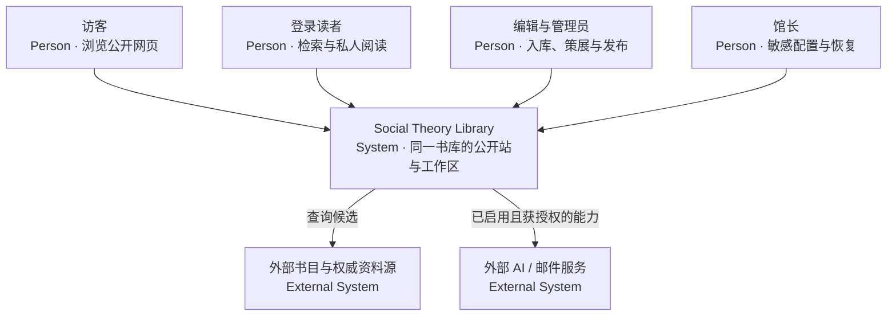
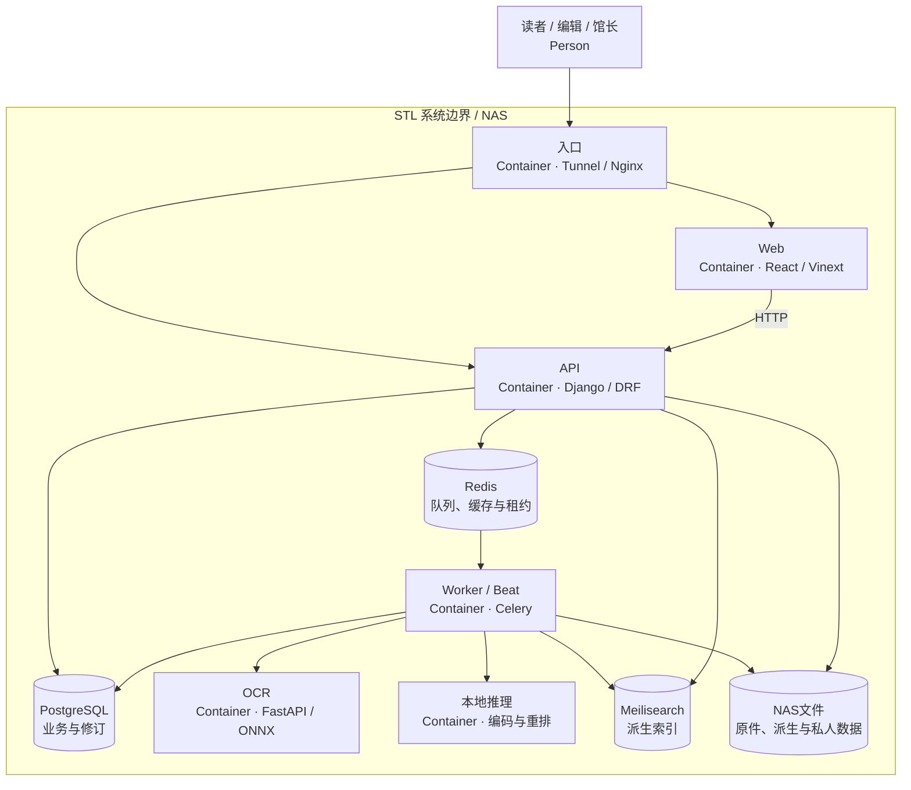

# 01 · 系统架构

[架构目录](README.md) · [运行细节 →](02_RUNTIME_ARCHITECTURE.md)

STL 是在 NAS 上运行的模块化单体。公开站、登录读者和管理端使用同一套 API、PostgreSQL、任务、检索索引和文件存储。Web 与 API 分容器，领域模块没有被拆成各自持有业务数据库的微服务。

## C4 · System Context

以下两图按C4的人员、系统、容器和外部依赖分层，使用GitHub原生Mermaid flowchart绘制；详细端口、队列和启停状态留在运行架构，避免一图承载全部实现细节。

外部服务画在边界外不代表本轮已调用成功。候选、机器结果与人工正式内容之间有确认和发布层。

## C4 · Container

图中worker是职责集合，实际有通用、入库、Discovery query/index角色；并非所有角色持续运行。网络、按需管理、授权文件交付及外部Provider调用见[运行架构](02_RUNTIME_ARCHITECTURE.md)。持久存储节点表示数据容器或NAS存储职责，不表示独立业务数据库。

## 后端模块边界

| 应用 | 权威职责 | 主要入口 |
| --- | --- | --- |
| accounts | 账号、角色、恢复、会话与头像 | `api/accounts/urls.py`、`ownership.py` |
| catalog | 作品/版本、知识实体、证据、修订、公开查询、策展、搜索投影 | `api/catalog/urls.py`、`services/` |
| ingestion | 上传批次、候选、处理任务、OCR与上架协调 | `api/ingestion/urls.py`、`services/pipeline.py` |
| reading | 本人进度、注释、书单、研究、引文核对、分享 | `api/reading/urls.py`、`*_models.py` |
| distribution | NAS/对象存储交付、回收、存储与备份流程 | `api/distribution/urls.py` |
| common / config | capability、加密、并发、AI路由、远程能力工作者、Celery、HTTP配置 | `api/common/`、`api/config/` |

这些模块以 Python 导入和数据库事务协作。文件系统不是书目真相来源，Meilisearch 不是编辑数据库，Redis 不是可靠的业务完成回执。

依据：[Compose](../../compose.yaml)、[Discovery overlay](../../compose.discovery.yaml)、[URL 根](../../api/config/urls.py)、[Web Dockerfile](../../web/Dockerfile)、[运行证据](AUDIT_BASELINE.md)。Sites/Worker、Drizzle/D1 等适配文件仍存在，未据此推断当前生产改用 Cloudflare Workers 或 D1。
