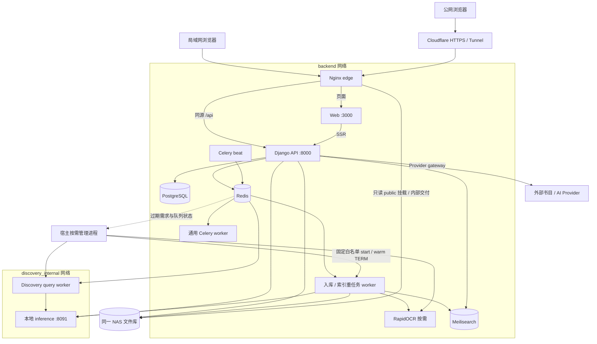

# 02 · 运行架构

[架构目录](README.md) · [部署与恢复](13_DEPLOYMENT_AND_OPERATIONS.md)

本章区分容器配置、观察时状态和业务可用性。2026-11-09 14:00 左右的只读检查是一个时间截面；按需容器停止不自动构成故障。

## 实际调用与网络

API 同时连接 backend、default、discovery_internal；Web 位于 backend；edge 位于 backend/public_front；推理服务仅内部网络。图中的命名来自容器角色，不代表真实主机地址需要写入前端。浏览器 API 使用 `/api`，由 `runtime-config.js` 可覆盖，见 [runtime-api.ts](../../web/lib/runtime-api.ts)。

## 观察时角色状态

| 角色 | 状态 | 说明 |
| --- | --- | --- |
| API、通用 worker、beat、ingestion-worker | running | 共同使用 curation-publish-r1 API 镜像 |
| discovery-query-worker | exited | 按需角色；本轮未提交查询激活它 |
| discovery-index-worker | created | 独立角色保留；重任务共用配置须结合活动 overlay 判断 |
| discovery-inference | running | 本地编码/重排服务；没有进行模型质量或容量实测 |
| RapidOCR、旧 PaddleOCR、DOCX preview、SearXNG | exited | RapidOCR 是当前配置主 OCR；旧 Paddle 为保留服务；没有启动它们作验证 |
| PostgreSQL、Redis、Meilisearch、Nginx、cloudflared | running | 容器运行不代表所有应用能力健康 |

公网 `/api/ready/` 返回 4.0.0、数据库可连接、待迁移数0，同时明确 `application_functional=not_evaluated`、`external_access=not_evaluated`。管理端状态页观察到数据库与队列正常、部分能力“尚未探测/不可用”，本轮没有按“探测”“修复”或“重试”。

## 数据和文件路径职责

API/任务角色挂载 archive、incoming、public、private、backups 及只读模型目录。原件保存于 archive；public 是派生/获准交付区域；private 承载私人材料；incoming 是入库暂存。edge 仅持有公开文件的只读挂载，实际下载仍经过 API 权限与内部转发边界。R2 可用作临时上传中转，是否启用以配置和回执为准。

Redis 同时承担 Celery broker、缓存、并发限制、租约与服务需求。业务结果保存在 `ProcessingJob`、发布事件、命令回执和领域修订，不以 Celery result backend 作为正式状态；配置明确关闭 result backend，采用 late ACK 和 prefetch=1。

## 按需服务与 AI 边界

[nas_on_demand.py](../../scripts/nas_on_demand.py)是宿主进程：检查固定容器白名单、队列/保留/活动任务、Redis 需求和停止标记，再启停服务。它使用温和 TERM；未知 broker/container 状态不会授权停止。应用不需要 docker socket。

外部元数据源经 provider gateway；本地 Discovery 推理有专用内部端点；通用 AI 能力由 Provider/Model 配置和 `common.ai_runtime` 路由；私人研究由本人资料范围与 Provider 授权共同控制。禁止把这些不同能力写成“一个大模型读完全库”。模型文件与密钥不入 Git。

## 源码可复现边界

本次已核对 API 791 份文件、OCR 5 份源码，以及 Web 发布清单1847项（环境注入项单列）。生产采用历史 release 叠加的 Compose 配置，不能仅运行根 `compose.yaml` 来重建同一环境。完整运行对应强度、镜像摘要及限制见[版本基线](AUDIT_BASELINE.md)。
