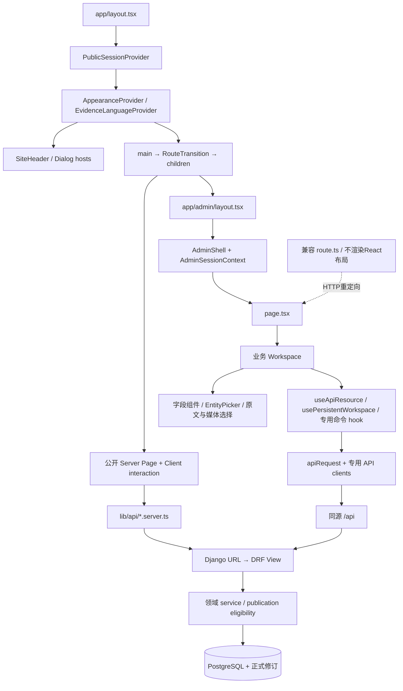

# 03 · 前端架构

[架构目录](README.md) · [管理组件图](05_ADMIN_COMPONENT_MAP.md)

Web 使用 React 19、Next App Router 目录约定，由 Vinext/Vite 构建和运行。`package.json` 的 `dev/build/start` 均调用 vinext。`next` 包和 Worker 适配存在，不意味着生产使用 Next CLI 或 Cloudflare D1。

## 页面到数据

根布局实际导入全局样式、网站框架、会话、外观和证据语言 Provider。`AdminShell` 读取同一会话建立管理身份边界，内嵌预览在授权后可去掉工作区外框。公开页使用的 serializer 不因浏览者恰好是管理员而放宽公开过滤。

## 前端模块与状态

| 层 | 具体文件或目录 | 职责 |
| --- | --- | --- |
| 页面入口 | `web/app/**/page.tsx`、兼容 `route.ts` | URL 参数、元数据、首屏取数、组件入口或重定向 |
| 业务组件 | `components/admin/workflow`、`knowledge`、`curation`、`reader` 等 | 表单、预览、对象选择、任务状态和命令 |
| 共享 UI | `components/ui`、`entity-picker`、`loading-state`、Dialog | 可访问控件、焦点、选择与加载表现 |
| 基础请求 | `lib/api.ts`、`runtime-api.ts` | 同源地址、会话凭据、错误、响应格式与会话变更 |
| 业务客户端 | `lib/api/*client.ts`、cataloging、discovery、schema契约 | typed request/response、资源路径和命令回执 |
| 请求状态 | `use-api-resource.ts`、`use-persistent-workspace.ts` | 生命周期、AbortController、owner范围、冲突与轮询 |
| 编辑状态 | `workflow-state.ts`、`use-scholar-save`、专用 command hooks | 页面草稿、dirty fields、预期版本、保存与恢复 |

没有发现全站统一 Redux/Zustand 状态层。React state/ref、Context、URLSearchParams 和专用 hooks 分工使用。表单不会因为 GET 重载就理所当然覆盖用户输入；不同工作区的实现仍需分别审查。

`usePersistentWorkspace` 用 `ownerId:path:sessionEpoch` 隔离状态，账户变化清空内存；401/403/404/410 清掉失效私有内容。mutate 保留同一 fingerprint 的 requestId，409 读取竞争版本并保留调用者表单。轮询有预算、后台页面暂停和手动恢复提示。这不是所有旧组件天然继承的保证。

## URL 与导航状态

- `edition` 决定 Work 工作台的具体版本，不能只凭 Work ID 保存版本字段。
- `return_to` 经安全路径校验保留原工作上下文；hash 定位 bibliography、files、publication 等步骤。
- `frame=1` 用于内嵌预览；`review=1` 进入发布审核。两者不是公开授权参数。
- `selected_type/selected_id`、`object_type/object_id`、`node`、`legacy_id`、`path` 等旧参数由兼容组件转换，不能删除旧路径后丢失对象选择。
- `/admin/recommendations?view=home|legacy`、`/admin/publication?site=...|item=...`、`/admin/processing/semantic-index` 的分支入口见[页面清单](ADMIN_PAGE_INVENTORY.md)。

## PDF Reader 与公开消费者

Reader 由 asset route、文档载入 hook、PDF.js 渲染和工具/注释面板组成。`use-reader-document.ts` 处理下载/文档请求；清单来自 `assets/{id}/manifest`，目录由版本化 outline 提供，文本命中有 document revision 与位置依据。公开元数据页与登录后正文入口分别鉴权。管理员内嵌 Reader 预览要保持不写读者记录，这一分支不能靠普通 Reader 页面存在来证明。

全量入口共155个，管理端79个；统计含 route handlers、预览和历史兼容入口。完整 import 与 JSX 证据由[静态索引](inventory/README.md)生成。本轮对关键发布/身份/原文链路作人工追踪，对其他组件保留静态关系证据，不宣称每一个条件分支都已在浏览器执行。
