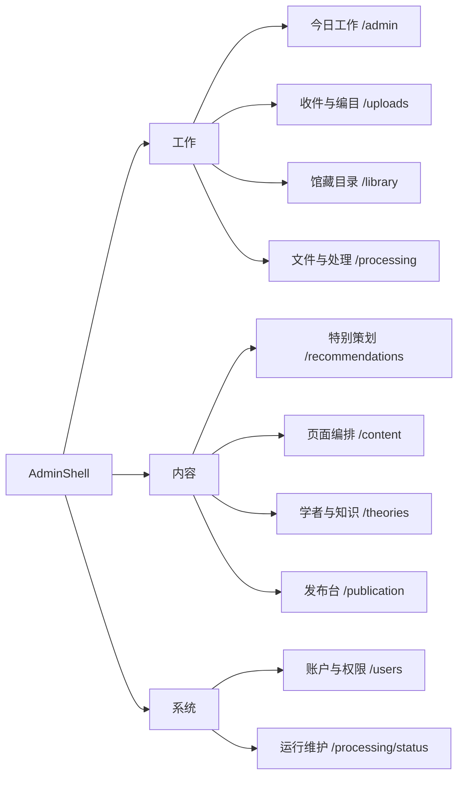

# 04 · 管理端信息架构

[架构目录](README.md) · [79入口清单](ADMIN_PAGE_INVENTORY.md) · [逐模块契约](ADMIN_MODULE_CONTRACTS.md)

当前导航由 [AdminShell](../../web/components/admin-shell.tsx) 定义，是“工作、内容、系统”三组、十个主要栏目。页面入口数量远多于侧栏项目；动态编辑器、预览、文件工具、兼容跳转和维护次级页共同构成79个入口。

图只展示实际导航分组。完整 URL、page.tsx、核心组件、查询参数和兼容路径见清单。次级路径按业务集中如下，避免把全部入口挤入一张不可读的图。

| 主入口 | 次级工作空间 |
| --- | --- |
| 收件与编目 | 批次、收件项、编目会话、手工书目、元数据候选 |
| 馆藏 | Work+Edition工作台、文件、OCR、页码、目录校准 |
| 特别策划 | 项目、文章编辑、预览、发布时间与历史；旧推荐位置入口保留 |
| 页面编排 | 页面版位、网站内容、欢迎页；媒体库为相关独立工具 |
| 学者与知识 | 人物、学者、主题、学科/子学科、理论传统/概念/争论/问题、关系、时间线、公共路径 |
| 发布台 | 对象审核预览、正式修订历史、恢复与撤回 |
| 运行维护 | 设置、索引、词表、诊断、存储、备份、分发、回收；反馈与视觉复核另有独立入口 |

## 管理员的实际任务路径

| 任务 | 主要路径 | 需要辨认的状态 |
| --- | --- | --- |
| 从文件入库 | 上传批次 → 收件项 → WorkflowEditor → 发布 | 文件接收、处理、元数据候选、人工确认、公开修订彼此独立 |
| 先建目录后补PDF | 手工编目 → 保存会话/版本 → 补文件 → 预检/发布 | 未保存表单与已存草稿不同；bibliographic模式不要求假造PDF |
| 修订已发布馆藏 | 馆藏 → 指定edition → 编辑 → 预览 → 发布 | 当前公开快照继续服务，草稿不立刻覆盖它 |
| 处理人物重名 | 人物规范工作区 → 身份/别名/重复预览 → 专门合并命令 | 人物身份、责任者、学者展示档案不是同一记录 |
| 编辑理论/主题 | 对象列表 → 主编辑器 → 关系/材料/影响/历史 → 发布审核 | 名称选择、关系确认和对象公开分别操作 |
| 编辑公共路径 | 理论下公共阅读路径 → 阶段/材料/顺序 → 校验/预览 → 发布 | 私人阅读计划是另一模块，不能直接公开 |
| 策划文章 | 项目 → 选材/文章 → 编排/助手候选 → 保存/预览 → 发布 | 项目权限、文章修订、首页摆放分别管理 |
| 校准原文 | 馆藏文件 → 目录/页码/OCR → 新派生文件或正文修订 | 原件、旧证据、读者锚点保留；导出任务尚未完成时不能称文件已生成 |

## 隐藏的复杂度

`/admin/library/works/[workId]`、收件详情和编目会话最终复用 `WorkflowEditor`，但入口来源、edition、return_to不同。将它们当成三个独立编辑系统会导致错误重构。反过来，网站内容、文章、证据策展和版位拥有不同的保存/发布协议，不能仅因 UI 都有“保存”而当成同一事务。

旧 `/knowledge`、`/taxonomy`、`/theory-nodes` 等入口主要保留兼容跳转。当前理论编辑器实际承接理论传统、概念、争论和研究问题。学科/子学科是独立权威对象，不能因为 KnowledgeNode 枚举也存在相关类型，就将目录页数据强行换成节点。

## 审计建议的具体方向

以作品+版本为上下文，把已有字段助手、身份匹配、候选观点、关系证据、公开预览和影响清单接入一个审阅队列。每项建议直接显示“写入对象、来源页码、现有值、建议值、是否新建、是否冲突”；管理员可在队列内确认，再批量保存草稿。人物和理论规范编辑器保留为深度维护工具，编辑后返回原任务位置。

这些是基于现有调用链的设计方向，不是本轮已经实现的新界面。详细依据和验收场景见 [08](08_CURATION_WORKFLOW.md) 与 [15](15_KNOWN_ISSUES_AND_OPEN_QUESTIONS.md)。
