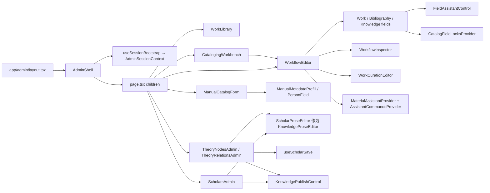
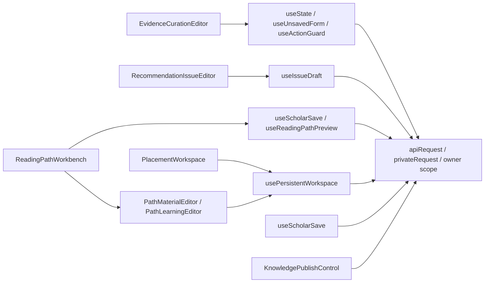

# 05 · 管理端组件图

[架构目录](README.md) · [178组件模块使用表](ADMIN_COMPONENT_INVENTORY.md)

下图来自入口文件、实际 import 和 JSX 调用；不是目录树的换皮。完整位置可在 [component-renders.csv](inventory/component-renders.csv) 中按组件名定位。`admin-sections.tsx`、`cataloging-session.tsx` 存在 re-export，须继续跟踪真正实现。

策展工作空间的保存路径单列如下。上图的`Route`也会按URL进入这些组件。

路径工作台在子字段选择器中复用持久查询，主保存使用专用命令；文章使用`useIssueDraft`，证据编辑器在组件内部维护draft与请求。它们没有统一调用`usePersistentWorkspace`。这一区别也解释了保存、恢复与错误状态为什么需要逐模块核对。

## 表单数据怎样流动

1. 工作区从 API 读取对象、当前版本、字段决定、任务和候选。
2. 受控字段把编辑结果回传父组件；父组件维护 draft、dirty、未保存提示和当前 edition。实体选择传 ID 与角色，名称只用于显示或待新建建议。
3. 候选先进入本地表单或暂存建议，来源 token、字段范围和撤销信息保留；“采用”不是无条件发布。
4. 保存命令携带 expected version / If-Match、requestId 和 owner；后端校验身份、字段政策、依赖和锁后写入。
5. 服务端返回 revision/receipt，前端再读取当前状态。超时结果不明时使用回执核对，不能直接重复创建。
6. 预览读取已保存草稿及其版本；发布要求核对当前版本与审核版本，冲突时保留输入并重新核对。

## Shell、响应式和异常状态

`AdminShell` 包含会话核对、未登录、无权访问、暂时网络失败与 retry。导航显示还受 capability 约束，后端权限仍是最终边界。窄屏（900px断点）管理侧栏以可关闭覆盖层呈现，处理 Escape、焦点与返回触发点；嵌入预览另有 frame 分支。

各工作区使用 `LoadingState`、空结果和错误区域；全站 ActionMenuBehavior 负责部分动作菜单关闭。表单密度、双列→单列和固定底部操作仍由 CSS module 或全局 admin 样式决定，不是 Shell 自动解决所有控件拥挤。

## 可维护性结论

已经共享的能力包括 EntityPicker、媒体选择、富文本、证据选择、发布控制、owner-scoped请求与命令回执。主要重复出现在大型多导出组件内的本地 draft、加载/刷新、预览入口及保存后同步逻辑。建议优先统一“提交结果未知/冲突/成功”的返回协议和界面提示，再按真正重复的业务段拆组件；不为减少行数拆出缺少业务边界的新抽象。

`WorkflowEditor` 与 `theory-system-admin.tsx` 同时承担大量状态、条件入口和表单。现状不等于错误，但审阅必须按入口条件定位函数，不能看到某个 import 就断言所有页面都使用该组件或 API。
