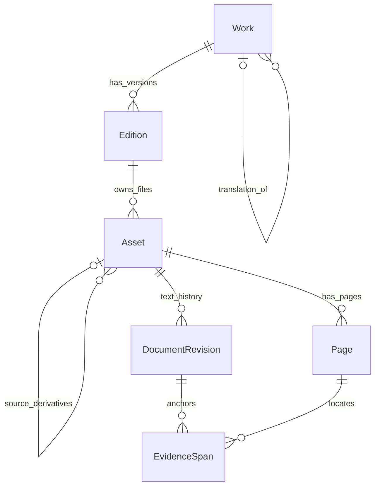
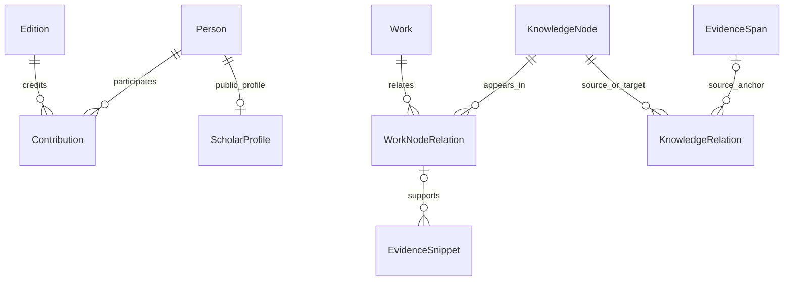
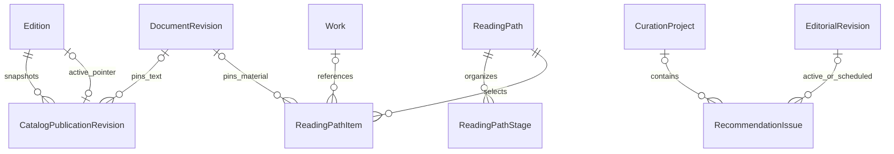

# 06 · 领域模型与数据职责

[架构目录](README.md) · [公开消费者](MODEL_PUBLIC_CONSUMERS.md) · [对象生命周期](OBJECT_LIFECYCLES.md)

模型清单来自 Python AST（包括 `discovery_models.py`、reading 的拆分模型），共205个含字段的模型声明，包含抽象基类，**不是205张已确认生产表**。默认表名按Django规则推导，自定义db_table优先；本轮没有查询生产业务表或复制业务记录。[字段CSV](inventory/model-fields.csv)保留每一字段的声明与来源行。

## 核心 ERD

文献、正文与证据：

人物、责任者与知识关联（文献和证据实体与上图相同）：

公开修订、阅读路径与文章：

ERD只画主要实体和FK含义，活动指针是 Edition 的单一当前选择，同时保留多份历史修订；不要把图理解为省略了数据库约束的DDL。EditorialRevision 的大部分target_type/target_id是应用层多态身份，并非一个对所有对象的数据库外键。

## 文献不是一个 Book 表

| 对象 | 实际含义 | 写入来源与生命周期 |
| --- | --- | --- |
| Work | 作品层题名、简介、语言、翻译关系等；可以有多个版本 | 手工编目/入库建立，维护草稿修订；不直接用Work flag判公开 |
| Edition | 具体出版版本与出版信息、材料模式、主版本、上架决定、活动公开修订 | 编目与馆藏维护；主版本驱动列表，其他合法已公开版本仍可阅读 |
| Asset | 原件/规范化/OCR/下载等文件对象；source_asset连接派生 | 文件处理创建新版本，保存checksum、validation、access_status；不能覆盖原件 |
| Page | 属于具体Asset的物理页、当前文本、印刷页码、geometry | 提取/OCR/人工校订；人工文本/页标签有自己的修订与锁定语义 |
| DocumentRevision | 某Asset一次正文处理的版本与来源/文本摘要、parser/OCR信息 | 新解析形成新revision；证据与检索需核对当前或固定修订 |
| DocumentOutlineRevision | 目录结构、采用状态与修正历史 | 自动识别/自动生效；人工修正后派发独立带书签下载生成 |
| PageMappingRevision / PageTextRevision | 印刷页映射与人工文本修订 | 单独校准，不把PDF物理页、印刷标签和文本偏移混为一个数字 |

`Edition.publication_mode`允许纯书目；metadata_ready、fulltext_ready、OCR状态和semantic状态是不同的就绪维度。PDF存在、正文能检索、书目已经公开不能互相推导。

## 权威实体、关系和来源

`Person`管理身份；`ScholarProfile`通过一对一关联管理学者展示。`Contribution`关联Edition与Person，并携带role、scope、order、approved；scope可表达章节责任范围。`PersonNameVariant`等保留异名；合并记录与`merged_into`保留身份变更历史。

现行理论对象主要是 `KnowledgeNode`（theory_tradition、concept、debate、research_problem等）。没有名为Theory的单一主表。旧 `TheorySchool`、`Concept` 仍存在，并通过 `LegacyKnowledgeMapping` 与规范节点映射；服务必须验证类型、名称/已确认异名和映射状态，不能靠名字相似自动合并。

`Topic`、`Discipline`、`Subdiscipline`是独立权威实体。WorkDisciplineRelation、WorkSubdisciplineRelation、WorkTopicRelation和KnowledgeNode相关连接表表达多重关系。`KnowledgeRelation`连接两个节点；`PersonNodeRelation`连接人物与节点并带方向；`ScholarRelation`连接学者档案；时间线另有事件与参与者关系。

证据并非全用同一种协议。`EvidenceSpan`固定DocumentRevision、Page、offset/bbox与原文，并有stale状态；`EvidenceSnippet`固定Asset及页码/quote，但没有固定DocumentRevision字段，serializer根据当前活动书目修订返回document_revision_id。该差异及风险见 [VN-B02](15_KNOWN_ISSUES_AND_OPEN_QUESTIONS.md#vn-b02)。不能称全部证据都已具备同样强的修订追溯能力。

## 候选、决定、锁与修订

MetadataCandidate记录值、来源、证据、置信度、归一值、冲突组与采用/拒绝。EntityResolutionCandidate处理身份匹配。EnrichmentCandidate及DerivedClaim保存机器补充与观点结果。机器状态不等于人工确认。

DecisionLog记录前后值、操作人、理由与撤销关联；CatalogFieldDecision记录字段值、证据、依赖指纹与失效原因；FieldLock保护人工锁定值。FieldLock物理上关联Edition，但Work层字段的锁范围由字段契约展开，不能只按一条锁表记录推断业务作用域。

EditorialRevision保存target、base_revision、patch、materialized_preview、changed_fields和状态；CanonicalObjectRevision记录正式对象版本。PublicationBundle/Item明确本次馆藏要连带确认的新对象。CatalogPublicationRevision是公开目录快照，绑定Edition、文档修订、阅读文件与就绪条件。KnowledgePublicationEvent和ProjectionState处理发布后异步传播。

## 策展与私人数据

CurationProject管理团队、材料与文章；RecommendationIssue指向活动/排期EditorialRevision。EvidenceCuration及Reference管理原文策展。页面编排没有独立ContentPlacement模型，使用`target_type=content_placement`的EditorialRevision及父对象锁；站点配置使用SiteSetting和修订账本。

ReadingProgress、Bookmark、SavedItem、ReadingList属于用户。Annotation的正文/标签密文与selector、asset checksum、orphaned标记共同保留；并不是所有元数据字段都加密。PrivateResearchRecord是抽象基类，ResearchProject、CitationAudit、PersonalReadingPlan等继承本人归属和加密数据；LibraryMessage/Source保存对话与证据关联。分享必须经过ReaderShare/Group的显式范围，不能推导管理员可读全部私人正文。

源码入口：[catalog/models.py](../../api/catalog/models.py)、[ingestion/models.py](../../api/ingestion/models.py)、[reading/models.py](../../api/reading/models.py)、[research_models.py](../../api/reading/research_models.py)、[字段契约](../../api/catalog/contracts/fields.py)。
