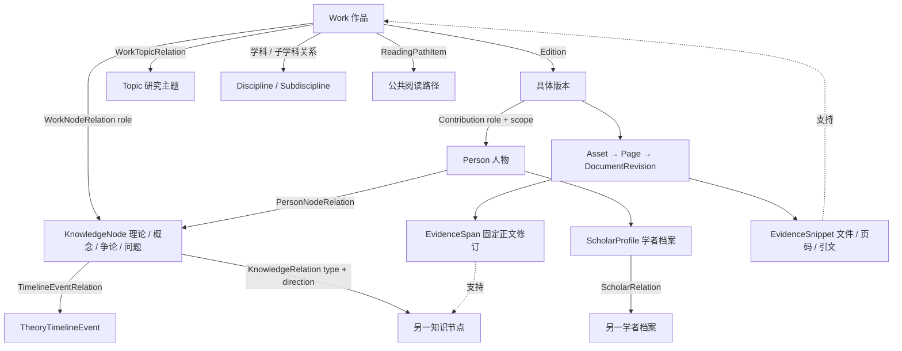

# 07 · 社会科学知识实体与关系

[架构目录](README.md) · [策展工作流](08_CURATION_WORKFLOW.md)

社会科学文献中的人物、理论和主题通常是多对多，关系也有不同含义。STL已经使用多类关系模型，但跨页面编辑和不同年代的证据协议仍增加管理员负担。

## 业务语义对应

| 需要表达的含义 | 当前结构 | 审计判断 |
| --- | --- | --- |
| 著作属于/发展某理论，还是只是使用/提及 | WorkNodeRelation.role：奠基、系统阐释、理论发展、经验应用、比较研究、批评反思、一般提及 | 不能从is_primary、strength或置信度推断思想归属；它们不是同一语义 |
| 继承、批评、回应、影响、概念借用 | KnowledgeRelation.relation_type + direction；人物相关另用PersonNodeRelation/ScholarRelation | 有多类型与方向；引用某作者不自动证明继承/影响，须给证据 |
| 作者、译者、编者、研究对象 | Edition→Contribution→Person，role+scope+approved | 作品主题中出现的人物不该自动成为责任者；章节合著须保留范围 |
| 学科归属与研究主题 | Discipline/Subdiscipline 与 Topic 独立模型及连接表 | 可同时多重归属；主题不是学科树的叶节点替代物 |
| 作品与具体译本/版次 | Work→Edition→Asset | 引文应定位版本和文件；不能用作品ID代替正文来源 |
| 跨书籍关系 | 共用规范节点、人物、主题、路径、策划与证据 | 已有共享身份基础；不能用每书新建同名实体制造伪连通 |
| 同名异人、异名同物 | PersonNameVariant、外部标识、重复预览、人工merge/rollback；节点alias/merge及LegacyKnowledgeMapping | 匹配是建议，确认/合并是单独命令；名称相似不足以自动合并 |
| 历史事件、研究对象与论争 | 时间线事件、人物角色、KnowledgeNode debate/research_problem及关系 | 并非所有社会科学研究对象都有独立通用实体类型，不能声称已覆盖任意知识本体 |

旧 `WorkTheoryRole` 有 `method_use`，映射到新 `WorkNodeRelation.empirical_application`；该映射无法保留方法使用与经验应用的细分差异。这是明确的表达能力限制，不是本轮已经观察到某条具体数据丢失。详见 [VN-B03](15_KNOWN_ISSUES_AND_OPEN_QUESTIONS.md#vn-b03)。

## 证据应该能回答什么

管理员核对关系需要看到：是谁的论述、哪一作品/版本、哪个文件/正文修订、物理页与印刷页、原文范围、抽取来源、为何支持此关系、人工决定与公开修订。`EvidenceEnvelope`已包含source、locator、quality、provenance、reader_url等字段；`Contribution`投影在具体页范围解析责任者。

旧EvidenceSnippet没有固定正文修订，当前serializer根据活动版本返回修订ID；新EvidenceSpan有固定revision与stale机制。不能把二者都描述为“不可变原文证据”。公开可访问性检查与历史来源准确性也不是同一问题：当前文件可读，不证明旧引文就是当前正文的原文。

## 公开图谱的范围

图谱使用正式关系和符合公开条件的端点，支持中心节点、层数、类型、学科、年份和数量上限；关系列表/人物/主题/文献为同一探索上下文。2026-11-09只读页面观察到当前默认中心1个节点、0条已公开关系。它只说明该中心与筛选范围的公开数据，不证明全库没有关系，也不能据此要求读取或补全正在进行的策展数据。

公共图谱、学者详情、主题导读、作品相关关系和阅读路径是不同消费者；管理员提交一条关系后，还要经过关系状态、端点状态、证据资格和发布/投影规则。设计上应在同一任务面板中解释这些条件，减少管理员逐页猜测为何未展示。
