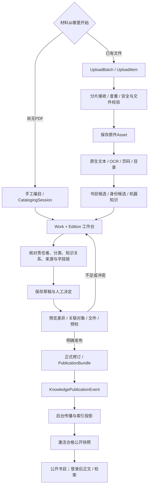
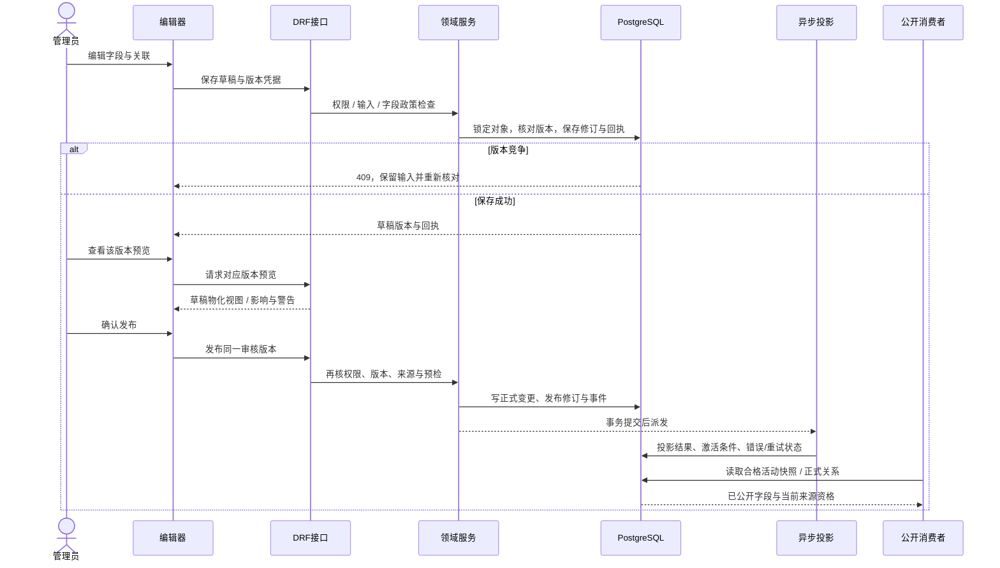
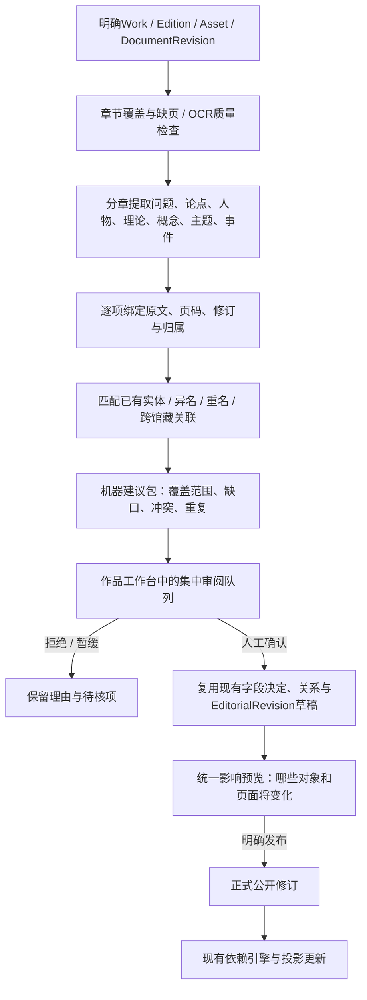

# 08 · 入库、知识策展与发布工作流

[架构目录](README.md) · [管理模块契约](ADMIN_MODULE_CONTRACTS.md) · [知识关系](07_KNOWLEDGE_GRAPH_AND_RELATIONS.md)

## 当前入库与上架

真实代码入口为 `pipeline.run_pipeline`、`manual_catalog_views`、`workspace_edits`、`publication_commands` 和 `knowledge_publication`。纯书目可以有metadata-ready公开修订，全文与智能索引另行准备；图不是“所有书必须先完整OCR才能上架”的规则。

## 保存、预览、发布时序

此时序说明公共协议；知识对象、馆藏、文章、站点和版位的具体命令不同。KnowledgePublishControl针对新对象还有prepare-public阶段：先把明确的公开意图写入待审核草稿，再读取预览，不应一按准备就绕过草稿审查。

## 现有 AI 能力究竟做什么

| 现有入口 | 输入与结果 | 人工边界 |
| --- | --- | --- |
| 元数据与实体候选 | 文件/书目源、已确认上下文 → MetadataCandidate / EntityResolutionCandidate | 字段采用、拒绝、查重与锁定 |
| 字段助手 | 当前对象+字段+上下文指纹 → 规范实体、书目或富文本建议 | lookup准备候选，既有mutation才负责写入；保留来源token与撤销 |
| DerivedClaim → 高价值候选 | 活动正文、非stale证据、质量/重要性阈值、明确归属 → 少量观点/批评/回应 | `MAX_ACTIVE_DECISIONS=5`；用于压缩审阅，不是整书知识全集 |
| WorkCurationEditor | 作品候选观点、路径摆放与推荐覆盖 | 采用产生CuratedClaim/草稿，正式发布另行处理 |
| 文章助手 | 策划问题 + 1–40个已选真实来源 → 提纲、导读、比较候选 | ProcessingJob异步生成；管理员逐项采用，只保存文章草稿 |
| 研究与阅读计划 | 本人问题与授权材料 → 私人研究结果/计划建议 | 本人数据，不自动写入公开知识库 |

依据：[field_assistant](../../api/catalog/services/field_assistant/service.py)、[字段策展适配](../../api/catalog/services/field_assistant/curation.py)、[高价值观点](../../api/catalog/services/claims/curation.py)、[文章助手](../../api/catalog/services/editorial_assistance.py)。不能把这些现有工具合称为已经具备“AI完整阅读整书、自动完成公开策展”的成品。

## 管理端的实际负担

同一本书涉及作品字段、版本字段、人物身份、学者档案、多个理论/主题、节点关系、原文证据、路径和文章。WorkflowEditor已集中一部分填写，但深度关系/学者/路径/文章仍各有工作区。管理员需要重复核对对象是否已有、哪一项需要保存、哪一项需要独立发布、为何公开页没有显示。

这不是仅靠多加“AI生成”按钮可以解决的问题。当前字段助手按字段组织，观点队列刻意只给少量高价值决定，文章助手按选定来源工作；它们尚未提供一个覆盖整书各章、所有实体与冲突的统一审阅包。

## 建议：在现有工作台集中审阅整书建议

以下是设计方向，**本轮没有新增模型、API、任务或界面**。

建议包最低字段应包括 `source_revision`、章节覆盖、suggestion_kind、目标对象/字段、已有ID或待新建实体、关系角色/方向、原文证据与页码、机器置信度、冲突/重复、人工decision及其actor、正式revision。置信度不能替代来源；没有依据的关系必须进入待核，不得生成确定的思想影响链。

具体界面调整：

1. 在 `WorkflowEditor` 的材料/候选区域增加整书审阅入口，保留当前Work+Edition与return_to，侧栏分“内容与问题、实体、关系、证据、冲突、公开影响”。
2. 复用 `MaterialAssistantProvider`、`FieldAssistantControl`、EntityPicker和原文选择器，右侧始终显示当前建议的真实页；在队列内查重/选择已有对象，不为每个名字跳到人物库。
3. 将 `WorkCurationEditor` 的高价值观点与关系候选并列展示，但明确“机器建议、人工已确认、正式已公开”三个状态。确认后的草稿仍可撤销或修改，不把批量接受同时当发布。
4. 深度人物/理论编辑仍使用现有编辑器，通过抽屉或可返回链接携带上下文；保存后回到同一建议，不重新输入版本、来源和页码。
5. 发布审核汇总对象与页面变化、源修订是否仍有效、待核冲突、草稿属于哪些编辑者；复用已有版本锁、预检和发布账本，不建立第二套正式知识库。

验收应采用不含私人数据的测试文献，包含合著章节、多译本、同名人物、批评与引用并存、OCR错页、已锁字段、撤回来源、并发编辑和部分Provider失败。评价指标是管理员实际完成时间、跨页次数、证据可回溯率与误关联率；本轮未测量这些指标，不填写虚构改善百分比。
