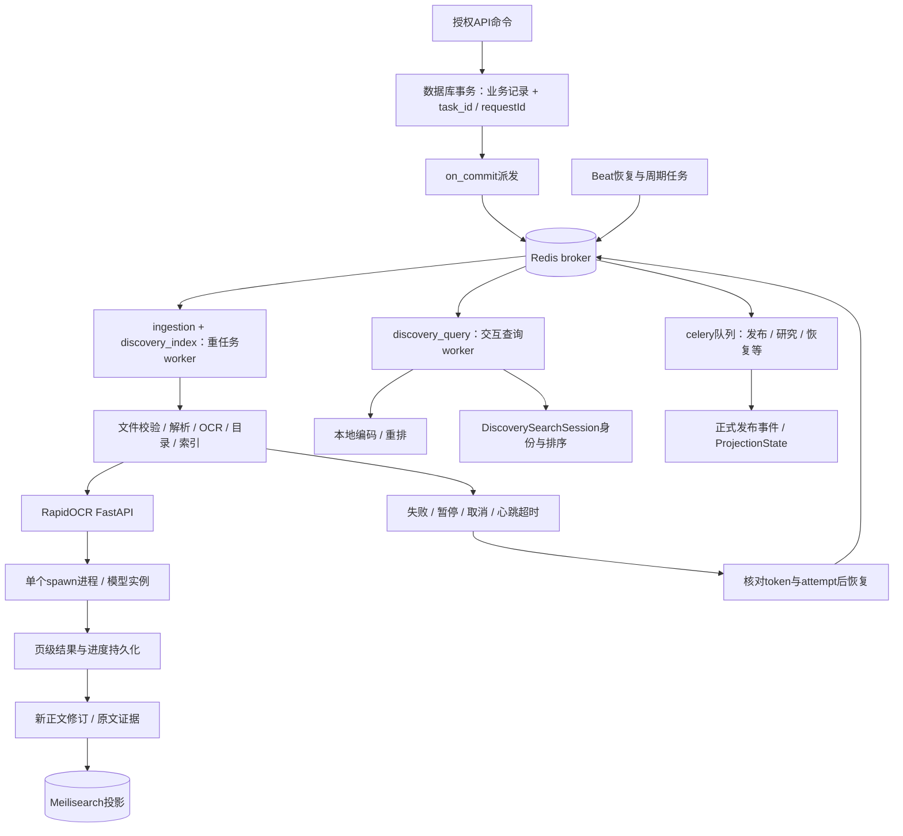

# 10 · 异步任务、OCR与检索投影

[架构目录](README.md) · [运行架构](02_RUNTIME_ARCHITECTURE.md)

## 任务拓扑

队列映射在 [settings.py](../../api/config/settings.py) 的CELERY_TASK_ROUTES。生产按需宿主服务将ingestion与discovery_index集中给重任务worker，交互查询独立；容器名不能直接等同队列专有职责。

## 当前 OCR 实现

`ocr_service/app.py`是FastAPI，应用版本`4.0.0-rapidocr-2`；requirements为RapidOCR 3.10.0、ONNX Runtime 1.31.0。源码加载模型清单与本地engine，HTTP进程将渲染/推理移入单个spawn ProcessPoolExecutor，避免阻塞健康接口；请求门、线程上限和任务状态约束并发。模型身份与摘要由 `rapid_models.py` / `model_probe.py` 管理。

旧PaddleOCR相关镜像、构建与历史说明仍在仓库/环境，不能因此继续把Paddle写成当前主运行OCR。本轮核对RapidOCR容器中的5份应用源码但容器当时停止；没有启动识别，也没有验证模型在该刻能成功执行整本书。

入库优先安全校验和原生文字提取，必要时OCR，产生新派生文件与DocumentRevision。Page保留来源、置信度、geometry和人工修正标记。`document_outline.py`使用已有书签、目录/标题、页标签与布局信息建立导航；自动结果不能覆盖人工修正。`correct_outline`及自动采用路径调用`queue_export`生成独立带书签副本，原件和正文修订保留。

## 任务状态不等于进程状态

| 层 | 状态来源 | 应如何解释 |
| --- | --- | --- |
| 容器 | Docker状态与按需管理 | running仅说明进程；exited可能为空闲停止 |
| 队列 | Redis pending/reserved/unacked | 投递/领取不等于任务完成 |
| 业务任务 | ProcessingJob、UploadItem、heartbeat、task_id/token | 是管理界面主要事实来源 |
| 文件/正文 | Asset.validation、Page进度、DocumentRevision | 已保存页数与最终派生文件需分别判断 |
| 发布投影 | KnowledgePublicationEvent、ProjectionState | 正式内容与搜索索引同步情况 |
| 用户查询 | DiscoverySearchSession channels/status/warnings | partial、failed、canceled与completed各有含义 |

late ACK、worker lost重新投递、有限attempt、lease/token与幂等回执共同防止重复提交。它们不保证外部服务永不失败。管理员应看到真实错误和可行动恢复；不能用删任务、放宽权限或改状态字段掩盖失败。

## 搜索与模型

Meilisearch承载书目/段落/Discovery等投影，本地inference负责编码与重排，semantic search与Discovery会话并存。`discovery_sessions.py`保存结果身份与排序而非复制所有引文；每次读取经publication/permission边界重新组装。重排不可用时保留关键词/向量融合次序并返回warning，不应在文档中称为同等质量的完整成功。

DerivedClaim抽取、全文索引和知识传播依赖正确的document revision、来源资格与模型版本。重建索引可以恢复派生数据，但不能替代人工确认的关系、锁定字段或私人阅读记录。
