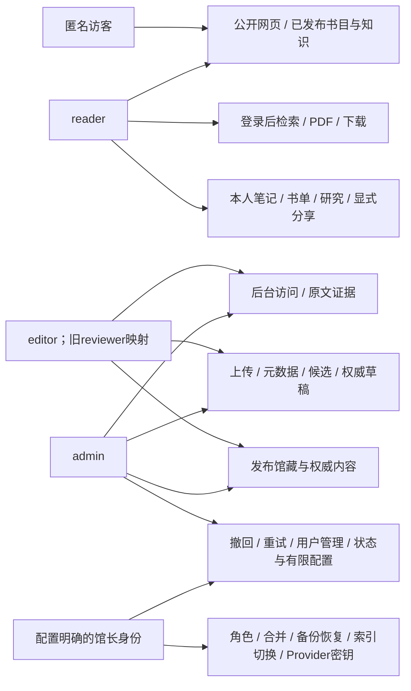

# 11 · 权限与数据边界

[架构目录](README.md) · [capabilities.py](../../api/common/capabilities.py) · [permissions.py](../../api/common/permissions.py)

当前访客只浏览公开网页；PDF正文、下载与Explore须登录。管理导航使用会话capability做显示控制，真正授权发生在API。已登录管理员访问公开详情也应读取同一公开快照，不能借后台身份把草稿混进公开页面。

此图不表示管理员或馆长自动拥有读者的私人正文访问权。reader功能与管理capability是不同维度。

| 主体 | 当前权限事实 |
| --- | --- |
| anonymous | AllowAny公开元数据；CanReadLibrary要求认证 |
| reader | 本人阅读/研究；不获得access_back_office |
| editor | STAFF_BASE + 上传、元数据、权威草稿/创建、候选审核、发布馆藏/权威、enrichment |
| admin | 编辑能力之外含撤回、重试、运行/用户管理、词表/索引状态等；并非所有敏感配置都可写 |
| owner | `accounts.ownership.is_library_owner`决定，追加owner-only capability；不是任意Django superuser |
| reviewer | 历史角色alias映射editor，暂未删库中旧值；不另设计第四种工作权限 |

特别注意：当前editor本身可以发布，不能在流程图中虚构一个强制“编辑提交给admin批准”的二人审批制度。若未来需要该制度，应提出明确权限/流程变更，不能只修改说明文字。

## 身份与请求隔离

会话使用受保护Cookie与服务端身份；前端owner范围用于防止账户切换时复用旧私有请求。`X-Editor-Owner`或`X-Reader-Owner`不是可自行授予权限的凭据。`AdminPrivateResponseMixin`设置private/no-store并核对owner；前端订阅会话变更、AbortController和组件key清理旧数据。

If-Match、edit_version和数据库锁防并发丢更新；requestId/回执解决请求结果未知。它们保护完整性，不替代权限、来源资格或发布审核。

## 私人数据与AI

Annotation正文/标签、研究记录、对话和某些上传使用已有加密服务。定位元数据、任务状态或部分标题未必全字段加密，不能笼统声称“数据库所有资料均加密”。密钥为运行配置，不进入Git；ProviderCredentialSecret存加密凭据，界面只显示安全摘要/别名。

外部Provider可能处理经授权的研究资料，本地模型也有独立能力路由。数据出站范围需以实际任务与配置为准；本轮没有录入密钥、测试邮件或调用生产Provider。公开策展与私人研究共用基础设施不等于共用公开数据范围。

## 文件和公开可见性

访问正文需要登录及文件/版本资格，引用与下载使用当前获准Asset。NAS原件、私人文件、模型、备份和Meili数据不进入Git。公开快照仍需实时屏蔽已撤回的知识端点及来源；历史修订保留不等于继续公开。

本轮只做只读生产核验。没有创建、修改、删除、上传、发布、撤回、人物合并、重新OCR、配置变更或数据库迁移。测试数据与截图范围见[公网核对](PUBLIC_SITE_VERIFICATION.md)。
