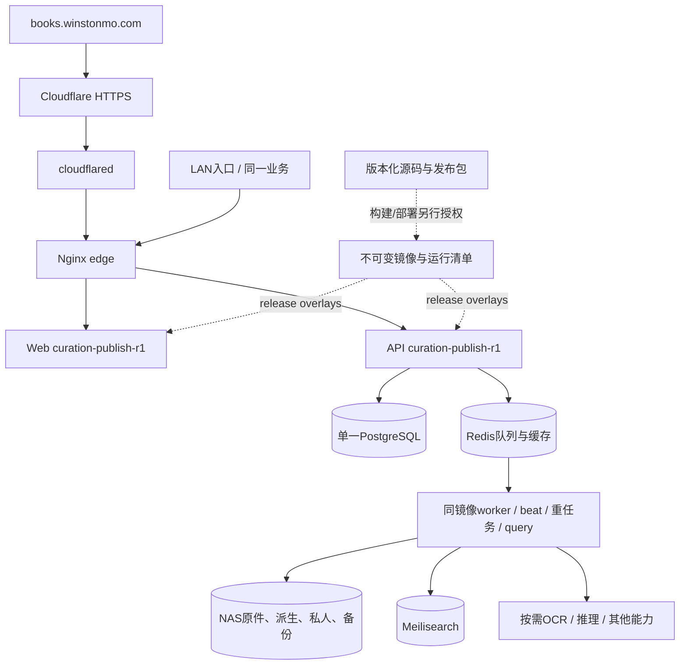

# 13 · 本地运行、生产部署与运维

[架构目录](README.md) · [运行架构](02_RUNTIME_ARCHITECTURE.md) · [版本身份](AUDIT_BASELINE.md)

## 本地开发入口

这是新建本地开发环境的说明，不是对既有NAS运行部署的命令。Compose会执行Django迁移，必须使用自己新建的本地数据库和数据目录，不借用生产`.env`或NAS挂载。

1. 安装Docker Compose；宿主机开发使用Python 3.12（API Dockerfile基线）及符合`web/package.json` engines的Node，当前镜像基线Node 24.22.1。
2. 从安全示例建立本地`.env`，填写随机secret、数据库密码、内部token和私人数据加密key；PostgreSQL密码与DATABASE_URL一致。设置本地NAS_HOST_ROOT，保留`PUBLIC_DEPLOYMENT_MODE=false`。
3. 使用统一edge origin，浏览器API保持`/api`。本地edge默认8080，应将CORS/CSRF trusted origins设为实际`http://localhost:8080`（需要直接3000开发时另外配置正确API与同源代理）。

```powershell
Copy-Item .env.example .env
# 编辑仅供本地使用的 .env 后：
docker compose -p stl-local config --quiet
docker compose -p stl-local up -d --build postgres redis meilisearch api worker ingestion-worker beat web edge
```

默认统一入口为 `http://localhost:8080`。基础Compose默认image标签还保留旧版本字符串，示例环境使用local标签；使用`--build`构建当前源码，不将旧标签当成应用版本。本轮没有在新的空白Docker环境实跑此流程，启动验证属于后续环境验收。

单独开发Web时在web目录运行`npm ci`、`npm run dev`；单独开发API需安装`api/requirements.txt`及libmagic等系统依赖，并明确设置进程环境。Django不会自动加载根`.env`；未设置DATABASE_URL会用开发SQLite，不能把SQLite检查当成PostgreSQL锁/约束验收。

OCR、Discovery、本地模型、SearXNG、DOCX和外部Provider是独立配置能力。先阅读对应Compose overlay、模型准备脚本与安全示例；无模型/凭据时保留不可用状态，不用演示数据冒充真实结果。根目录 `.env.example` 仅示例，不应发布原样安全默认值。

## 生产部署拓扑



本轮观察生产活动配置累计27层Compose文件，经过多个release覆盖。端口3000/18080/18082/18084由edge统一入口接入；当前实际映射与NAS内部路径没有写入前端。仅看某个旧override文件名或根compose tag不能证明正在运行哪个版本。

## 发布与恢复必须记录的事实

- 源Git SHA、工作区状态、构建上下文、镜像digest与文件manifest；环境注入的runtime-config单列。
- API/Web/OCR分别版本，worker/beat是否与API一致；数据库迁移状态及应用功能范围分别记录。
- 变更前数据库、源码、环境、镜像和文件回退入口；备份可读与恢复预演结果不能用“有一个文件”代替。
- 正式切换后用公网和LAN真实入口核对，不以本地测试证明Cloudflare或NAS成功。
- 回退通常恢复旧镜像/配置及活动修订，不执行`down -v`或删除卷；数据库恢复为单独高影响操作。

上述是运维协议，本轮没有执行其中的生产变更步骤。GitHub main更新也不等于公网重新部署。

## 当前可观测性限制

`/api/health/`报告应用版本；`/api/ready/`核对数据库及迁移。它们不包含完整Git/镜像身份，也不验证OCR、Provider、索引质量或私有研究。运行状态页提供分能力事实与探测动作，本轮只读取页面。建议后续发布流程生成不含秘密的release manifest，明确SHA、镜像digest、构建时间与schema版本；先解决可追溯性，不增加第二套运行控制面。
