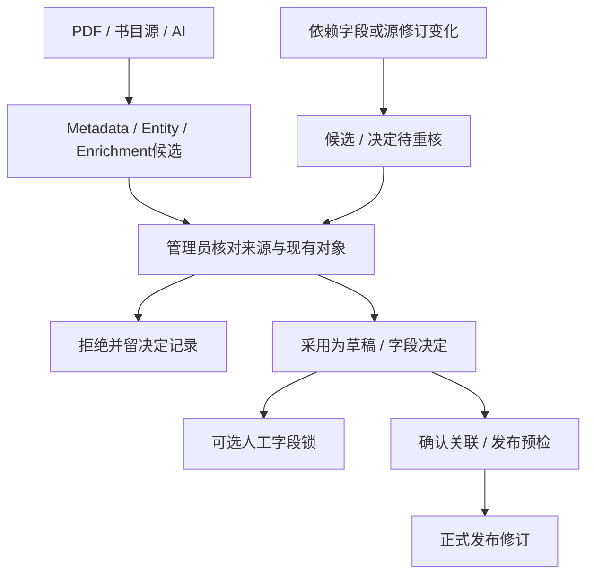
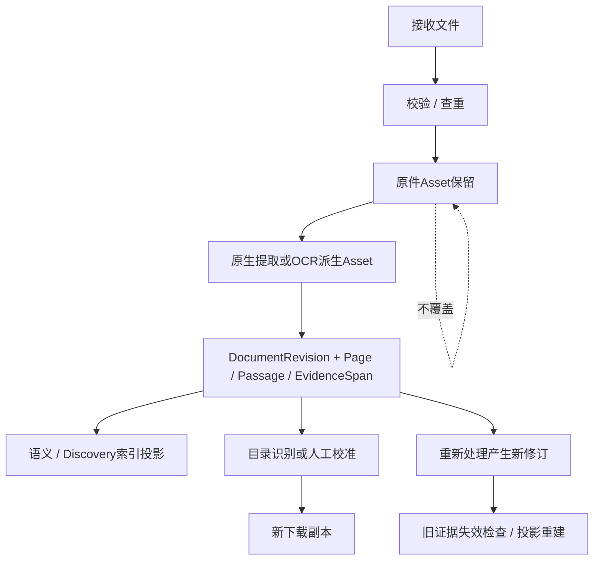
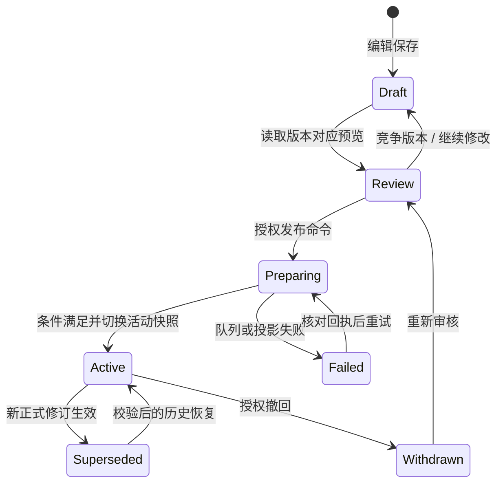

# 核心对象生命周期

[架构目录](README.md) · [领域模型](06_DOMAIN_MODEL.md)

## 候选与人工决定

这是业务阶段图，不把不同模型的status枚举强行统一。reject不是删除来源；锁不是公开；采用候选不应掩盖人工实际修改的内容。

## 文件、正文与派生数据

目录修订不是正文修订；带书签下载生成可能仍在任务中。私人注释保留原asset checksum与锚点，失配应显式orphaned/待核，不静默改绑。

## 公开内容

此图综合馆藏业务阶段。EditorialRevision、CatalogPublicationRevision、Edition各自枚举不同；具体状态见模型CSV。恢复正式历史不是删除新历史或覆盖原始文件。知识对象和文章使用各自发布协议，见[模块契约](ADMIN_MODULE_CONTRACTS.md)。

## 私人研究

本人创建 → 加密保存 → 本人继续研究/引用原文 → 明确选择分享范围 → 可撤销分享/本人数据操作。共享的是授权范围，不能据此公开全项目、原上传或关联的其他私人笔记。研究派生候选进入公共策展必须经过单独授权与正式编辑流程；本轮没有实施这种数据迁移。
