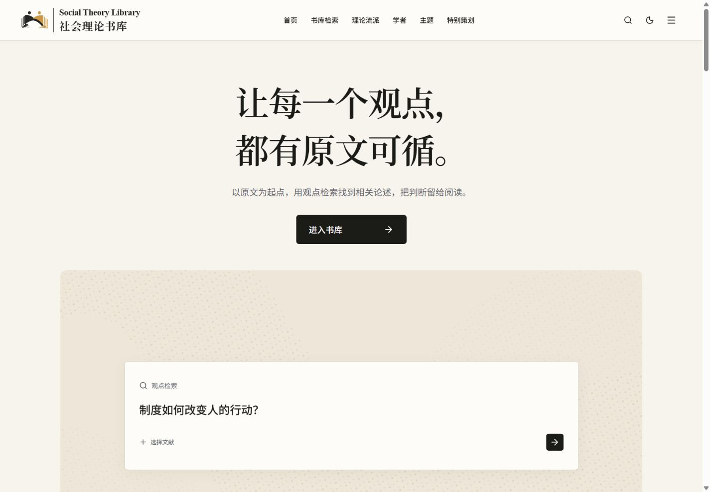
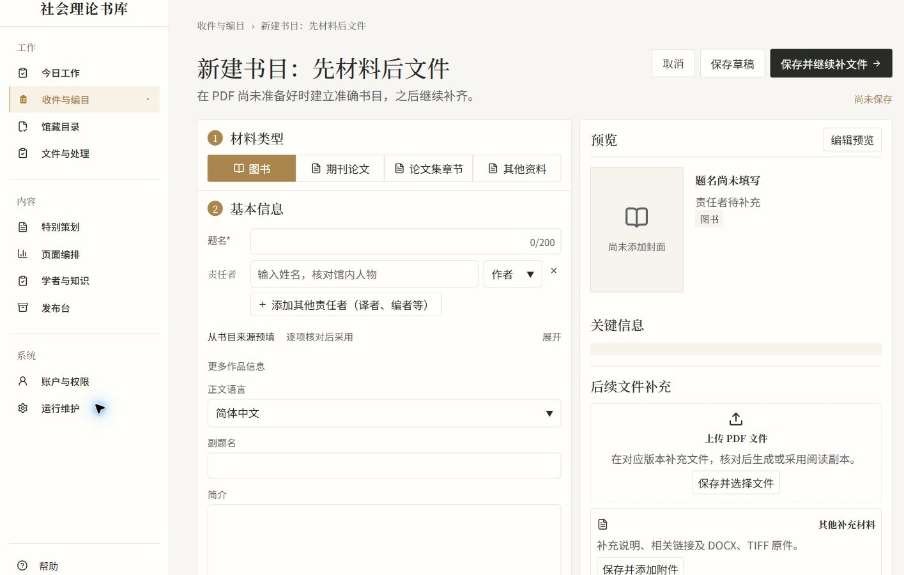
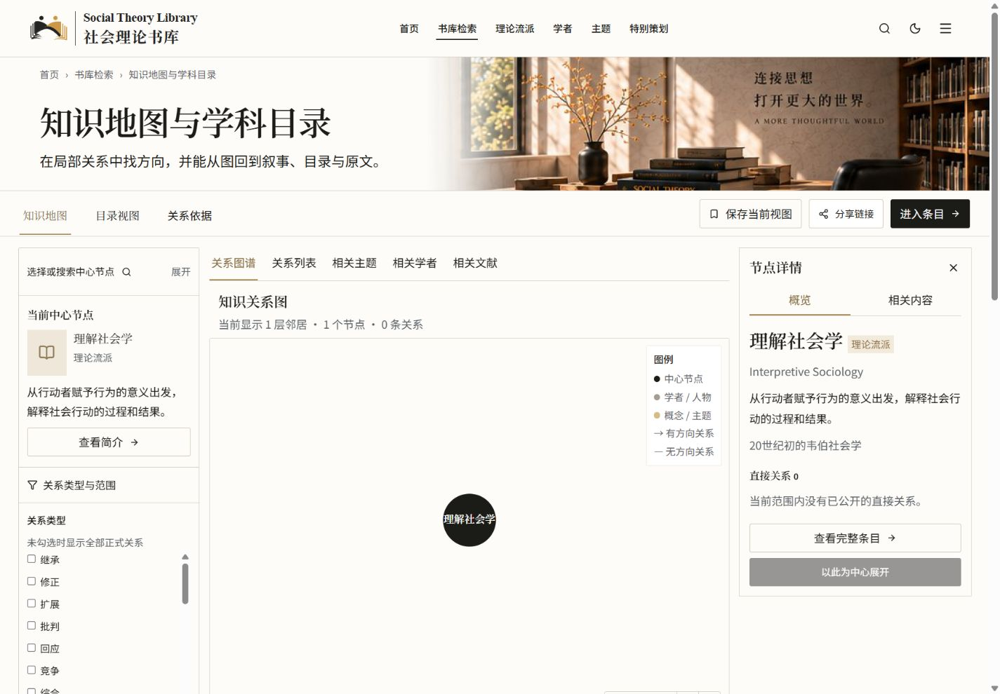
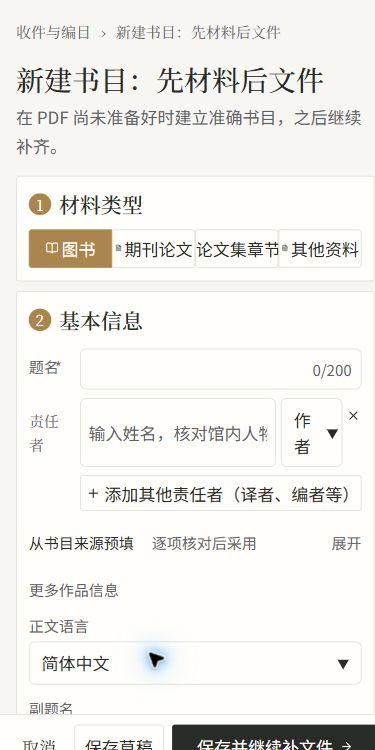

# 公网只读核对与截图

[架构目录](README.md) · [问题清单](15_KNOWN_ISSUES_AND_OPEN_QUESTIONS.md)

日期：2026-11-09。目标：`https://books.winstonmo.com`。使用真实浏览器的Playwright/无障碍页面读取能力；匿名会话核对公开边界，已有授权管理会话核对工作区。没有提交业务表单、发起搜索任务、读出凭据或执行运维动作。

## 实际访问范围

| 区域 | 观察结果 | 限制 |
| --- | --- | --- |
| `/` | 欢迎页，进入书库链接到/home，连续演示 | 随机文案只记录当次；没有逐帧动效验收 |
| `/home` | 公开首页、导航、公开策划及馆藏入口 | 1440×1000与390×844截图；未审读策展正文 |
| `/explore` | 匿名进入登录；授权会话显示检索入口 | 未提交查询或生成任务 |
| `/works/[slug]` | 书目、版本、责任者和阅读入口存在 | 只核对页面结构/读取边界；不评审正在开展的内容策展 |
| `/reader/[assetId]` | 匿名重定向登录，保留next | 未在授权会话开始阅读，以避免进度写入；Reader内部行为由源码/历史测试分开说明 |
| 学者、理论、主题 | 列表及代表学者/主题详情可读 | 只读结构与公开状态，未修改资料 |
| 学科/子学科 | 社会学与农村社会学代表详情可读 | 非全部实体遍历 |
| `/theories/graph` | 范围筛选、图谱/列表和详情区存在；默认中心1节点0关系 | 不是全库关系数量，也不据此判数据损坏 |
| `/theories/reading-paths` | 显示“没有符合条件的公开阅读路径” | 是观察时公开数据状态；未读取私人计划 |
| `/account`、登录页 | 匿名进入登录；授权会话显示本人读者中心 | 不导出私人记录或账户截图 |
| `/admin/uploads`、library、processing、publication | 对应批量收件、馆藏、任务、发布台标题与工作框架加载 | 未执行上传/重试/发布 |
| `/admin/cataloging/new` | 空白编目表单、保存/补文件、内联预览 | 桌面/窄屏截图，未输入或保存 |
| admin scholars/topics/theories | 列表与编辑工作区入口可读 | 不展开正在进行的私有策展记录 |
| admin theories disciplines/subdisciplines/reading-paths/relations/timeline | 相应子工作区加载 | 未创建/采用/发布/合并 |
| admin media/content/processing/status | 媒体、编排、维护页面加载 | 只读标题/结构；不触发探测和配置操作 |

细分观测记录见 [browser-observations.json](inventory/browser-observations.json)。一些页面先出现骨架/权限核对状态，随后加载完成；报告以最终观察为准，不把瞬时加载当故障。完整79入口已静态覆盖，**没有宣称79个入口全部完成浏览器验收**。独立文章编辑/发布预览和用户/备份等敏感状态使用源码核对；未读取首期PDF进行中的策展工作。

## 代表截图

所有图片均为真实页面截图，不是参考图、AI效果图或整页贴图实现。公开页面可能含当前已发布的测试内容，不代表内容定稿。管理图片是空白未保存表单，裁掉账户与通知区域。

### 欢迎页 · 1440×1000

### 公开首页 · 1440×1000

### 管理编目与内联预览 · 桌面局部

### 公开知识关系 · 1440×1000

### 窄屏 · 390×844

| 首页 | 空白编目（裁去账户栏） |
| --- | --- |
|  |  |

窄屏编目控件挤压已记录VN-A01。发布写入、冲突恢复、Provider/OCR和私人数据隔离仍需独立测试环境/授权验收，截图不能代替这些验证。
