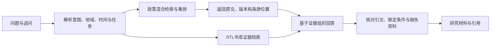
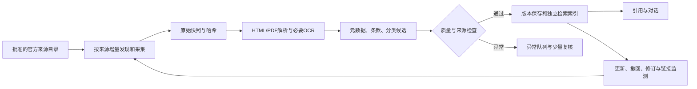

# STL 政策库研究预览与后续架构

更新：2026-11-03。交付为可操作 Demo，独立于 STL 正式业务流程。本文把实际实现、验证结果和后续建议分别记录。来源核验日期为本日；本文件不是运营主体的正式法律意见。

## 本次交付

- 内网入口：`http://192.168.5.6:18086/policy`，仅同局域网可访问，未发布到公网域名。
- 同域名页面已放入 `web/app/policy/page.tsx`；本次为独立预览服务器，尚未切换现有 STL Web106。
- 品牌复用现有 `BrandImage`、2026-10-27 黑金标识、中英名称、自托管 Noto 字体和现有纸白/炭黑/砂金风格。复用原生 Dialog 与输入法安全的回车提交逻辑。
- 支持自然语言检索入口、简单追问继承、地区/类型/成文日期筛选、按地区并列节选、官方来源侧窗、引用草稿、当前页面材料篮和 TXT 导出。
- 五份真实政策文件、十一处原文节选，涵盖国家级、上海和绍兴。文件类型包括法律、部门规章、行政规范性文件。数据和条款可定位到 `web/lib/policy-demo/data.ts` 中的官方出处。
- 实际调用预览环境已有的 `/rerank` 服务，返回 `cross-encoder/mmarco-mMiniLMv2-L12-H384-v1`、revision 与 artifact 身份。没有新模型、向量索引、数据库迁移或馆藏写入。
- 界面中的研究视角由样本编者整理；回答导语是明确的规则提示。**未接入自由生成式回答，不把规则检索说成完整 Agent。**

典型体验：点击“平台如何保障新就业形态劳动者的权益？”→核对条款→“选入材料”→切换“地区比较”→追问“只看上海的规定”→导出原文与引用。

## 验证与状态

| 项目 | 本次证据 | 分类 |
|---|---|---|
| 页面、查询接口、独立样本、重排适配 | 类型检查和定向构建退出0，内网 HTTP200 | D 已实现关闭开发项 |
| 地区/日期/文号/空结果/追问 | `node --import tsx --test tests/policy-demo.test.ts` 一项核心检查通过，内含七组断言 | D |
| 模型复用 | 内网查询 HTTP200，`engine=semantic`，返回8条节选；一次请求约4.6秒，仅代表这一请求 | D |
| 材料选择和 TXT 导出 | 浏览器读回已选入状态；真实下载文本含条款、文号、官方链接和定位 | D |
| 桌面/手机排版及来源侧窗 | 1440与390宽度定向查看；修正手机标题断行和侧窗背景滚动。最终截图在 `output/policy-demo-20261103` | B 待用户审阅 |
| 公开服务边界 | 异源查询403，直接访问服务器模块404；未运行正式全站测试 | D（仅所述范围） |
| 自动复制引用 | HTTP内网受浏览器剪贴板限制时明确提示手动复制；TXT导出可用 | B HTTPS环境待验收 |
| 完整智能对话、全国数据、时效/修废追踪、用户材料持久化、STL工作台集成、API/MCP | 本轮未实现，见后文建议 | C 后续范围 |

检测命令：`impeccable.cmd detect --json web/app/policy/policy-workspace.tsx web/app/policy/policy.module.css web/policy-preview/main.tsx web/policy-preview/preview.css` 返回空发现列表。该结果不是视觉获奖或全面可用性的证明。

类型命令：在 `web` 目录执行 `node node_modules/typescript/bin/tsc --noEmit --pretty false --incremental false`，退出0。Demo客户端构建使用 `node node_modules/vite/bin/vite.js build --config vite.policy-preview.config.ts`；SSR服务编译追加 `--ssr <web绝对路径>/lib/policy-demo/search.server.ts --outDir ../dist/policy-preview/server`。均退出0。未执行全站构建、全量E2E或正式统一验收。

## 实际运行与恢复

预览节点使用已存在的 Web106 镜像中的 Node 24，入口为 `web/policy-preview/server.mjs`；无新增依赖。容器 `stl-policy-preview-20261103-r2`，应用内容只读挂载 `/home/Winston/stl-policy-preview-20261103-r2`，仅绑定 `192.168.5.6:18086`，0.5CPU/256MiB/无Swap/cap-drop ALL/no-new-privileges。仅提供白名单静态文件和政策样本查询，无登录、数据库凭据或用户私人材料。

调用模型的路径为 Demo → 预览环境 `discovery_internal` 网络 → `discovery-inference:8091/rerank`。既有模型服务没有增加宿主端口。原 STL 整组预览服务本次核实时处于停止状态，**仅启动其中已有的 inference 容器**；独立 Demo 为新增容器。正式生产服务、域名代理、原预览 Web/API、数据库和模型文件均未改。

最初尝试的本机 SSH 转发被 NAS 配置拒绝，未改变 SSH/防火墙配置；两个转发进程已退出。最终按既有容器内部网络连接，不需要端口转发。

回退可停止 `stl-policy-preview-20261103-r2`；保留的 `stl-policy-preview-20261103-r1` 是首版预览，同一端口不能同时启动。停止政策库不影响 STL 正式业务。若要恢复本轮前完全停止的预览状态，在确认没有其他预览任务使用模型后，再停止 `stl4-preview-20261026-r1-discovery-inference-1`。没有删除任何卷、模型、旧镜像或原始文件。

本机开发启动：在 `web` 运行 `node node_modules/vite/bin/vite.js --config vite.policy-preview.config.ts`，默认地址 `http://127.0.0.1:5178/policy`。没有显式设置有效的 `POLICY_DEMO_INFERENCE_URL` 时，界面会如实使用关键词检索。这个入口与 NAS 留存的模型版预览不同。

## 产品定位建议

较有价值的方向是“政策证据研究工作台”：帮助学者找到制度依据，比较地区与时间差异，并把政策原文与书库中的理论解释放在同一个研究问题下。政策文本只能直接证明正式规定、目标和制度设计；执行、因果效应、真实受益情况需要别的经验材料。

可优先验证的用途：

1. **概念到制度。** 从平台劳动、社会保护、国家能力、治理、分类与边界等概念寻找可能相关的政策条款。推荐必须说明对应关系和原文位置；理论原文与政策条款分别展示，不能暗示理论作者讨论过某份政策。
2. **中央与地方比较。** 对相同议题比较责任主体、资格条件、资源配置、实施期限和救济路径。先建立可比口径，再讨论差异；缺资料不填“无政策”。
3. **政策演变与研究语料。** 保存同一文件的修订关系和政策术语变化，提供可复现的某日语料快照、筛选条件和版本引用。适合政策扩散、议程变化及政策工具研究。
4. **论证与引用检查。** 检查论文中的“政策要求/政策已经实现”是否混淆，引用是否遗漏适用地区、版本和时间。只标出证据缺口，不自动替研究者作因果结论。

Demo先展示第1、2、4项的最小操作路径。第3项依赖正式数据与版本系统，应放在采集层稳定以后。

## 自然语言对话需要多复杂的 Agent

早期不需要多个 Agent 自由讨论。建议使用一个受约束的调度器，调用明确的只读工具：检索、地区/时间筛选、取条款、比较版本、创建引用、检索书库证据。复杂度主要来自数据和证据的可靠性，而非 Agent 数量。

先用结构化会话状态保存主题、地区、截止时间与已选材料，不把全部对话直接拼成长提示词。生成模型只收到已取出的条款和稳定标识。精确引文由服务端从原文切片，不让模型重写。断言必须对应证据，找不到时说明缺口。法律效力、地方适用、施行日期和成文日期分别处理。

同一请求限定工具调用次数、时间、候选量和费用。爬虫内容视为外部数据，不能变成系统指令。暂不让聊天请求触发全网采集或修改数据库。查询失败时保留已有真实结果并显式提示，不用示例回答补位。MCP只封装同一套只读API，不另建业务流。

本 Demo 的自然语言解析仍是同义词和明确追问词规则，语义重排仅改变候选顺序，不能回答任意复杂问题。它验证了用户操作与模型复用路径，尚未证明正式对话质量。

## 与 STL 的架构关系

同域名是入口选择，不要求两个产品共享入库工作流。建议政策库作为独立 Django 业务模块，使用独立数据表、对象存储前缀、Celery队列和Meilisearch索引；复用既有PostgreSQL/Redis等基础服务、账号、品牌组件及受配额约束的模型服务。不要把政策文件伪装成图书Edition。

核心实体建议为 `PolicyDocument`、`PolicyVersion`、`PolicyPassage`、`Source`、`FetchRun` 和文件关系表。保留发布机关、共同发文机关、文号、成文/公布/施行/失效日期、制定地域、实际适用地域、官方URL、抓取时间、原始文件哈希和解析版本。发布机关地域与适用地域不得合并成一个自动推断字段。效力状态允许“未核实”。

每条政策证据向 STL 传输统一格式：来源类型 `policy`、文件与版本ID、条款/页码、准确文字、官方出处、引用草稿、核验时间和必要使用限制。书库证据继续使用原有书籍/版本身份。共享引用工作台只接收这个契约，政策抓取失败不阻断书库入库。

数据分类至少分成五个维度：

| 维度 | 内容 |
|---|---|
| 文件性质 | 法律、行政法规、地方性法规、部门规章、地方政府规章、行政规范性文件、一般政策文件、解读、草案等分别标识 |
| 法学检索 | 劳动与社会保障、行政、民商、经济、数据与网络等多标签；须另定可维护的词表 |
| 时空范围 | 机关、制定地域、适用地域、版本时间、施行时间分别保存 |
| 政策分析 | 目标群体、资格条件、政策工具、责任主体、资金/资源、执行和救济条款 |
| 社科用途 | 可研究的制度安排及概念关联，保存推荐依据，不当成事实或法效力 |

“办法”“通知”等名称不能单独决定法律位阶。党内法规、司法解释等另有制度位置，不能强行挤进一条简化效力等级。

## 尽量自动维护的采集流程

起步先选择少量省市和两三个研究议题，把增量、重试、去重与修废追踪跑通，再扩地区。来源目录应记录采集方式、频率、许可/约定、最后成功时间、覆盖区间和失败原因。对省、市、部门网站分别登记覆盖，不用一个全国总数冒充完整性。

有官方API、开放目录、RSS或结构化列表时优先使用；普通网页按域名限速、缓存、条件请求、退避重试。无访问授权或需要绕过验证码/登录/限制的源不进入自动采集。原始页面、附件和机器整理结果分层保存，不覆盖人工锁定数据。

大部分常规任务可以自动化；合并同名文件、判断隐含废止、发布涉及私人信息的材料、跨版本冲突和异常解析需要异常队列。目标应是“稳定流程自动完成，少量异常集中处理”，而不是无人负责的零维护。质量监测要覆盖长期零更新、附件漏采、解析比例异常和官方撤回，而不只是HTTP200。

执行量与费用按真实抓取页数、增量字符、OCR页数、模型输入、重排次数测量。只对新增或变更内容处理；可先用规则抽元数据，模型处理难例，避免每次全库重新分析。

## 同类产品核验

| 产品 | 已观察到的事实 | 对 STL 的含义 |
|---|---|---|
| [PolicyData](https://policydata.cn) | 公开前端与 `/api/policy/coverage` 已含省级源及杭州等市级源；不同城市数量差异明显。公开说明涉及搜索、原文段落、版本以及API/MCP | 不能再以“所有同类都没有省市”作前提。可参考版本与引用接口，不假定有批量再分发授权 |
| [中国工程科技知识中心政策库](https://policy.ckcest.cn/) | 页面显示国家/省/市分类及政策问答入口；问答需要登录。本次未登录验证回答质量。可见统计更新时间为2026-05-08 | 自然语言入口已不是独占优势；应把证据可复查、研究语料和书库理论联结做扎实 |
| [清华大学科技政策研究中心 iPolicy 介绍](https://www.sppm.tsinghua.edu.cn/yjjg/xjyjjg/qhdxkjzcyjzx.htm) | 官方介绍中已有政策数据库与自动采集、分析研究方向 | 自动化政策研究已有先例，不能把自动抓取本身作为唯一创新 |
| [国家规章库](https://big5.www.gov.cn/gate/big5/www.gov.cn/zhengce/xxgk/gjgzk/index.htm)、[国务院政策文件库](https://sousuo.www.gov.cn/zcwjk/) | 官方分类检索与规范文本来源 | 适合作权威核验入口，各自范围不等同于所有地方政策 |
| [北大法宝](https://www.pkulaw.com/) | 法律数据库已有法规类别、地域与效力等专业检索能力 | 法学分类需要参考成熟词表与方法；不能复制付费库正文、独有整理成果或用许可外方式镜像 |

上述数量与功能只能说明页面或接口当时的呈现，不证明完整收录、持续更新或检索质量。API/MCP开放访问也不等于允许永久镜像、训练或公开再分发。

## 中国大陆运营的风险与设计回应

风险判断取决于实际运营主体、服务器位置、服务内容、收费方式、用户范围和模型部署；以下是方案阶段需落实的边界。

| 风险 | 依据与项目含义 | 设计回应 |
|---|---|---|
| 官方文件与网页版权混淆 | [著作权法](https://www.ncac.gov.cn/xxfb/flfg/flfg_532/202103/t20210309_50530.html)第5条排除法律法规、国家机关决议决定命令及其他立法行政司法性质文件等；不代表政府站所有解读、照片、图表、商业数据库整理均无版权。第15条涉及汇编 | 优先官方文件；原文、解读、图片和第三方整理分别管理权利与许可 |
| 抓取方式与数据竞争 | [2025年修订反不正当竞争法](https://www.cnipa.gov.cn/art/2026/5/20/art_104_206437.html)涉及以不正当方式获取使用经营者合法持有数据；[网络数据安全管理条例](https://www.cac.gov.cn/2024-09/30/c_1729384452307680.htm)要求自动访问不非法侵入、干扰服务 | 不绕过技术措施、不高频压站、不复制竞争产品数据库；逐源记录依据、频率和退出机制 |
| 已公开个人信息再汇总 | [个人信息保护法](https://www.cac.gov.cn/2021-08/20/c_1631050028355286.htm)第27条对已公开信息仍有合理范围等条件；公开不等于无限再利用 | 避免把公示名单、身份证号、联系方式、处罚个案直接全量索引；必要时删除/脱敏，提供纠错与下架入口 |
| 大模型对公众服务 | [生成式人工智能服务管理暂行办法](https://www.cac.gov.cn/2023-07/13/c_1690898327029107.htm)与实际面向境内公众的生成服务相关；是否涉及登记、备案或安全评估取决于服务形态，调用已备案模型不当然豁免应用责任 | Demo目前不生成自由回答；正式接入前按应用实际形态向属地主管部门核实，明确投诉处理、数据用途和服务责任 |
| 生成内容标识 | [人工智能生成合成内容标识办法](https://www.cac.gov.cn/2025-03/14/c_1743654684782215.htm)涉及显式/隐式标识及传播/导出场景 | 原文与AI解释分开展示，保留生成记录；正式生成或导出时落实对应标识，不能只加一个总免责声明 |
| ICP与相关服务资质 | [非经营性互联网信息服务备案说明](https://zjca.miit.gov.cn/bsfw/bszn/fjyxhlwxxfwbahz/art/2020/art_27ba712270224ad2a6a9db8e7703dfb9.html)；[网络出版服务管理规定](https://www.nppa.gov.cn/xxgk/fdzdgknr/zcfg_210/bmgz_213/202112/t20211209_442163.html)的定义涉及部分编辑加工的数字作品和数据库 | 需依据运营方式评估备案、经营许可及是否构成网络出版，不能仅凭“学术用途”宣称豁免，也不能直接断言所有政策索引都须出版许可 |
| 新闻化运营 | [互联网新闻信息服务管理规定](https://www.cac.gov.cn/2017-05/02/c_1120902760.htm)的新闻信息定义和许可边界涉及相关报道评论服务 | 单纯资料索引与持续政策新闻报道/评论需要分别评估；加入资讯流、订阅简报前核定范围 |
| 错引、过期与错误法律结论 | 地方规定、施行时间、附件和后续废止可能影响适用，模型无法自行补全未知效力 | 引用固定到版本与条款，未知效力明确标记，显示核验日期；不提供未经证据支持的个案法律结论 |

把公共政策文本送往外部模型和把用户论文、笔记、询问记录送往外部模型是不同的数据处理。正式系统需要分别定义权限、保留期限、受托处理与可能的跨境义务。本 Demo 在既有内网模型上只处理公开样本和本次查询，不调用外部生成API。

## 下一步建议

先根据本 Demo 确定交互是否适合学者，再实现一个完整垂直范围：少量省市、平台劳动等一个议题、官方源增量采集、版本与条款引用、单调度器的证据对话。等这条链可维护且有真实查询评估后，扩展全国覆盖和书库工作台。

最先验收的应是：原文能找回、地区和日期不串、没有材料时不编、引用能够复现、更新失败可见、重复采集不产生重复文件。Agent数量、全国总条数和自动化百分比都不能替代这些结果。
